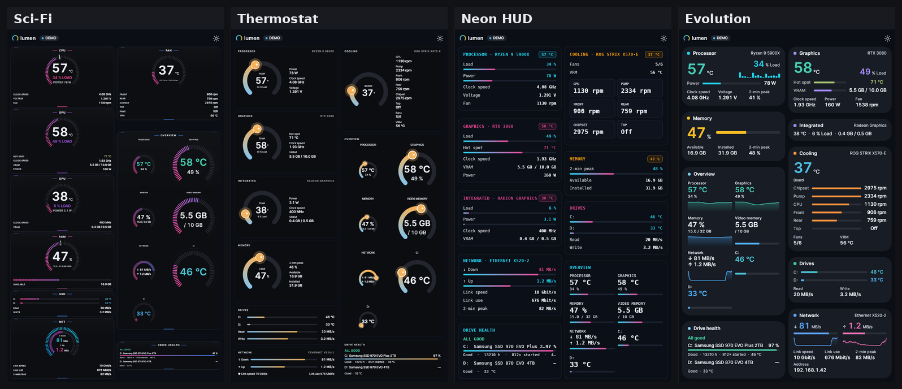
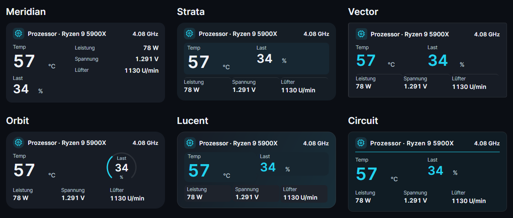
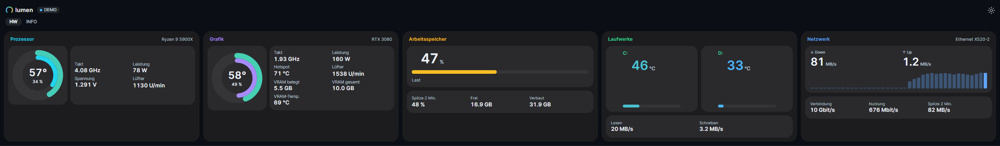
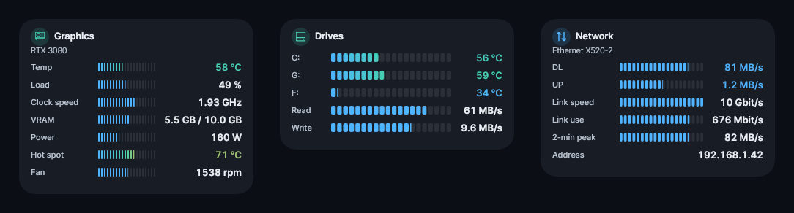
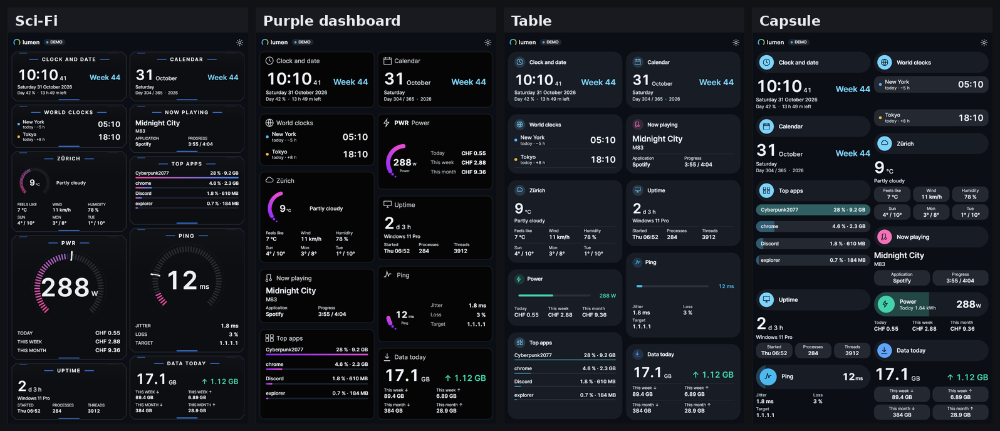
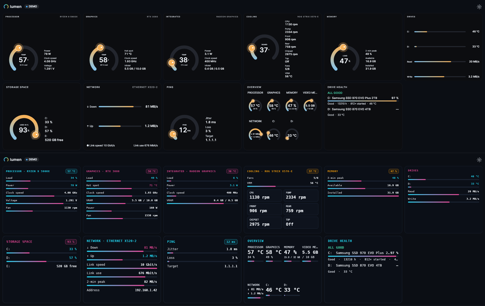
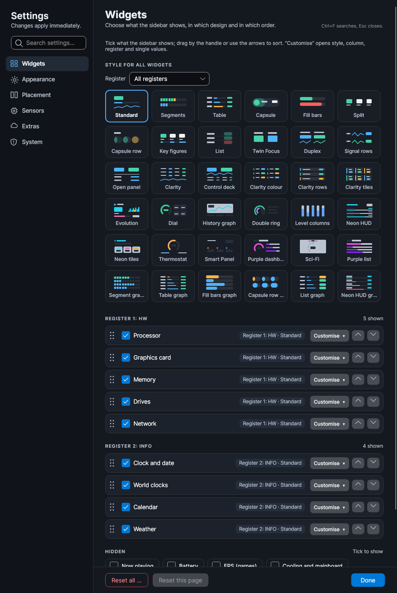

# Lumen 4.1.1 – Clear Network Values

A portable hardware-monitoring sidebar for Windows 10 and 11 with **60 widget designs**. Every widget – hardware and info alike – takes the look of the design you choose. Use it vertically at either side of your desktop or horizontally at the top or bottom, in dark or light.

**[Download Lumen 4.1.1](https://github.com/nemesis122/Lumen-HWMonitoring-Sidebar/releases/tag/v4.1.1)** · [All designs](docs/style-gallery.md) · [Release notes 4.1.1](docs/release-notes/v4.1.1.md) · [4.1.0](docs/release-notes/v4.1.0.md) · [4.0.3](docs/release-notes/v4.0.3.md) · [4.0.2](docs/release-notes/v4.0.2.md) · [4.0.1](docs/release-notes/v4.0.1.md) · [What's new in 4.0.0](docs/release-notes/v4.0.0.md)



## New in 4.1.1

- Download and upload appear once in Evolution and Dial, including identical and zero rates.
- Capsule removes the repeated upload caption and gives the hardware name a wider heading above the rates.
- Duplicate network readings are now checked by sensor identity across all 60 designs.
- Verified with 3,802 tests and 2,163 extended layout/data cases (18,105 assertions).

[Full 4.1.1 release notes](docs/release-notes/v4.1.1.md)

## New in 4.1.0

- **15 new designs**, for 60 total: Meridian, Strata, Vector, Orbit, Lucent, Circuit, Panorama, Terminal, Thermal, Mosaic Pro, Ribbon Flow, Split Lens, Aperture, Pixel Deck and Horizon Sync.
- **Complete sensor selection in every design**, with compact recommended defaults and individually selectable additional values.
- **Native drive layouts:** large side-by-side temperatures, aligned values, per-device gauges/history and read/write pairs at the bottom.
- **Configurable drive order:** C: first by default, alphabetical or detection order. Hardware names use clean per-drive title lines; Hottest labels are gone.
- **Stable fitting:** fixed the design-switch layout loop, stale sensor bindings and duplicate History Graph upload values.
- New installations start with **Standard**; saved choices remain saved. World clocks, weather and calendar defaults are unchanged.

[Full 4.1.0 release notes](docs/release-notes/v4.1.0.md) · [All designs and new previews](docs/style-gallery.md)



## New in 4.0.3

- **Nine additional designs:** Pure, Pure Widgets, Clean Dark, Compact Pro, Performance View, Pure Bar, Pure Number, Pure Segments and Pure Widgets Right. Choose designs globally, per register or per widget.
- **Readable horizontal layouts:** bounded rings, compact charts and better use of the space beside graphics.
- **Stable readings:** reserved number widths and a network 2-min peak that keeps its row.
- **Optional integrated graphics:** enable it in **Widgets → Processor → Customise → Sensor values**. It is off by default for new settings.
- **Clearer design picker:** four columns and wrapping names.

[New design previews](docs/neue-sidebar-designs.md) · [Load indicators](docs/pure-lastanzeigen.md) · [Values on the right](docs/pure-widgets-rechts.md) · [Horizontal before/after](docs/horizontale-darstellung.md)



## Fixed in 4.0.2

Evolution no longer moves by a pixel every second, widgets stay steady when a sensor stops reporting for a moment, and every bar inside a widget starts and ends at the same place. [Details](docs/release-notes/v4.0.2.md)



**4.0.1:** bars no longer grow and shrink with the number beside them, fans keep their place, a stopped fan no longer shrinks its Dial tile and the network's 2-min peak never disappears. [Details](docs/release-notes/v4.0.1.md)

## What's new in 4.0.0

- **26 new designs**: Sci-Fi, Thermostat, Neon HUD, Neon tiles, Smart Panel, Purple dashboard and list, Evolution, Dial, History graph, Double ring, Level columns, Duplex, Signal rows, Open panel, the Clarity family, Control deck and six graph variants.
- **Every widget in every design**: clock, calendar, weather, now playing, top apps, data usage, uptime, overview and drive health follow the chosen design.
- **Design per register**: one design for HW, another for INFO.
- **Size controls**: widget, graphic, main value, value and label size – per widget or for all at once.
- **Every drive and both network directions** are shown in every design.
- **Designs follow your background and colour scheme.**
- **No jumping**: columns end flush at the bottom, widgets keep their place when values change.
- **Translated everywhere**, no word broken in the middle.







**[Browse all 60 designs, in dark and light](docs/style-gallery.md).** All pictures use demo data.

## Sensor support

| Source | Integration |
| --- | --- |
| **LibreHardwareMonitor** | Built-in sensor library for supported CPU, GPU, storage, mainboard, fan and battery readings. |
| **Open Hardware Monitor** | Built-in driverless GPU/SMART fallback, combined with LibreHardwareMonitor readings. |
| **AIDA64** | Optional external source through shared memory. Enable shared memory in AIDA64's External Applications settings, then select AIDA64 in **Settings → Sensors**. |
| **HWiNFO** | Optional external shared-memory source, also available in **Settings → Sensors**. |

Automatic selection and fallback are supported. Hardware, permissions and available drivers determine which readings can be obtained. AIDA64 and HWiNFO are separate applications; they are not bundled with Lumen.

## Layout and widgets

- Left/right sidebar or top/bottom bar, with multiple rows/columns and up to six pages.
- Automatic density, adjustable text size, custom titles and hardware names.
- CPU, discrete/integrated GPU, memory, drives, storage space, network, cooling, power, FPS, ping, battery, system, weather, clocks, calendar, media, usage and notes.
- Colour presets, state colours, Windows accent, theme files, glass and several typefaces.
- English, German, French, Italian, Spanish and Portuguese.

## Diagnostics

Error reports include the executable path, active layout, recent activity, available error logs, session state and restart history. Log read failures are distinguished from missing logs. Settings → System also shows the executable location and provides **Open folder**.

Logs and reports stay local. Nothing is uploaded automatically.

## Download and run

Download **Lumen-4.1.1.exe** for the portable application, or the portable ZIP with licence files. No separate .NET installation is required. Close an older running instance before starting the new EXE. Settings are stored beside the EXE, with an AppData fallback when that folder is read-only.

The release also includes the complete source archive, all gallery images and SHA-256 checksums.

## Build and verify

```powershell
dotnet test tests/Lumen.Tests -c Release -m:1
dotnet run --project tools/Lumen.Regression -c Release -- --expect-fixed
dotnet publish src/Lumen.App -c Release -r win-x64 --self-contained -m:1 -p:PublishSingleFile=true -p:IncludeNativeLibrariesForSelfExtract=true -p:IncludeAllContentForSelfExtract=true -p:EnableCompressionInSingleFile=true -p:DebugType=none -o publish
```

The release workflow builds the EXE from the tagged source, runs the tests and packages the source, screenshots and checksums. UI image baselines are OS-specific.

## Licence

Lumen is distributed under the [MIT licence](LICENSE). The Open Hardware Monitor source in `lib/OpenHardwareMonitor.Driverless` remains MPL-2.0. LibreHardwareMonitor is used as a NuGet package under its licence. PresentMon is MIT-licensed. Included notices are in `licenses/` and the source archive.

