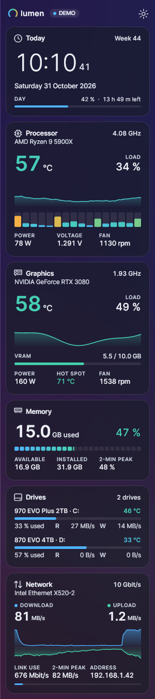
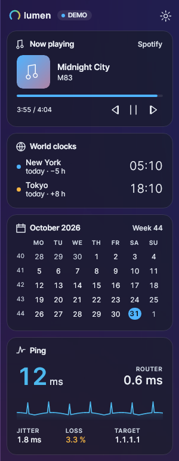
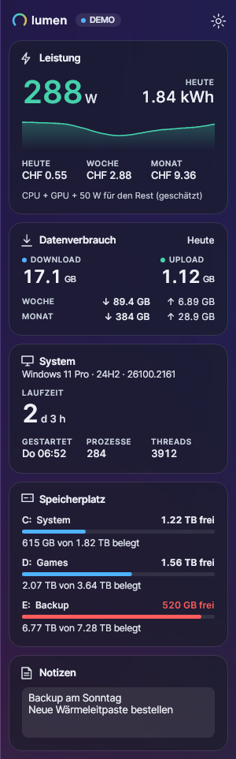
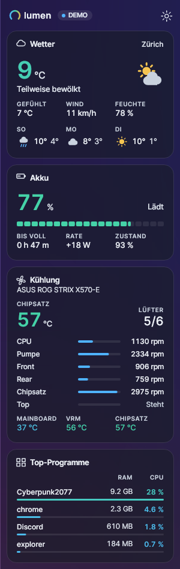
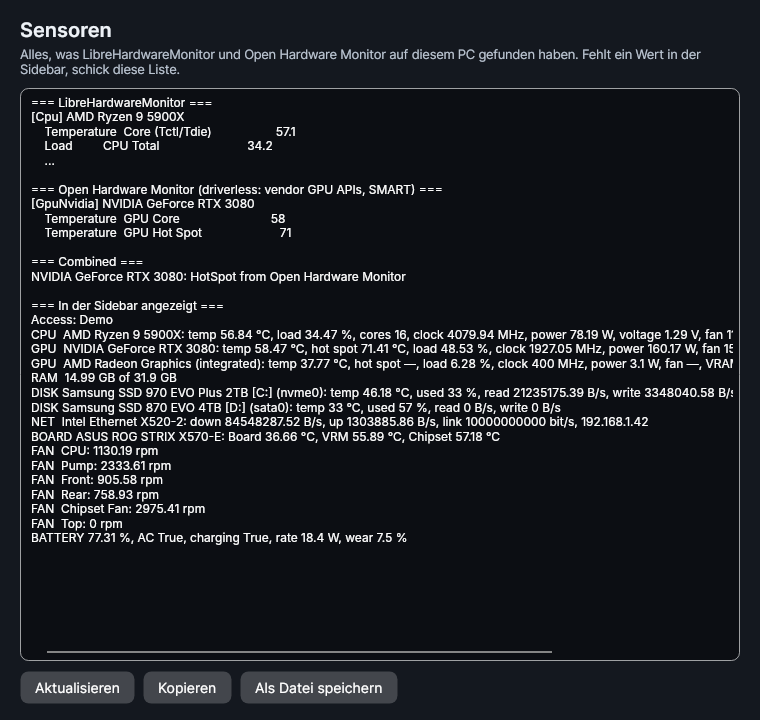
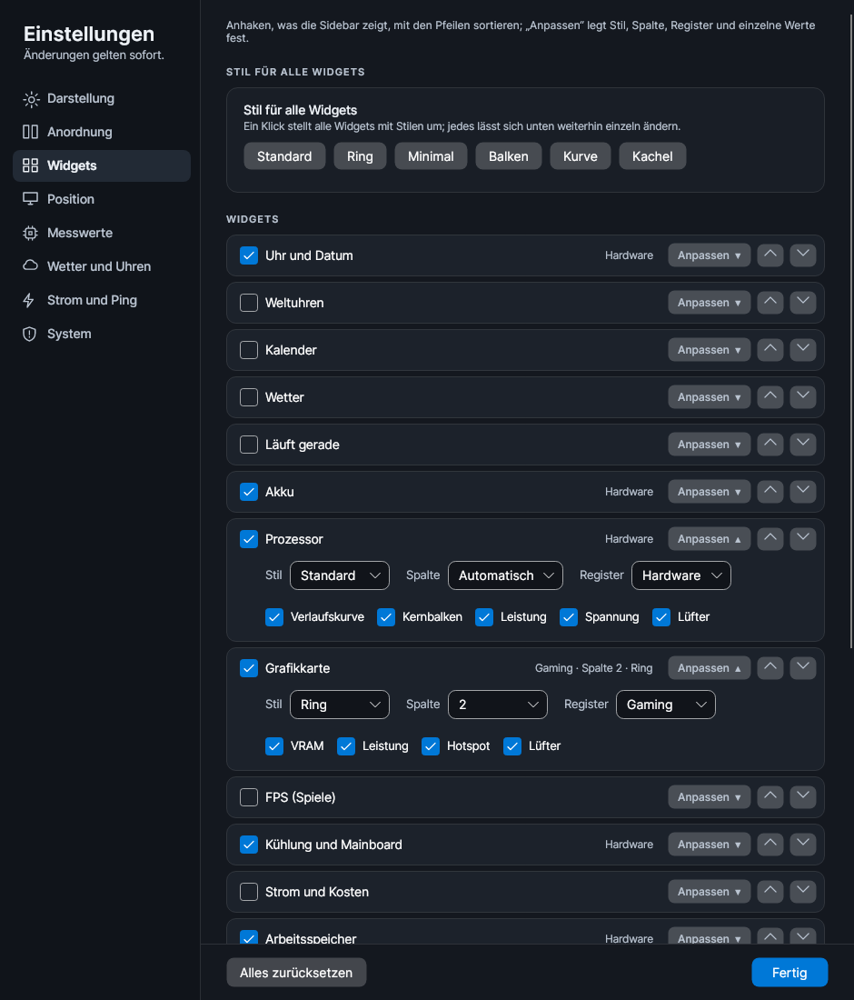
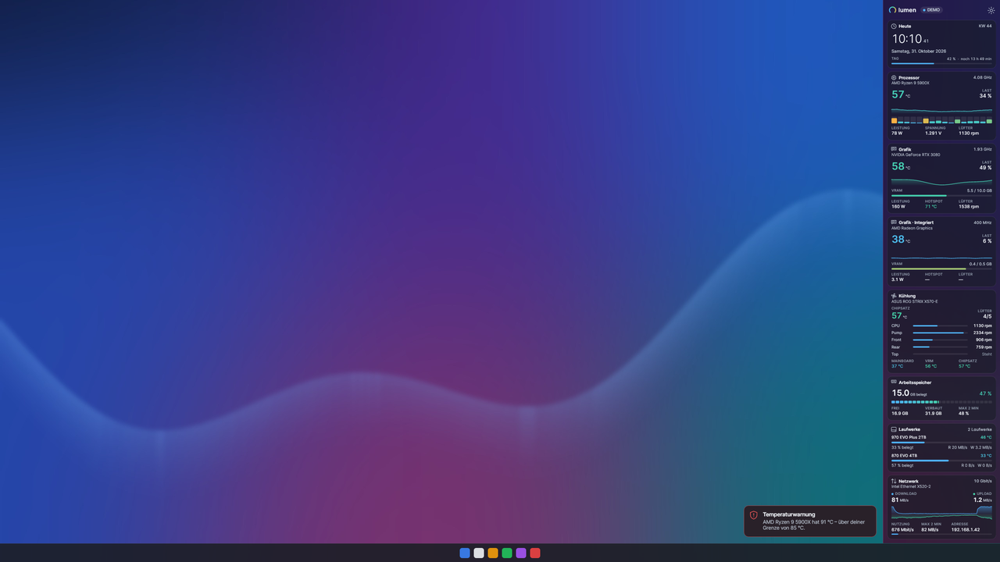

# Lumen Monitoring HW Sidebar

A modern hardware sidebar for Windows 10 and 11: a slim glass strip on the edge of the screen
with clock, processor, graphics cards, cooling, memory, drives, network and more. One portable
EXE, .NET included, in six languages.

**[Download the latest release](../../releases/latest)** · portable `Lumen-x.y.z.exe`, no installation

<p>
  
  
  
</p>

## Highlights

- **Colour means state.** Every reading moves along one cool-to-hot ramp (blue, mint, amber,
  red), so a glance shows what is working hard. Alternatively the Windows accent colour or a
  preset; hot readings still turn amber and red.
- **Temperature leads.** Wherever a part has a temperature, it is the big number, with two
  minutes of history behind it.
- **Fills the screen exactly.** The automatic density sizes everything to reach from the top of
  the screen to the taskbar, without scrolling. One or two columns.
- **Three styles per widget:** the full card, a ring tile (two side by side) or one slim line.
- **Hardware names** under every title, shortened in tiles (Ryzen 9 5900X, RTX 3080).
- **Missing stays missing:** a sensor that cannot be read shows "—", never a fake zero.

## Widgets

| Hardware | More (opt-in) |
|---|---|
| Processor: temperature, load per thread, clock, power, voltage, fan | Weather (Open-Meteo, no account) |
| Graphics, dedicated and integrated: temperature, hot spot, load, VRAM, power, fan | Now playing (Spotify, browsers, media apps) with controls |
| Cooling and mainboard: every spinning fan, board, VRM and chipset temperatures | Ping and jitter to the internet and the router |
| Memory with segment bar and 2-minute peak | Power and cost per day, week and month |
| Drives: temperature, used space, read and write rates | Data usage per day, week and month |
| Network: download/upload, throughput in Mbit/s, share of the link, IP | Storage space per drive letter |
| Battery: charge, time left, rate, health | System uptime, world clocks, calendar, notes, top apps |
| FPS of the game in the foreground, 1 % low, frame time (PresentMon) | |

<p>
  
  
  
</p>

## Sensors

Two libraries work together, so hardware one of them misses is still covered:

- **LibreHardwareMonitor 0.9.6** with the PawnIO driver reads CPU, GPUs, drives, mainboard
  sensors, fan controllers and battery.
- **Open Hardware Monitor, driverless build** (MPL-2.0, in `lib/OpenHardwareMonitor.Driverless`)
  reads GPUs through the NVIDIA and AMD vendor APIs and drives through Windows SMART. It only
  fills readings Libre left empty and adds GPUs or drives only it can see; identical models are
  paired one by one.
- Windows itself supplies memory, network, CPU load as a fallback, battery state, volumes,
  processes, uptime and media.

CPU temperatures and mainboard sensors need **administrator rights** and the **PawnIO** driver.
Without them the sidebar says so and offers a restart as administrator. *Start with Windows*
creates a logon task with highest rights, so there is no UAC prompt at every start.

**Settings → System → Show all sensors** lists every sensor both libraries found and what the
sidebar shows, with Copy and Save, for tracking down a missing reading.



## Settings

Everything applies immediately: language, theme, colours, glass and opacity, high contrast,
hardware names, text size, density, columns, width, screen and edge, always on top, reserved
desktop space, update interval, °C/°F, warning threshold with pop-up, and per widget its
visibility, order, style, column and individual values.

<p>
  
  
</p>

Settings are stored in `lumen-settings.json` beside the EXE, or in `%AppData%\Lumen` if that
folder is read-only. `Lumen.exe --demo` shows demo data.

## Build

```
dotnet test tests/Lumen.Tests
dotnet publish src/Lumen.App -c Release -r win-x64 --self-contained -p:PublishSingleFile=true -p:IncludeNativeLibrariesForSelfExtract=true -p:EnableCompressionInSingleFile=true
dotnet run --project tools/Lumen.Shots -- shots     # renders the screenshots headless
```

The release workflow (Actions → *Build and publish release*) builds on Windows, runs the tests
and publishes the EXE, the source ZIP and the screenshots under the version in
`Directory.Build.props`.

Built with Avalonia 11.3 and the Inter typeface. Open Hardware Monitor parts are under MPL-2.0;
the bundled PresentMon 2.3.1 (Intel) is under the MIT licence. Both licence texts are in `licenses/`.
