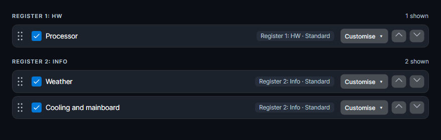

# Lumen 3.0.1

A portable hardware-monitoring sidebar for Windows 10 and 11, with **44 selectable widget designs**, bold readings and live graphics. Use it vertically at either side of your desktop or horizontally at the top or bottom. Dark and light themes are supported.

**[Download Lumen 3.0.1](https://github.com/nemesis122/Lumen-HWMonitoring-Sidebar/releases/tag/v3.0.1)** · [All designs](docs/style-gallery.md) · [Release notes](docs/release-notes/v3.0.1.md)

## Fixed in 3.0.1

Widget settings now group widgets by their actual register, matching the sidebar. Changing a register immediately updates the group and summary. Numbered names distinguish registers even when they share a custom name. Sorting, hidden widgets and empty registers follow the same assignments.




## Choose a design for each widget

**Each widget can use its own design — mix and match styles across your sidebar.** This feature was already available in earlier releases.

Open **Settings → Widgets → Customise** on the widget you want to change. The global **Style for all widgets** control is available if you prefer one consistent design.


## Widget designs

The collection includes classic compact layouts, rings, graphs, capsules and lists, plus larger graphic designs:

- **Signal Pro, Rail Pro, Orbit Pro, Prism and Spectrum:** bold numbers with distinct waveform, segmented, radial, diagonal and history graphics.
- **Double Capsule Plus:** an independent design with a second capsule for additional readings, such as CPU clock/power or GPU memory/power.
- **Liquid:** a fluid-style fill reflecting the current load or level.
- **Twin Focus:** two prominent readings with separate graphics, such as temperature/load or download/upload.
- **Contour:** a large central reading surrounded by layered contours.
- **Split Edge:** a diagonal layout with a main reading and two available extra values.
- **Ribbon:** a real history band with the latest reading beside its endpoint.
- **Core Grid:** overall CPU utilization and individual readings for every reported core. Other widget types show their available extra readings.

**[Browse images of all 44 designs, in dark and light themes](docs/style-gallery.md).** All pictures use demo data.

## Sensor support

| Source | Integration |
| --- | --- |
| **LibreHardwareMonitor** | Built-in sensor library for supported CPU, GPU, storage, mainboard, fan and battery readings. |
| **Open Hardware Monitor** | Built-in driverless GPU/SMART fallback, combined with LibreHardwareMonitor readings. |
| **AIDA64** | Optional external source through shared memory. Enable shared memory in AIDA64's External Applications settings, then select AIDA64 in **Settings → Sensors**. |
| **HWiNFO** | Optional external shared-memory source, also available in **Settings → Sensors**. |

Automatic selection and fallback are supported. Hardware, permissions and available drivers determine which readings can be obtained. AIDA64 and HWiNFO are separate applications; they are not bundled with Lumen.

## Layout and widgets

- Left/right sidebar or top/bottom bar, with multiple rows/columns and up to six pages.
- Automatic density, adjustable text size, custom titles and hardware names.
- CPU, discrete/integrated GPU, memory, drives, storage space, network, cooling, power, FPS, ping, battery, system, weather, clocks, calendar, media, usage and notes.
- Colour presets, state colours, Windows accent, theme files, glass and several typefaces.
- English, German, French, Italian, Spanish and Portuguese.

## Diagnostics

Version 3.0.0 improves horizontal layout stability, the Double Capsule indicator and local diagnostics. Error reports include the executable path, active layout, recent activity, available error logs, session state and restart history. Log read failures are distinguished from missing logs. Settings → System also shows the executable location and provides **Open folder**.

Logs and reports stay local. Nothing is uploaded automatically.

## Download and run

Download **Lumen-3.0.0.exe** for the portable application, or the portable ZIP with licence files. No separate .NET installation is required. Close an older running instance before starting the new EXE. Settings are stored beside the EXE, with an AppData fallback when that folder is read-only.

The release also includes the complete source archive, all gallery images and SHA-256 checksums.

## Build and verify

```powershell
dotnet test tests/Lumen.Tests -c Release -m:1
dotnet run --project tools/Lumen.Regression -c Release -- --expect-fixed
dotnet run --project tools/Lumen.Gallery -c Release -- docs/images/styles-3.0.0
dotnet publish src/Lumen.App -c Release -r win-x64 --self-contained -m:1 -p:PublishSingleFile=true -p:IncludeNativeLibrariesForSelfExtract=true -p:IncludeAllContentForSelfExtract=true -p:EnableCompressionInSingleFile=true -p:DebugType=none -o publish
```

The release workflow builds the EXE from the tagged source, runs the tests and packages the source, screenshots and checksums. UI image baselines are OS-specific.

## Licence

Lumen is distributed under the [MIT licence](LICENSE). The Open Hardware Monitor source in `lib/OpenHardwareMonitor.Driverless` remains MPL-2.0. LibreHardwareMonitor is used as a NuGet package under its licence. PresentMon is MIT-licensed. Included notices are in `licenses/` and the source archive.

