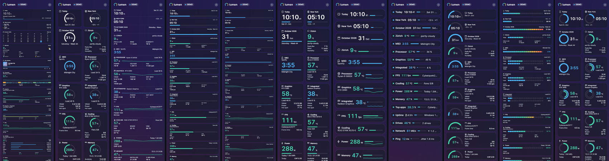
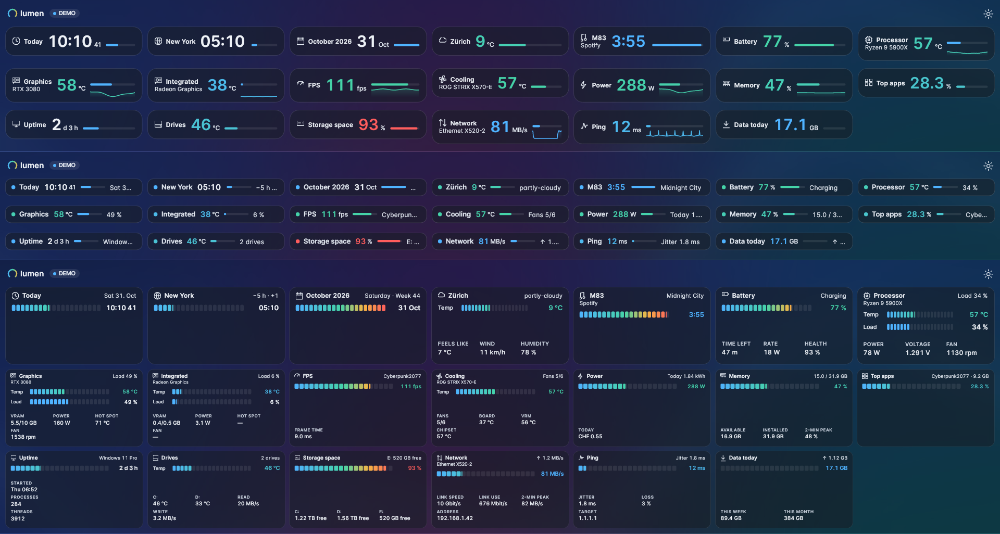
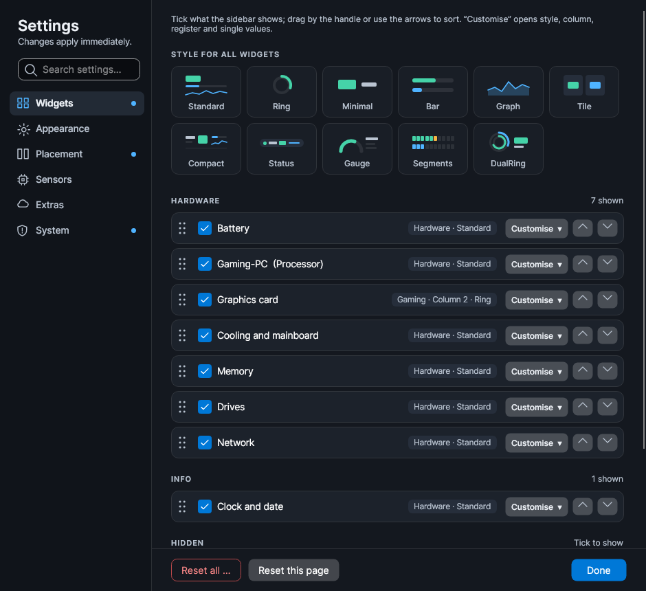
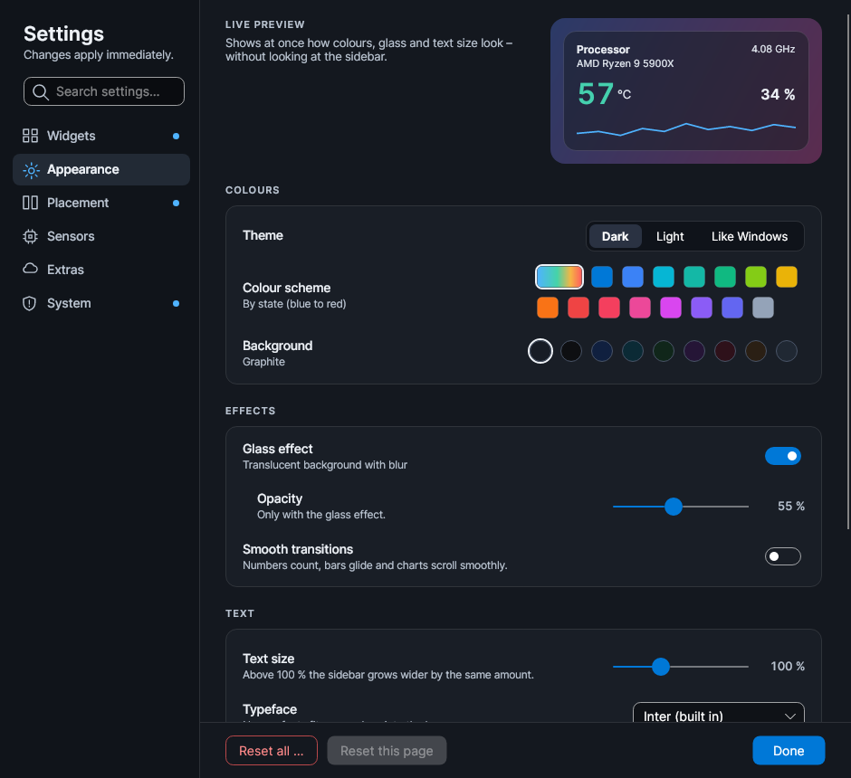
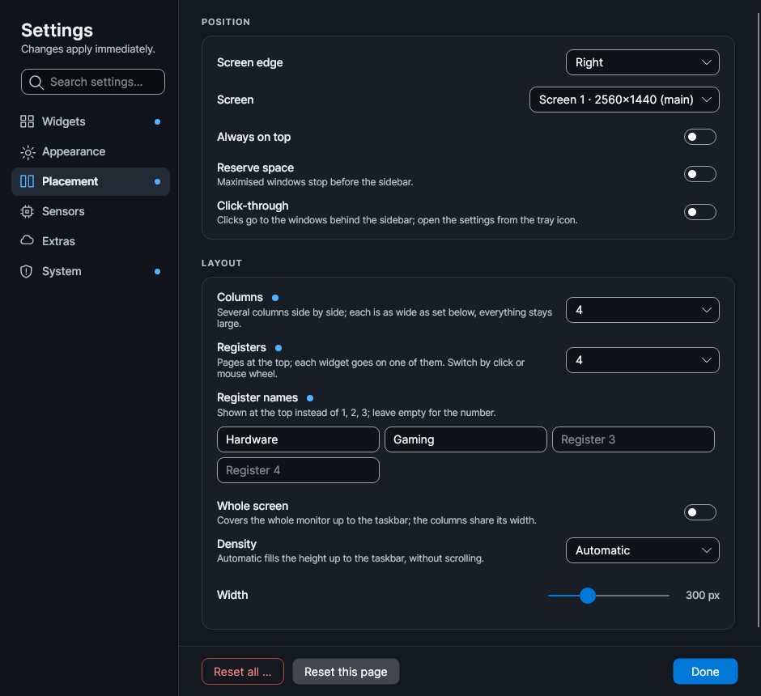
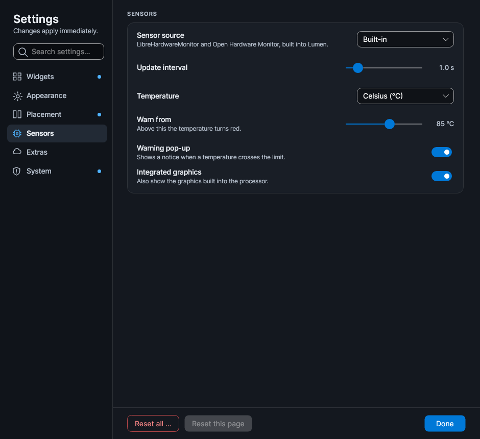
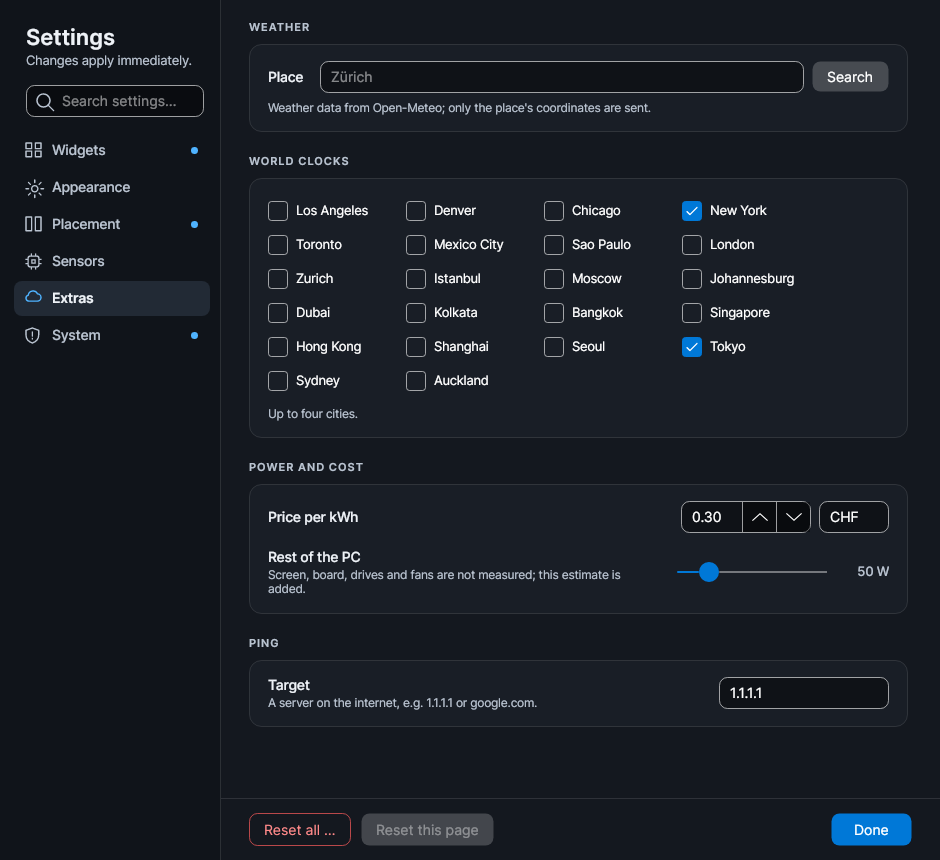
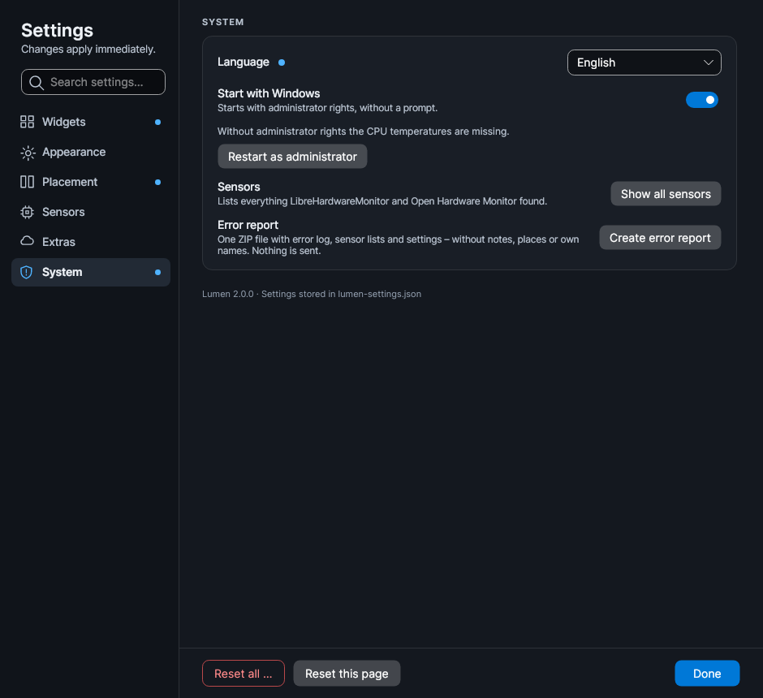
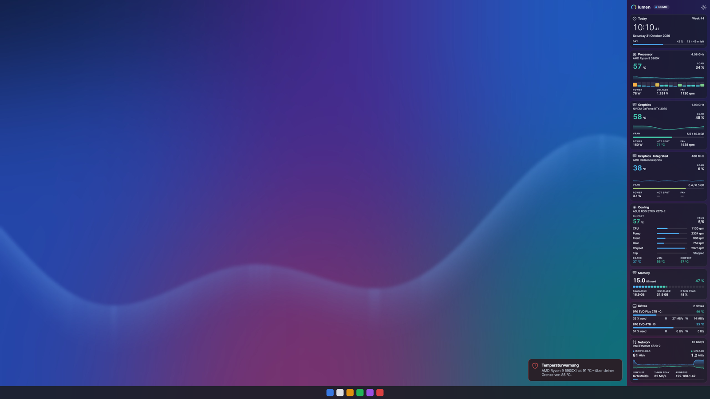

# Lumen HW Monitoring Sidebar

A modern hardware sidebar for Windows 10 and 11 – one portable EXE, .NET included, six languages
(English, Deutsch, Français, Italiano, Español, Português). **[Download the latest release](../../releases/latest)** – portable `Lumen-x.y.z.exe`, no
installation. All screenshots use demo data.


## New in 2.1

- **AIDA64 or HWiNFO as sensor source** (optional), with automatic fallback to the built-in sensors.
- **Eleven styles for every widget**, five of them new and compact: Compact, Status, Gauge,
  Segments, Dual ring – made for slim bars at the top or bottom.
- **Clearer settings:** six topics, search across all settings, live preview, reset per page.
- **Themes as files** (`*.lumentheme`) and a **choice of typeface**, including narrow Bahnschrift.
- **More robust:** freeze watch with automatic restart, error report as one ZIP, fewer readings
  while nothing shows them, and tests that render every style and compare it pixel by pixel.

All details: [release notes 2.1.0](docs/release-notes/v2.1.0.md).

## Side, top or bottom

- **Right or left edge**, 1–6 columns, or the whole screen.
- **Bar at the top or bottom** with 1–6 rows, across the whole width or only as wide as its
  widgets, centred. Can reserve its space like the taskbar.
- **Automatic density** fills the height exactly, without scrolling.
- **Registers (pages) 1–6** with your own names, switched by click or mouse wheel.
- **Text size 50–200 %** – above 100 % the sidebar widens by the same factor.

**Right edge – top – bottom** (whole screen, demo data):

<p>
  
  
  
</p>

**Bar at the top**, two rows:


**Bar at the bottom**, two rows with mixed styles:


**Settings for the bar** – edge and row height, rows and layout:

<p>
  
  
</p>

<p>
  
  
</p>

## Widgets and styles

- Clock, world clocks, calendar, weather, now playing, battery, processor, graphics (dedicated and
  integrated), FPS, cooling and mainboard, power and cost, memory, top apps, system, drives,
  storage space, network, ping, data usage, notes.
- **Eleven styles for every widget** (except notes): Standard, Ring, Minimal, Bar, Graph, Tile and
  the compact Compact, Status, Gauge, Segments and Dual ring. **One click sets the style of all
  widgets.** Every style shows the single values you keep switched on.
- **Own title and hardware name per widget**, each can be shown or hidden.
- **Drives and storage space:** choose which drives and volumes appear; each detail switchable.
- **Network:** link speed, link use, 2-minute peak, local address and – only on request in the
  settings – the external IP (one HTTPS request per click, never in the background).

<p>
  
  
  
  
</p>


**All eleven styles** down the side, from Standard to Dual ring:



**Compact styles in the bar** – Compact, Status and Segments:



## Colours

State colours (blue → mint → amber → red), the Windows accent or 14 presets; nine backgrounds
(Graphite, Black OLED, Midnight blue, Deep sea, Forest, Aubergine, Burgundy, Mocha, Slate); glass
with adjustable opacity; dark or light theme; high contrast. Defaults: dark, high contrast, language
as in Windows.

- **Typeface:** Inter (built in), Segoe UI, Segoe UI Variable, Bahnschrift, narrow Bahnschrift
  (more values fit into a bar) or monospace. Missing fonts fall back to Inter.
- **Themes as files:** *Appearance → Themes* saves the whole look – colours, background, glass, text
  size, typeface – as a `*.lumentheme` file, and loads one back. No layout and no personal data.

<p>
  
  
</p>

## Sensors

- **LibreHardwareMonitor 0.9.6** (PawnIO) and the **driverless Open Hardware Monitor** work
  together; one shared set of rules picks the right readings on Intel (incl. P/E cores), AMD Ryzen,
  NVIDIA, AMD and Intel Arc graphics, laptops and many mainboards.
- **AIDA64 or HWiNFO as source (optional):** *Settings → Sensors → Sensor source* reads their shared
  memory (AIDA64: *Preferences → External Applications → Enable shared memory*; HWiNFO: *Shared Memory
  Support*). While one of them answers, LibreHardwareMonitor and Open Hardware Monitor pause, so only
  one program talks to the sensor chips, and Lumen needs no administrator rights. If it stops,
  Lumen switches back to the built-in sensors on its own. *Automatic* takes whichever runs.
- The CPU temperature is the mainboard's CPU sensor for every source (not the die diode); the CPU
  clock is the average of all cores. Drives are matched to Windows disks by serial number, so drive
  letters stay right in every source.
- Drive letters per physical drive; VPN and virtual network adapters are skipped.
- **Settings → System → Show all sensors** lists everything both libraries found.
- CPU temperatures need administrator rights; *Start with Windows* runs elevated without a prompt.
- Temperature warning with pop-up; errors are written to `lumen-crash.log` beside the EXE.

## Reliability

- **Freeze watch:** if the sidebar stops answering for 20 seconds, Lumen notes it in
  `lumen-crash.log` and restarts itself – at most three times in half an hour.
- **Error report:** *Settings → System → Create error report* (or the tray menu) puts one ZIP on the
  desktop: error log, sensor lists, settings and a few system facts. Notes, places, coordinates,
  the ping target and own names are removed. Nothing is sent anywhere.
- **Light on the PC:** the process list and system counts are only read while their widget shows;
  a hidden sidebar reads every 5 seconds and draws nothing.
- **Tested:** every style is rendered as bar and sidebar; the tests fail if a layout never comes to
  rest, or if a picture differs from its approved reference.

## Settings

Six topics – Widgets, Appearance, Placement, Sensors, Extras, System – with a search across all
settings, a live preview of the look, a dot on every topic you changed and *Reset this page*.
Everything applies immediately.

<p>
  
  
  
  
  
  
</p>

<p>
  
  
</p>

Settings are stored in `lumen-settings.json` beside the EXE, or in `%AppData%\Lumen` if that
folder is read-only. `Lumen.exe --demo` shows demo data. The EXE is not code-signed, so Windows
SmartScreen may ask once ("More info" → "Run anyway").

## Build

```
dotnet test tests/Lumen.Tests                                   # incl. layout and picture tests (LUMEN_UPDATE_REFERENCES=1 renews the pictures)
dotnet publish src/Lumen.App -c Release -r win-x64 --self-contained -p:PublishSingleFile=true -p:IncludeNativeLibrariesForSelfExtract=true -p:IncludeAllContentForSelfExtract=true -p:EnableCompressionInSingleFile=true
dotnet run --project tools/Lumen.Shots -c Release -- shots      # renders the screenshots headless (LUMEN_SHOT_LANG=en for English)
```

The release workflow (Actions → *Build and publish release*) builds on Windows, runs the tests and
publishes the EXE, the source ZIP and the screenshots under the version in `Directory.Build.props`.
Built with Avalonia 11.3 and the Inter typeface.

## Licence

Lumen is released under the [MIT licence](LICENSE). The Open Hardware Monitor parts in
`lib/OpenHardwareMonitor.Driverless` stay under MPL-2.0; the bundled PresentMon 2.3.1 (Intel) is
under the MIT licence. Both licence texts are in `licenses/`. LibreHardwareMonitor (MPL-2.0) is
used as a NuGet package.
