# Lumen 4.5.3 – Transparency, readable rings and consistent colours

A portable hardware-monitoring sidebar for Windows 10 and 11 with **109 designs**, including **51 All-in-One designs** that show the whole PC in one card. Every widget – hardware and info alike – takes the look of the design you choose. Use it vertically at either side of your desktop or horizontally at the top or bottom, in dark or light.

**[Download Lumen 4.5.3](https://github.com/nemesis122/Lumen-HWMonitoring-Sidebar/releases/tag/v4.5.3)** · [All designs](docs/style-gallery.md) · [Release notes 4.5.2](docs/release-notes/v4.5.2.md) · [4.5.1](docs/release-notes/v4.5.1.md) · [4.5.0](docs/release-notes/v4.5.0.md) · [4.4.0](docs/release-notes/v4.4.0.md) · [4.3.0](docs/release-notes/v4.3.0.md) · [4.2.1](docs/release-notes/v4.2.1.md) · [4.2.0](docs/release-notes/v4.2.0.md) · [4.1.1](docs/release-notes/v4.1.1.md) · [4.1.0](docs/release-notes/v4.1.0.md) · [4.0.3](docs/release-notes/v4.0.3.md) · [4.0.2](docs/release-notes/v4.0.2.md) · [4.0.1](docs/release-notes/v4.0.1.md) · [What's new in 4.0.0](docs/release-notes/v4.0.0.md)

## New in 4.5.3

- Fixed transparency of Cyan Glas cards and inner case-edition value tiles.
- Larger fan/RAM/voltage rings, with unchanged number font sizes.
- Optional SSD life/hours/activity readings are off by default in the five case editions.
- Settings previews refresh immediately after colour changes and reset.
- The extra RAM GB bar follows the percentage bar's default colour; overrides still work.

[Full 4.5.3 release notes and update instructions](docs/release-notes/v4.5.3.md)

## New in 4.5.2

- **Five new live case editions:** AMD, NVIDIA, Intel, Studio and Command Center, each with different native widgets and layouts. Hardware models and values come from your detected devices.
- **240–640 px per column**, **one to six columns**, and **one to six named registers**. Automatic density fills the work area above the taskbar; Comfortable/Compact retain scrolling. [Layout guide](docs/width640.md).
- **Widget and sensor colours:** independent title/label/value/graph overrides, palette or HEX, inheritance/reset and optional automatic warning colours. Profiles and exported themes include the settings. [Colour guide](docs/widget-sensor-colours.md).
- **Colour assignment fixes** for Panel/Black graphs and bars, core cells, gauges, additional sensor rows, volume bars, repeated RAM readings and Notes editing.
- **More stable layouts:** corrected wide-height fitting, narrow/extreme-size case widgets, shifting memory values and enlarged rings. Selected sensors, fonts and placement remain configurable.
- **29 font options retained**, with separate global fonts for titles, labels, values and graph text, including readable, technical, monospaced, bold and graffiti/marker styles.

Enable **Placement → Whole screen** for the wide Command Center. Existing width,
columns, registers, density and sensor choices are preserved when selecting a design.

[Full 4.5.2 release notes, screenshots and update instructions](docs/release-notes/v4.5.2.md)

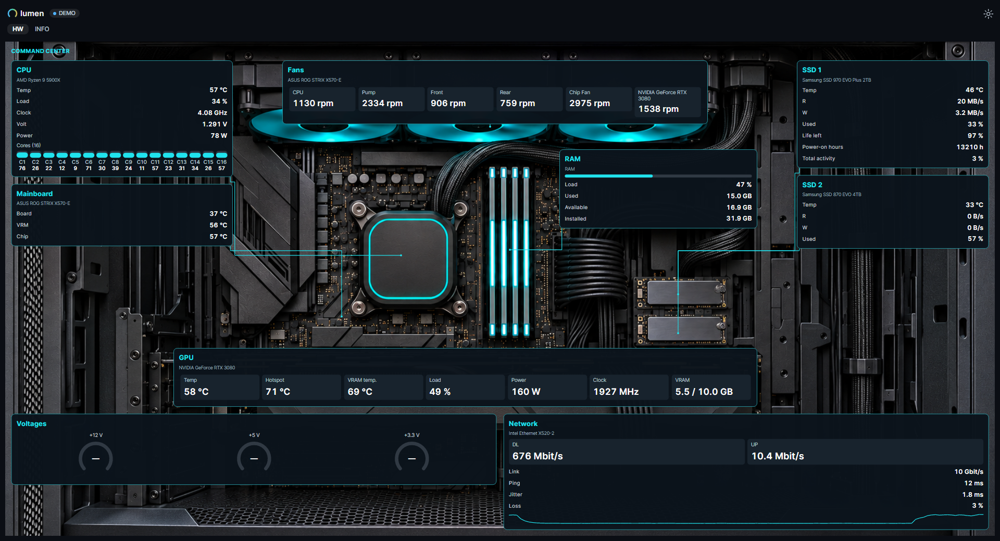

## New in 4.5.1

- **22 additional bundled font families**, including clear, technical, monospaced, bold and graffiti/marker styles; **29 font options** in total.
- **Independent global fonts for Titles, Labels, Values, and Graphs and scales**, with a common base typeface when desired.
- **Value colour and Label colour**, widget accents, theme palettes and custom colours; the selected font stays readable in dark and light pickers.
- **One to six columns**, each configurable from **240 to 440 logical pixels**, plus **one to six registers with custom names** and widget assignments.
- **Automatic density fits the available height above the taskbar**; Comfortable and Compact retain scrolling. Whole-screen and the existing monitor, edge and horizontal-bar settings remain available.
- **Cyan Glas, Mainboard Card, Double Table, Quadrants and Network Center** add native live hardware views. Cyan Glas has compact dark cards, short component connections and a separate case picture for two columns.
- **Per-sensor selection and separate GPUs/drives** with actual device names. GPU choices identify each detected device by number and model; available RAM, board, drive and network details remain selectable.
- **Existing settings are preserved**. Unwanted preview designs are excluded, and profiles using them migrate to Cyan Glas. Narrow Thermal Grid RAM values no longer change row heights when they update.

[Full 4.5.1 release notes: fonts, colours, all layout options, sensors and update instructions](docs/release-notes/v4.5.1.md)

| Cyan Glas: one column | Cyan Glas: two columns |
| --- | --- |
| 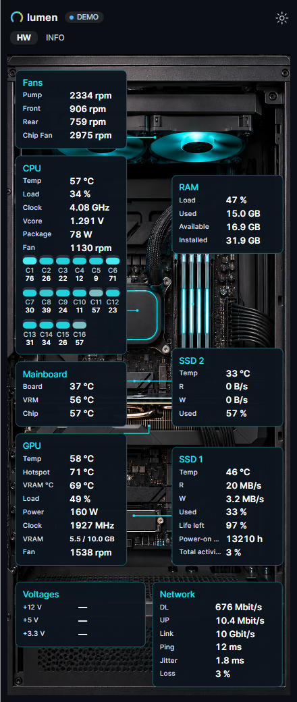 | 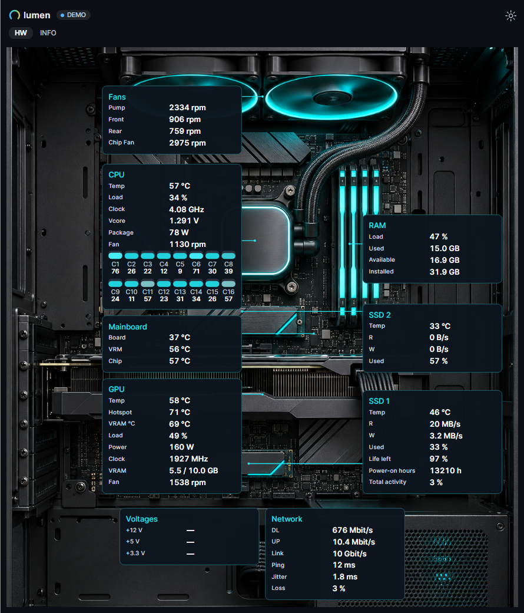 |

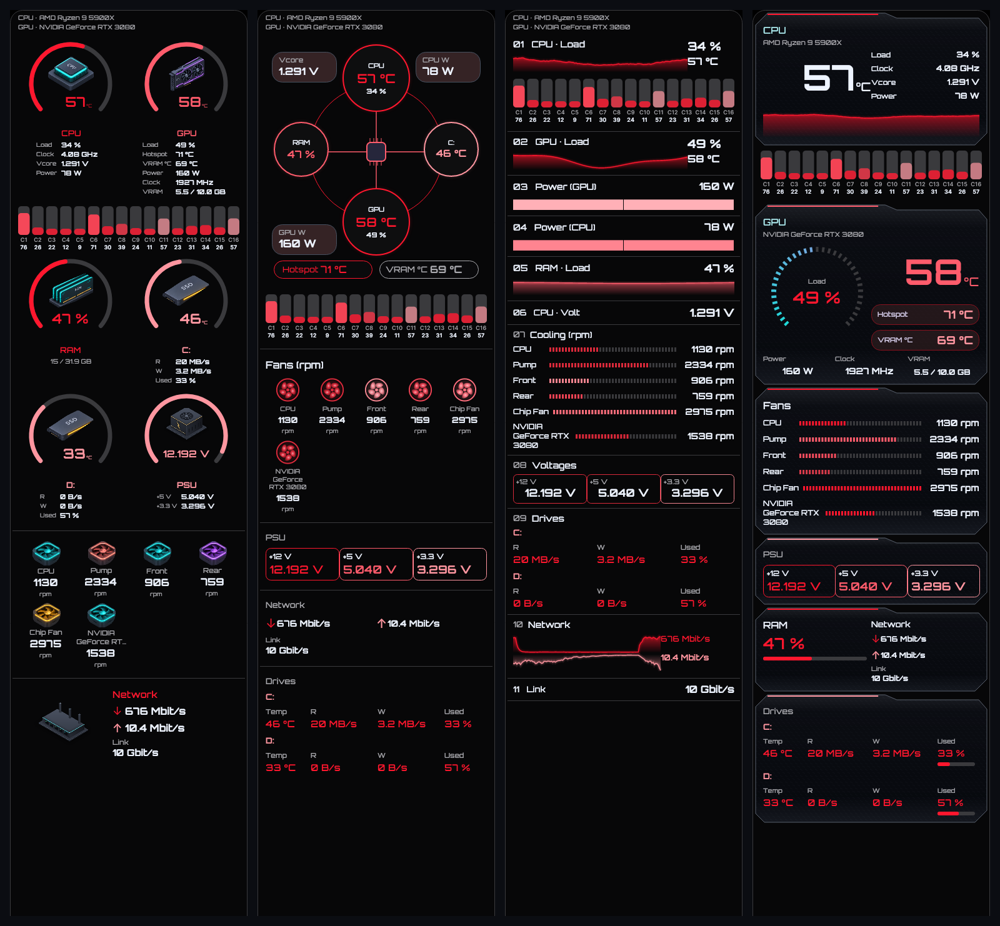

## New in 4.5.0

- **Four Panel designs**: Panel, Panel Rings, Panel Header and Panel Plain show each part as a panel with a picture and large values.
- **Red designs**: every AIO design is also available in red, with dark grey cards, the Orbitron typeface and one red throughout (18 designs).
- **Value colour and Label colour** in Settings → Appearance → Colours: choose the colour of the numbers and of the names and captions in every design.
- **Orbitron** is a new built-in typeface; the chosen typeface and colour scheme now reach every design.
- Integrated graphics are shown completely in every design; Isometric Rig groups its further values; long Sci-Fi titles fit the card.
- Removed from the selectors: Pure widgets, Pure Widgets Right, Capsule row graph, Fill bars graph and Mainboard. Profiles using them fall back to Standard.

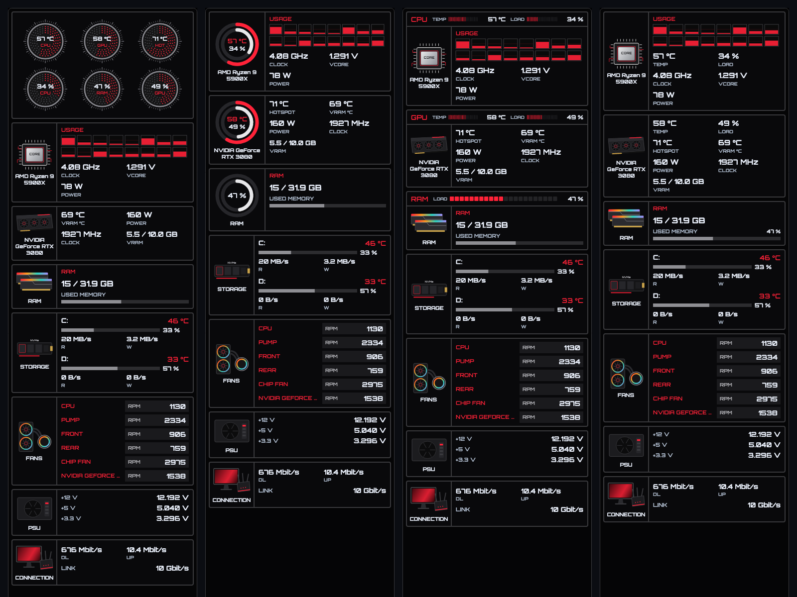

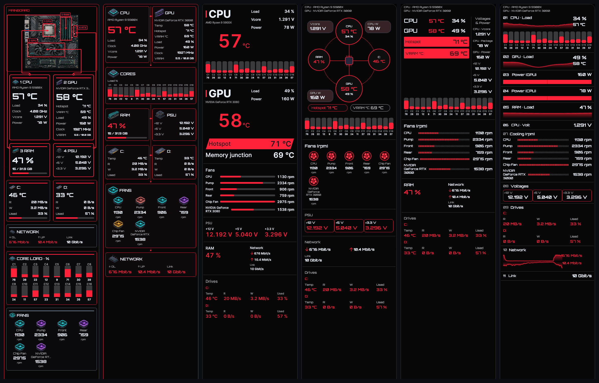

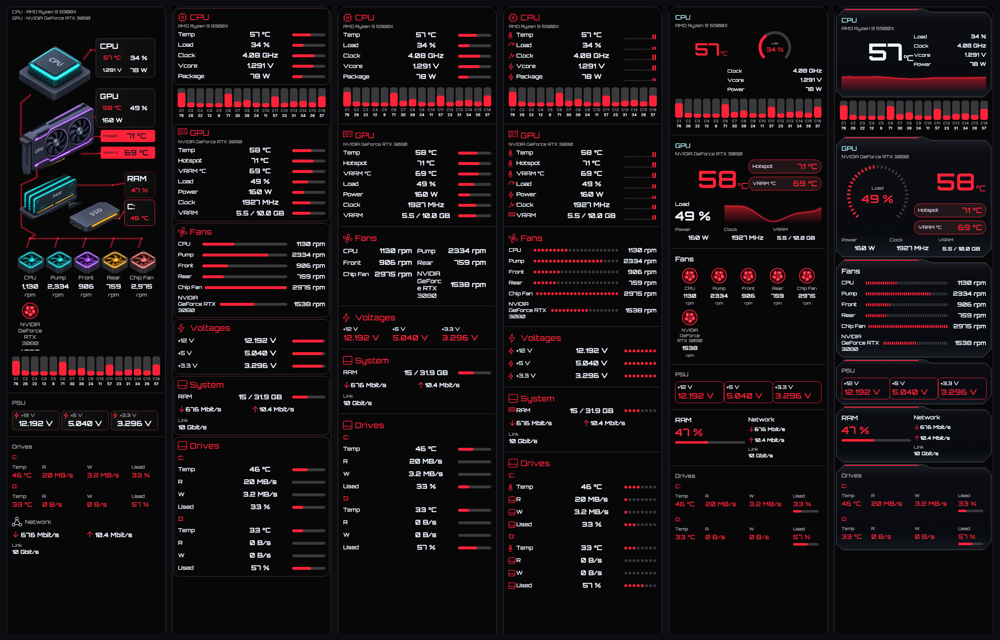

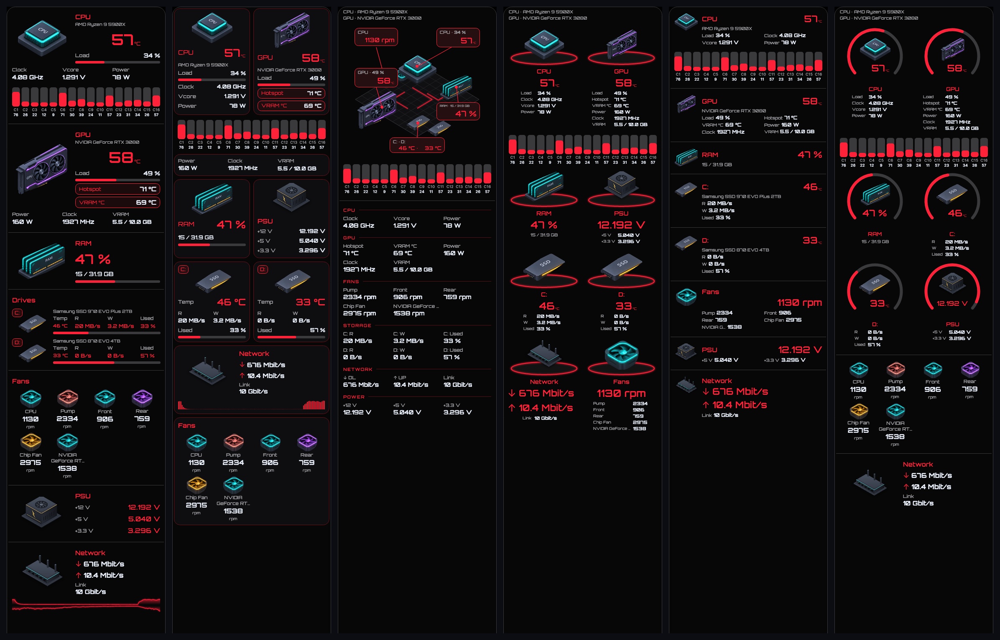

[4.5.0 release notes and screenshots](docs/release-notes/v4.5.0.md)

## New in 4.4.0

- **Mainboard, Mainboard Cores, Mainboard Map and Mainboard Map Desktop**: new layouts with complete live hardware readings. The Desktop design uses the whole selected monitor, with bounded artwork and readable values.
- **Mainboard Cores** places CPU/GPU above a full-width core-load strip, then RAM/PSU, drives, fans and network. Narrow widths wrap core bars into more rows.
- **Main-widget choices are saved per design.** A new ordinary design starts with five hardware and four info widgets; a new AIO design starts with seven hardware and four info widgets. Returning to a customized design restores its own checks. Extra widgets and individual sensor choices are kept.
- **Matching extra widgets in every AIO design**, including clock, world clocks, calendar, weather, FPS, battery, ping, notes and timer.
- Clearer Mainboard connections and network fields: PCB traces do not run through full-width panels, even with transparent backgrounds.
- Removed from the selectors: Mainboard Typography, Data Matrix, Instruments, Strips; AIO Pop Console, AIO Chromatic; Aperture. Existing profiles migrate these designs to Standard while keeping their other widget settings.

[4.4.0 release notes and screenshots](docs/release-notes/v4.4.0.md) · [Mainboard guide](docs/mainboard.md)

### Mainboard previews

All screenshots use demo readings.

| Mainboard | Mainboard Cores | Mainboard Map |
| --- | --- | --- |
| 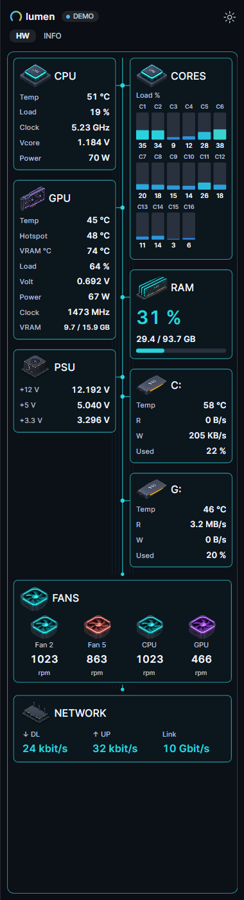 | 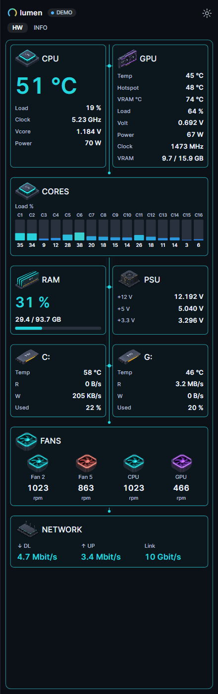 | 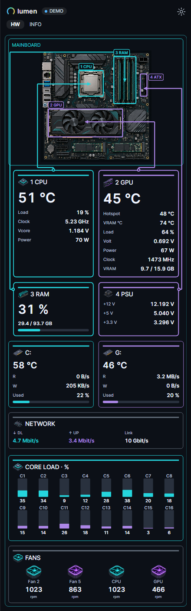 |

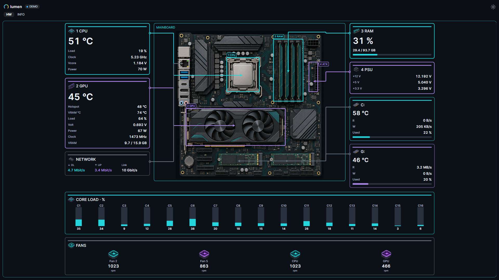

## New in 4.3.0

- **English only** with short labels: CPU, GPU, RAM, DL/UP, Temp, Volt, R/W. Hotspot, Clock and Power keep their full names.
- **Only the main graphics card** is shown by default; the "Fans 2/2" count is off by default.
- Narrow AIO designs show drives in two columns; Isometric Rig no longer squeezes all drives into one tag.
- Widget fixes: no repeated "C:" in drives, "Chip Fan" instead of a second "Chip", "0 rpm" for stopped fans everywhere, no broken words in Split Lens, readable captions in Dial, Sci-Fi and Thermostat.
- Verified with 4,615 tests.

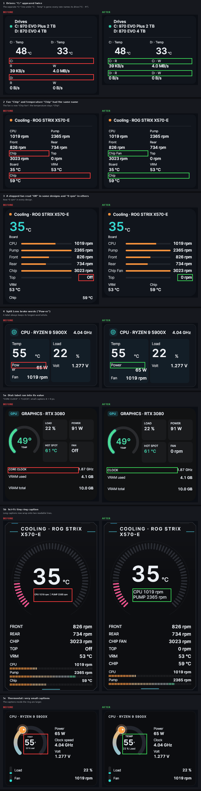

[Full 4.3.0 release notes](docs/release-notes/v4.3.0.md)

## New in 4.2.1

- AIO values keep a fixed room: nothing moves when digits or units change.
- Network arrows stay in place in Isometric Compact, Pedestals and Rig.
- Labels and values are left-aligned in Isometric Rings and Pedestals; labels keep a readable size in Studio Light, Instrument and Precision.
- Verified with 5,336 tests, including a new no-movement test for all 18 AIO designs.

[Full 4.2.1 release notes](docs/release-notes/v4.2.1.md)

## New in 4.2.0

- **18 All-in-One (AIO) designs:** CPU, GPU, RAM, drives, cooling, power supply and network in one card. The widget switches show or hide each part, and every AIO value can be selected under *Customise*.
- **Six isometric AIO designs** with 3D part illustrations: Atlas, Tiles, Rig, Pedestals, Compact and Rings.
- **CPU core load** as bars below the CPU in every AIO design.
- Three new widget designs: Splitflap, Measure Tape and Hardware Map.
- Stable layout: values keep their place and size while they change.

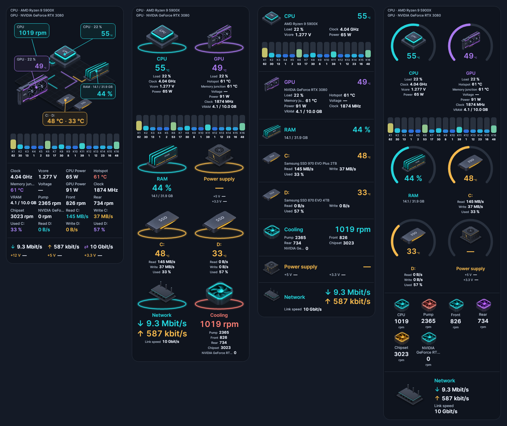

[Full 4.2.0 release notes](docs/release-notes/v4.2.0.md)

## New in 4.1.1

- Download and upload appear once in Evolution and Dial, including identical and zero rates.
- Capsule removes the repeated upload caption and gives the hardware name a wider heading above the rates.
- Duplicate network readings are now checked by sensor identity across all 60 designs.
- Verified with 3,802 tests and 2,163 extended layout/data cases (18,105 assertions).

[Full 4.1.1 release notes](docs/release-notes/v4.1.1.md)

## New in 4.1.0

- **15 new designs**, for 60 total: Meridian, Strata, Vector, Orbit, Lucent, Circuit, Panorama, Terminal, Thermal, Mosaic Pro, Ribbon Flow, Split Lens, Aperture, Pixel Deck and Horizon Sync.
- **Complete sensor selection in every design**, with compact recommended defaults and individually selectable additional values.
- **Native drive layouts:** large side-by-side temperatures, aligned values, per-device gauges/history and read/write pairs at the bottom.
- **Configurable drive order:** C: first by default, alphabetical or detection order. Hardware names use clean per-drive title lines; Hottest labels are gone.
- **Stable fitting:** fixed the design-switch layout loop, stale sensor bindings and duplicate History Graph upload values.
- New installations start with **Standard**; saved choices remain saved. World clocks, weather and calendar defaults are unchanged.

[Full 4.1.0 release notes](docs/release-notes/v4.1.0.md) · [All designs and new previews](docs/style-gallery.md)

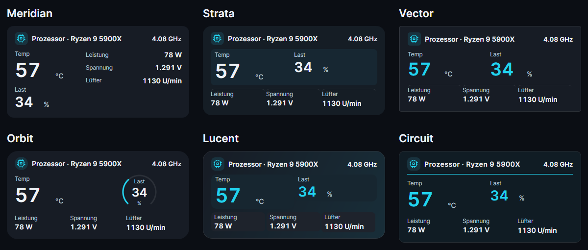

## New in 4.0.3

- **Nine additional designs:** Pure, Pure Widgets, Clean Dark, Compact Pro, Performance View, Pure Bar, Pure Number, Pure Segments and Pure Widgets Right. Choose designs globally, per register or per widget.
- **Readable horizontal layouts:** bounded rings, compact charts and better use of the space beside graphics.
- **Stable readings:** reserved number widths and a network 2-min peak that keeps its row.
- **Optional integrated graphics:** enable it in **Widgets → Processor → Customise → Sensor values**. It is off by default for new settings.
- **Clearer design picker:** four columns and wrapping names.

[New design previews](docs/neue-sidebar-designs.md) · [Load indicators](docs/pure-lastanzeigen.md) · [Values on the right](docs/pure-widgets-rechts.md) · [Horizontal before/after](docs/horizontale-darstellung.md)

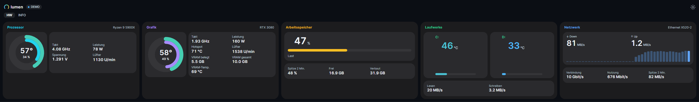

## Fixed in 4.0.2

Evolution no longer moves by a pixel every second, widgets stay steady when a sensor stops reporting for a moment, and every bar inside a widget starts and ends at the same place. [Details](docs/release-notes/v4.0.2.md)

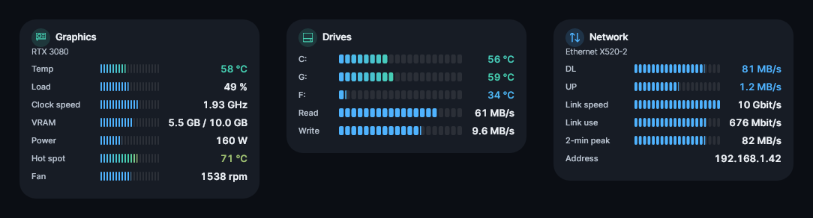

**4.0.1:** bars no longer grow and shrink with the number beside them, fans keep their place, a stopped fan no longer shrinks its Dial tile and the network's 2-min peak never disappears. [Details](docs/release-notes/v4.0.1.md)

## What's new in 4.0.0

- **26 new designs**: Sci-Fi, Thermostat, Neon HUD, Neon tiles, Smart Panel, Purple dashboard and list, Evolution, Dial, History graph, Double ring, Level columns, Duplex, Signal rows, Open panel, the Clarity family, Control deck and six graph variants.
- **Every widget in every design**: clock, calendar, weather, now playing, top apps, data usage, uptime, overview and drive health follow the chosen design.
- **Design per register**: one design for HW, another for INFO.
- **Size controls**: widget, graphic, main value, value and label size – per widget or for all at once.
- **Every drive and both network directions** are shown in every design.
- **Designs follow your background and colour scheme.**
- **No jumping**: columns end flush at the bottom, widgets keep their place when values change.
- **Translated everywhere**, no word broken in the middle.

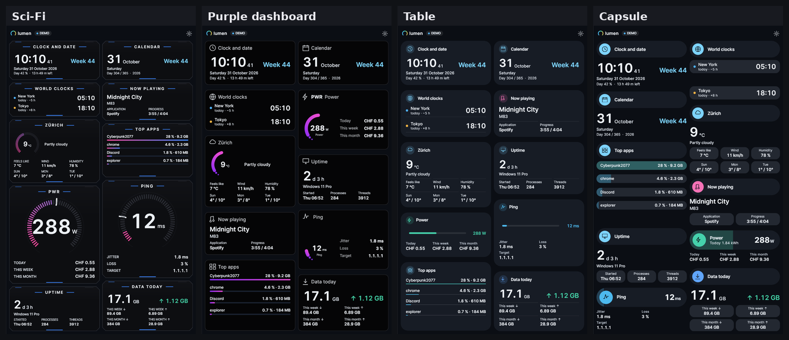

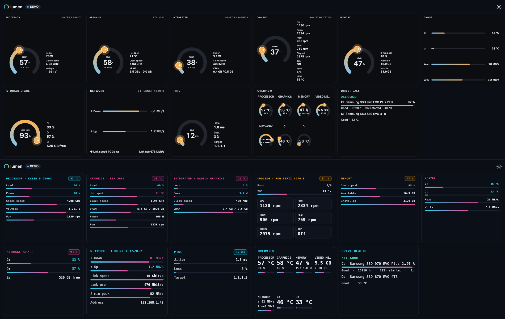

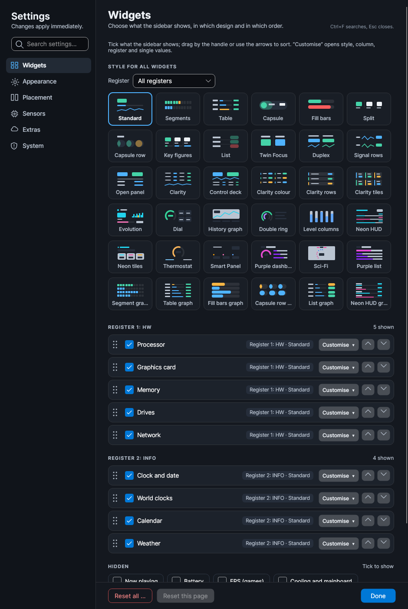

**[Browse all 60 designs, in dark and light](docs/style-gallery.md).** All pictures use demo data.

## Sensor support

| Source | Integration |
| --- | --- |
| **LibreHardwareMonitor** | Built-in sensor library for supported CPU, GPU, storage, mainboard, fan and battery readings. |
| **Open Hardware Monitor** | Built-in driverless GPU/SMART fallback, combined with LibreHardwareMonitor readings. |
| **AIDA64** | Optional external source through shared memory. Enable shared memory in AIDA64's External Applications settings, then select AIDA64 in **Settings → Sensors**. |
| **HWiNFO** | Optional external shared-memory source, also available in **Settings → Sensors**. |

Automatic selection and fallback are supported. Hardware, permissions and available drivers determine which readings can be obtained. AIDA64 and HWiNFO are separate applications; they are not bundled with Lumen.

## Layout and widgets

- Left/right sidebar or top/bottom bar, with multiple rows/columns and up to six pages.
- Automatic density, adjustable text size, custom titles and hardware names.
- CPU, discrete/integrated GPU, memory, drives, storage space, network, cooling, power, FPS, ping, battery, system, weather, clocks, calendar, media, usage and notes.
- Colour presets, state colours, Windows accent, theme files, glass and several typefaces.
- English interface with short, compact labels.

## Diagnostics

Error reports include the executable path, active layout, recent activity, available error logs, session state and restart history. Log read failures are distinguished from missing logs. Settings → System also shows the executable location and provides **Open folder**.

Logs and reports stay local. Nothing is uploaded automatically.

## Download and run

Download **Lumen-4.5.1.exe** for the portable application, or the portable ZIP with licence files. No separate .NET installation is required. Close an older running instance before starting the new EXE. Settings are stored beside the EXE, with an AppData fallback when that folder is read-only.

The release also includes the complete source archive, all gallery images and SHA-256 checksums.

## Build and verify

```powershell
dotnet test tests/Lumen.Tests -c Release -m:1
dotnet run --project tools/Lumen.Regression -c Release -- --expect-fixed
dotnet publish src/Lumen.App -c Release -r win-x64 --self-contained -m:1 -p:PublishSingleFile=true -p:IncludeNativeLibrariesForSelfExtract=true -p:IncludeAllContentForSelfExtract=true -p:EnableCompressionInSingleFile=true -p:DebugType=none -o publish
```

The release workflow builds the EXE from the tagged source, runs the tests and packages the source, screenshots and checksums. UI image baselines are OS-specific.

## Licence

Lumen is distributed under the [MIT licence](LICENSE). The Open Hardware Monitor source in `lib/OpenHardwareMonitor.Driverless` remains MPL-2.0. LibreHardwareMonitor is used as a NuGet package under its licence. PresentMon is MIT-licensed. Included notices are in `licenses/` and the source archive.

