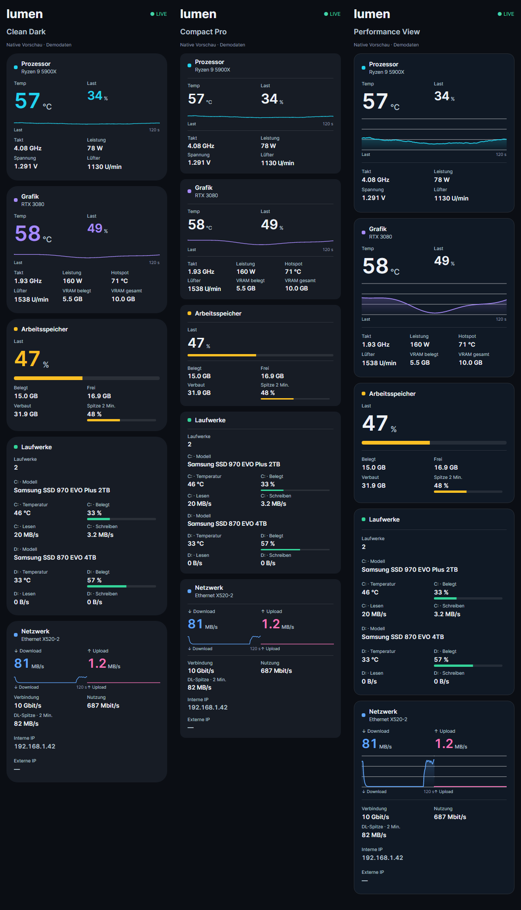
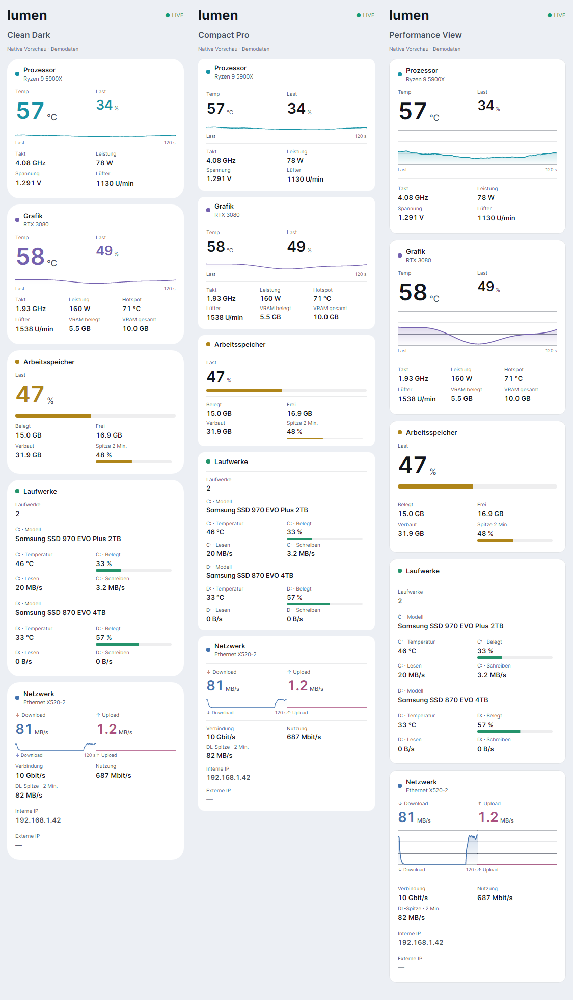

# Three additional sidebar designs

These are native Avalonia widget layouts based on the three sidebar concepts. They are additional choices in Settings → Widgets, including the global, per-register and per-widget design pickers. Existing saved settings retain their numeric style IDs.

| Design | Appearance |
| --- | --- |
| Clean Dark | Rounded graphite cards, large category-coloured main values, fine history curves. |
| Compact Pro | Smaller main values, tighter spacing and aligned reading grids. |
| Performance View | Outlined panels, white main values and larger filled history curves with a grid. |

All three use live sensor readings and the existing sensor filters. CPU/GPU curves show load; network curves show download and upload at the same scale. The history caption follows the selected update interval. Each drive has its own group. Widget naming, accent colours and independent value, label and graphic sizes remain available. Info and overview widgets use matching frames. Both dark and light palettes are supported.

The screenshots below are rendered from the actual controls using demo data, not readings from the user's PC.





Generate the previews:

```powershell
dotnet run --project tools/Lumen.Gallery -c Release -- docs/images/favorites --favorites
```

Validation: 1,687 tests passed; regression tool completed 1,407 cases with no failures. The new tests cover complete sensor sets, both palettes, narrow widths, sensor visibility and stable readout controls.
