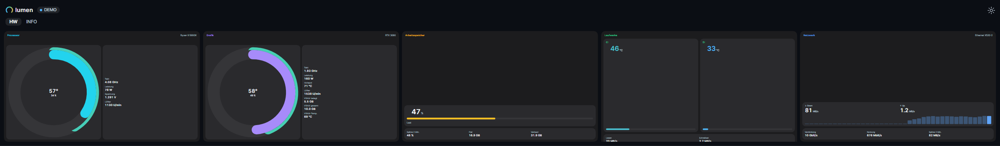
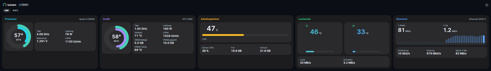

# Korrektur der waagrechten Darstellung

Das gemeldete Bild ließ sich mit dem bisherigen Code bei 2560 × 376 Pixeln reproduzieren.

## Ursachen

1. Quadratische Kacheln verlangten auch in der flachen Leiste eine Höhe entsprechend ihrer Breite. Beim Verkleinern der gesamten Karte wurde deren logische Breite größer; die Quadrat-Höhe wuchs mit. Dadurch blieben die Ringe groß, während die Schrift immer kleiner wurde.
2. Die automatische Höhenverteilung vergrößerte innere Abstände, was große leere Flächen und nach unten versetzte Inhalte erzeugte.
3. Nach dem Umbruch eines Messwertrasters konnte die bisherige Skalierungssuche bei einem unnötig kleinen Maßstab bleiben.

## Änderungen

- In der waagrechten Ansicht haben quadratische Pure-Widgets-Grafiken eine begrenzte Größe und werden innerhalb ihrer Kachel zentriert.
- Pure-Widgets rechts nutzt den Platz neben dem Ring für bis zu zwei Messwertspalten.
- Clean Dark, Compact Pro und Performance View ordnen Laufwerke nebeneinander sowie Netzwerkdetails und Adressen in einem Raster an. Verlaufskurven bleiben in der flachen Leiste niedriger.
- Die Leiste verteilt freien Raum nicht mehr auf innere Zeilenabstände. Die Karten enden weiterhin auf einer gemeinsamen Linie.
- Eine begrenzte Suche ermittelt den größten tatsächlich passenden Maßstab, auch wenn Messwerte dabei umbrechen.

Die senkrechten Layoutpfade behalten ihre bisherige Anordnung und Quadratgrößen. Bestehende gespeicherte Einstellungen wurden nicht verändert.

## Vorschau mit nativen Controls und Demodaten

Vorher:



Nachher:



Die neuen Tests prüfen acht Designs oben und unten bei 1280 × 240, 1920 × 320 und 2560 × 376 Pixeln. Sie messen die tatsächlich transformierte Schriftgröße, nicht nur den eingestellten FontSize-Wert.

```powershell
dotnet run --project tools/Lumen.Gallery -c Release -- outputs/horizontal --horizontal-check
dotnet test tests/Lumen.Tests -c Release -m:1
```
