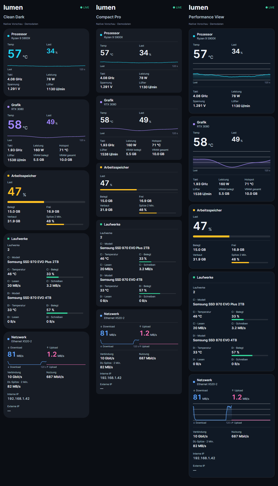
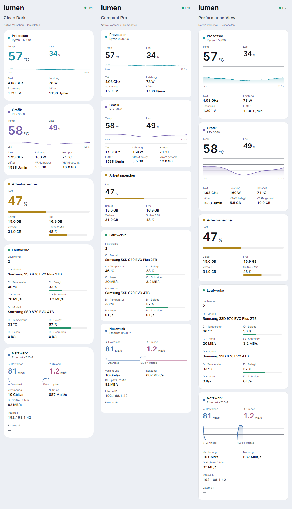

# Drei zusätzliche Sidebar-Designs

Die Designs wurden in den lokalen Quellstand aus `Lumen-4.0.2-Lokal-Pure-Source/Lumen-Source` integriert. Alle bisherigen Designs einschließlich Pure und Pure Widgets sowie ihre gespeicherten IDs bleiben erhalten. Insgesamt stehen 41 Designs zur Wahl.

| Design | Darstellung |
| --- | --- |
| Clean Dark | Runde Karten, große farbige Hauptwerte und feine Verlaufskurven. |
| Compact Pro | Kompakte Hauptwerte, engere Abstände und ausgerichtete Messwertraster. |
| Performance View | Umrandete Karten, weiße Hauptwerte und größere gefüllte Kurven mit Raster. |

Auswahl unter **Einstellungen → Widgets**, für alle Widgets, ein Register oder ein einzelnes Widget. Die drei Designs unterstützen die bestehenden Sensorfilter, eigene Widgetnamen, Akzentfarben und Größenregler. CPU und GPU zeigen den Lastverlauf; Download und Upload haben gleich große Werte und dieselbe Diagrammskala. Laufwerke sind nach Gerät gruppiert. Helle und dunkle Darstellung werden unterstützt. Die Sensoranbindung wurde nicht verändert.

Die Bilder zeigen echte native Controls mit Demodaten:





```powershell
dotnet test tests/Lumen.Tests -c Release -m:1
dotnet run --project tools/Lumen.Regression -c Release -- --expect-fixed
dotnet run --project tools/Lumen.Gallery -c Release -- docs/images/neue-sidebar-designs --favorites
```

Validierung dieser lokalen Integration: 1.759 Tests erfolgreich. Der Livebetrieb mit realen Hardware-Sensoren wurde hier nicht ausgeführt.
