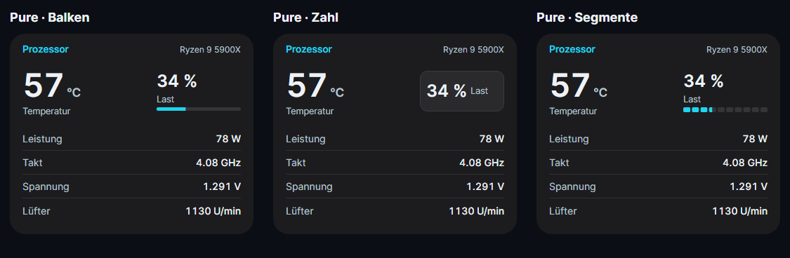
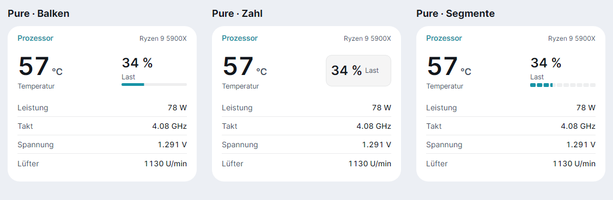

# Pure: drei gut lesbare Lastanzeigen

Zusätzlich zum ursprünglichen Pure mit Kreis stehen drei Varianten zur Verfügung:

- **Pure · Balken:** großer Prozentwert, Beschriftung und schmaler stufenloser Balken.
- **Pure · Zahl:** großer Prozentwert mit Beschriftung in einer kleinen Kapsel.
- **Pure · Segmente:** großer Prozentwert, Beschriftung und zehn Segmente. Kleine Lasten füllen das erste Segment anteilig.

Die Lastwerte sind 24 px groß, die Beschriftung 12,5 px. Die Haupttemperatur bleibt 46 px groß. Alle Varianten verwenden kontrastreiche Zahlen und die ruhige Pure-Kartenfläche. Eine Grafik ergänzt immer den exakten Zahlenwert. Fehlende Lastwerte werden als Gedankenstrich angezeigt.

Auswahl unter **Einstellungen → Widgets**, für alle Widgets, ein Register oder ein einzelnes Widget. CPU und GPU erhalten die neue Lastanzeige. RAM, Laufwerke und Netzwerk behalten ihre passende Pure-Darstellung; INFO und Übersicht verwenden den Pure-Rahmen. Das ursprüngliche Pure, Pure Widgets und alle anderen bisherigen Designs bleiben erhalten. Insgesamt stehen 44 Designs zur Auswahl.

Die Bilder sind aus den echten Controls mit Demodaten gerendert:





Vorschauen erzeugen:

```powershell
dotnet run --project tools/Lumen.Gallery -c Release -- docs/images/pure-lastanzeigen --pure-alternatives
```
