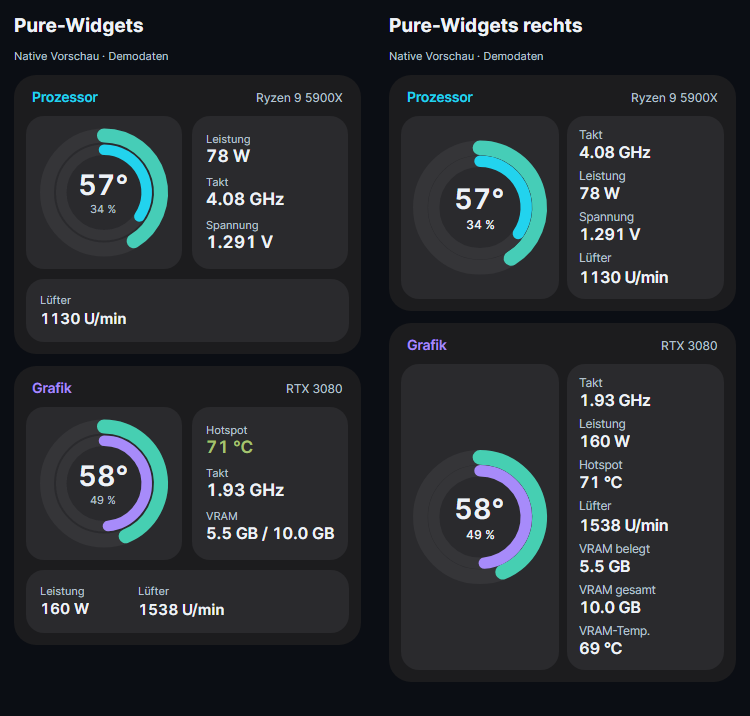
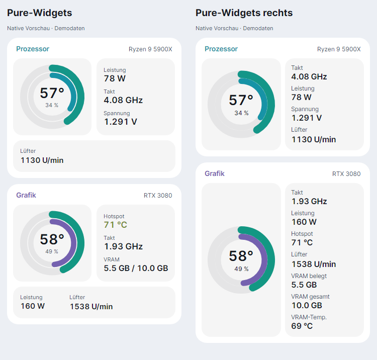

# Pure-Widgets rechts

Zusätzliche Variante von Pure Widgets nach dem markierten Bildschirmfoto: Bei **Prozessor und Grafikkarte** bleibt der Ring links. Sämtliche weiteren ausgewählten Messwerte stehen in der rechten Kachel, einschließlich Leistung und Lüfter. Die separate Messwerte-Kachel unter dem Ring entfällt.

Die rechte Liste wird nicht auf drei Werte begrenzt. Auch VRAM belegt/gesamt sowie die Speichertemperatur stehen rechts, sofern ausgewählt und vorhanden. Ein stehender Lüfter bleibt als 0 U/min sichtbar. Sensor-Schalter, eigene Namen, Größenregler und Farbthemen bleiben verfügbar. Kurze Sensoraussetzer behalten vorübergehend ihre Zeile. Die Werte-Controls werden bei reinen Messwertänderungen nicht neu aufgebaut.

RAM, Laufwerke, Netzwerk und INFO-Widgets verwenden die bisherige Pure-Widgets-Darstellung. Die ursprüngliche Variante Pure Widgets bleibt als eigener Eintrag erhalten.

Auswahl unter **Einstellungen → Widgets → Anpassen → Design → Pure-Widgets rechts**, oder über die Designauswahl für alle Widgets beziehungsweise ein Register. Insgesamt gibt es 45 Designs.

Die Vorschau verwendet native Controls und Demodaten:





```powershell
dotnet run --project tools/Lumen.Gallery -c Release -- docs/images/pure-widgets-rechts --widgets-right
```
