# Lumen 1.10.3

A modern hardware sidebar for Windows 10 and 11 – one portable EXE, .NET included, six languages
(English, Deutsch, Français, Italiano, Español, Português). Download `Lumen-1.10.3.exe` below and
start it; no installation.

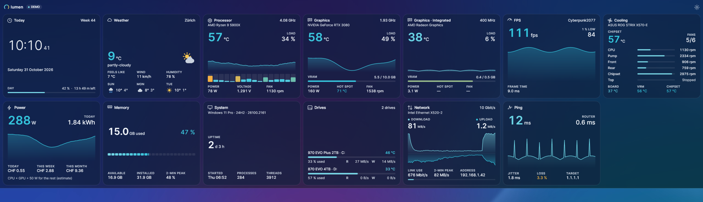

## Layout

- **Side or bar:** right or left edge, or a bar at the top or bottom of the screen.
- **Columns at the side (1–6), rows in the bar (1–6)**, whole screen or whole width, or a bar
  only as wide as its widgets, centred. Can reserve its space like the taskbar.
- **Automatic density** fills the height exactly, without scrolling.
- **Registers (pages) 1–6** with your own names, switched by click or mouse wheel.
- **Text size 50–200 %** – above 100 % the sidebar widens by the same factor.

  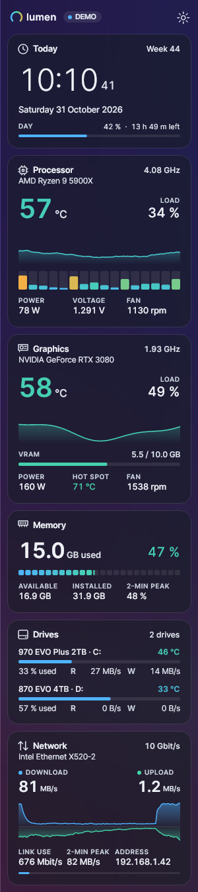
  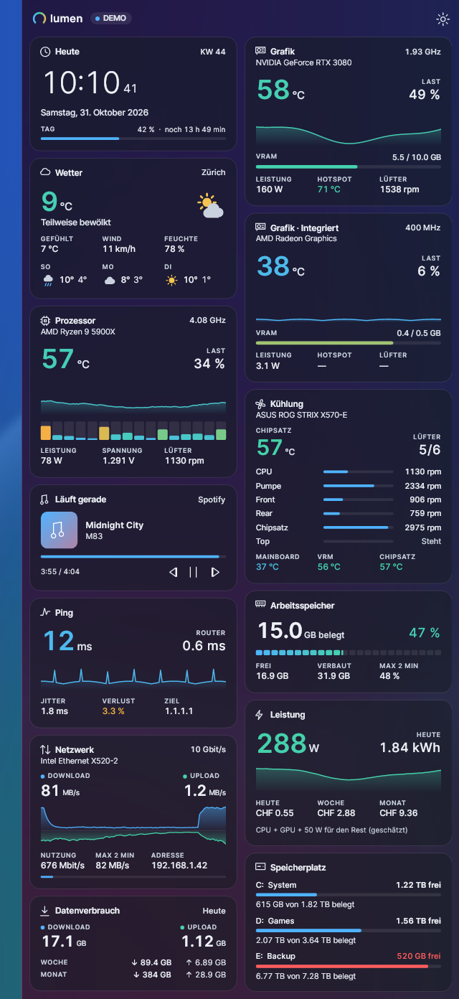

## Widgets and styles

- Clock, world clocks, calendar, weather, now playing, battery, processor, graphics (dedicated and
  integrated), FPS, cooling and mainboard, power and cost, memory, top apps, system, drives,
  storage space, network, ping, data usage, notes.
- **Six styles per widget:** Standard, Ring, Minimal, Bar, Graph, Tile – also for drives and
  storage space. **One click sets the style of all widgets.**
- Every style shows the single values you keep switched on (power, voltage, fan, VRAM, hot spot,
  jitter, link speed …); long values such as IP addresses get their own line.
- **Own title and hardware name per widget**, each can be shown or hidden.
- **Drives and storage space:** choose which drives and volumes are shown; model name,
  temperature, usage bar, used %, read/write rates each switchable.
- **Network:** link speed of the adapter, link use, 2-minute peak, local address and – only on
  request in the settings – the external IP (one HTTPS request per click, never in the background).

  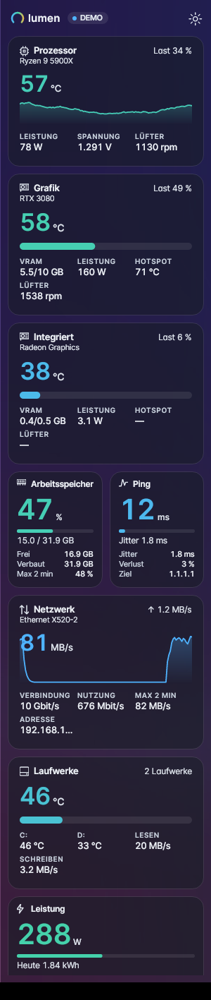
  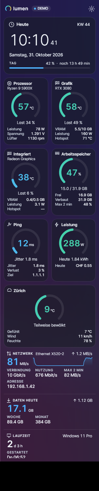
  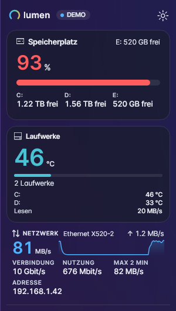
  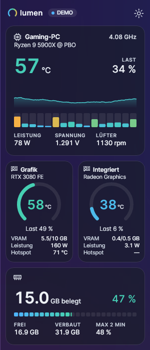

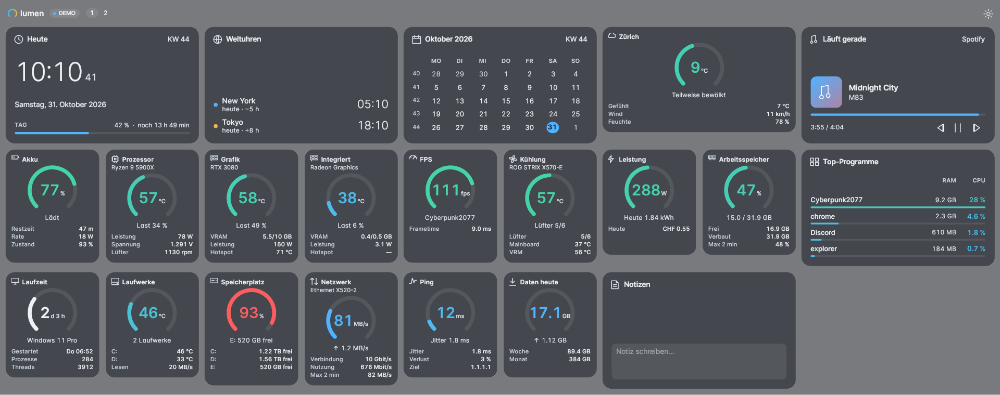

## Colours

- State colours (blue → mint → amber → red), the Windows accent or 14 presets.
- Nine backgrounds: Graphite, Black (OLED), Midnight blue, Deep sea, Forest, Aubergine,
  Burgundy, Mocha, Slate. Glass effect with adjustable opacity, high contrast.
- Defaults: dark theme, high contrast on, language as in Windows.

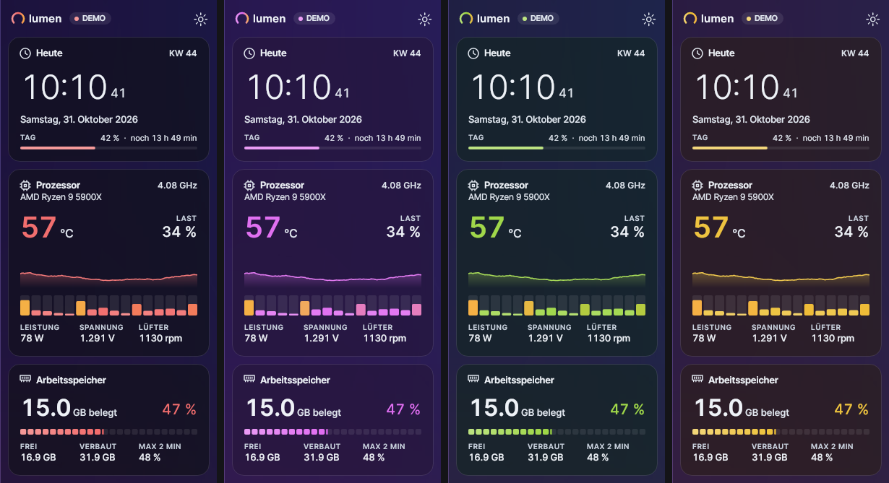

## Sensors

- **LibreHardwareMonitor 0.9.6** (PawnIO) and the **driverless Open Hardware Monitor** work
  together; one shared set of rules picks the right readings on Intel (incl. P/E cores), AMD
  Ryzen (Tdie without offset), NVIDIA, AMD and Intel Arc graphics, laptops and many mainboards.
- Drive letters per physical drive; VPN and virtual network adapters are skipped.
- **Settings → System → Show all sensors** lists everything both libraries found.
- CPU temperatures need administrator rights; *Start with Windows* runs elevated without a prompt.

## Settings

Wide window with topics: appearance, layout, widgets, position, readings, weather and clocks,
power and ping, system. Everything applies immediately.

  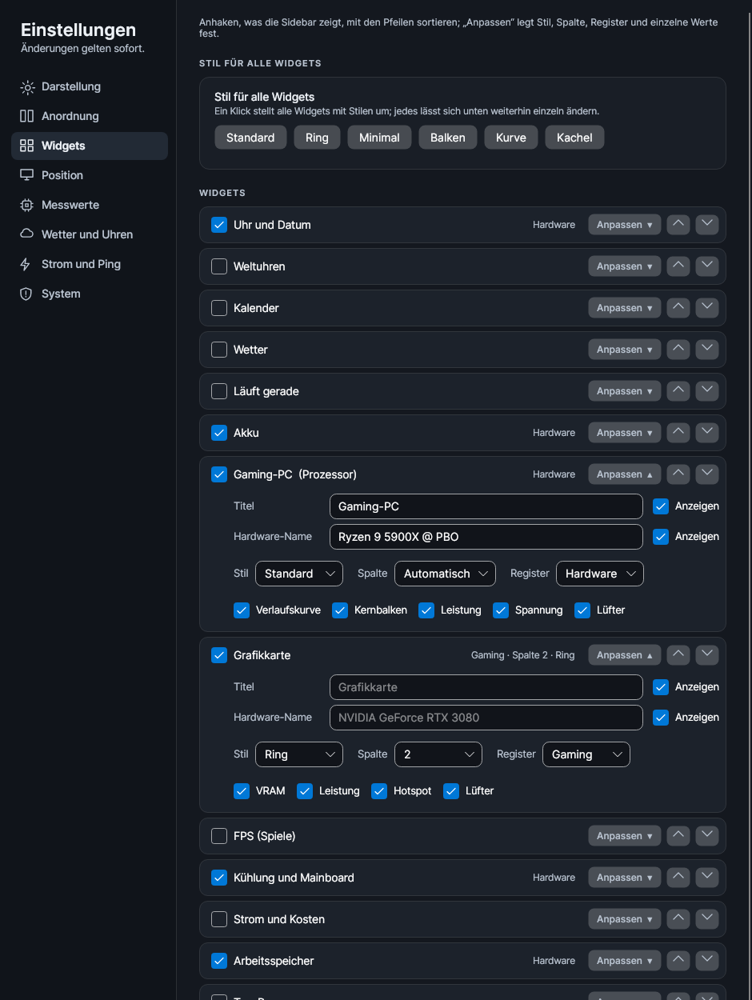
  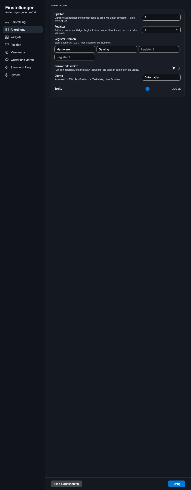

## Fixed in this version

- The bar at the top or bottom with several rows no longer fails in the compact styles
  ("Invalid Arrange rectangle"); an empty register shows a hint instead of crashing.
- Errors are written to `lumen-crash.log` beside the EXE.

The EXE is not code-signed, so Windows SmartScreen may ask once ("More info" → "Run anyway").
`SHA256SUMS.txt` lists the checksums. Licence: MIT.
