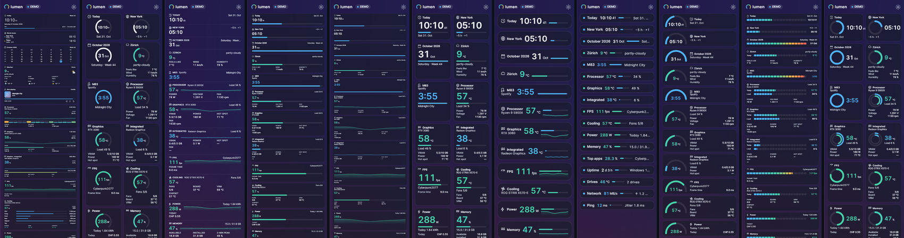
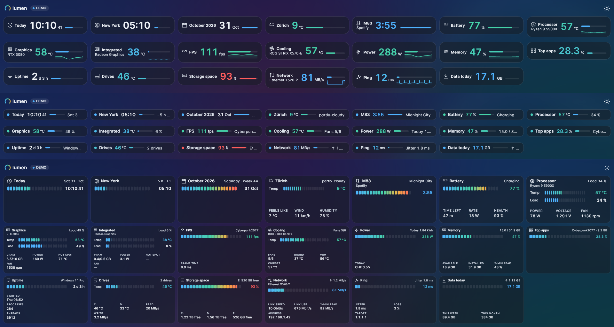
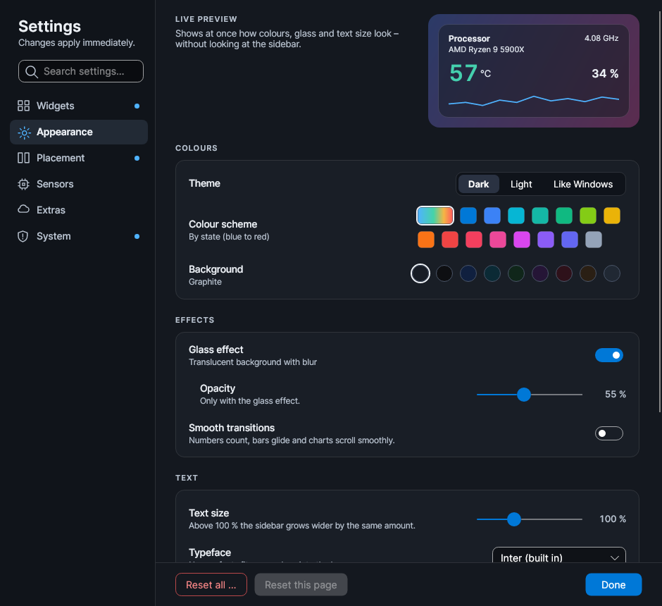
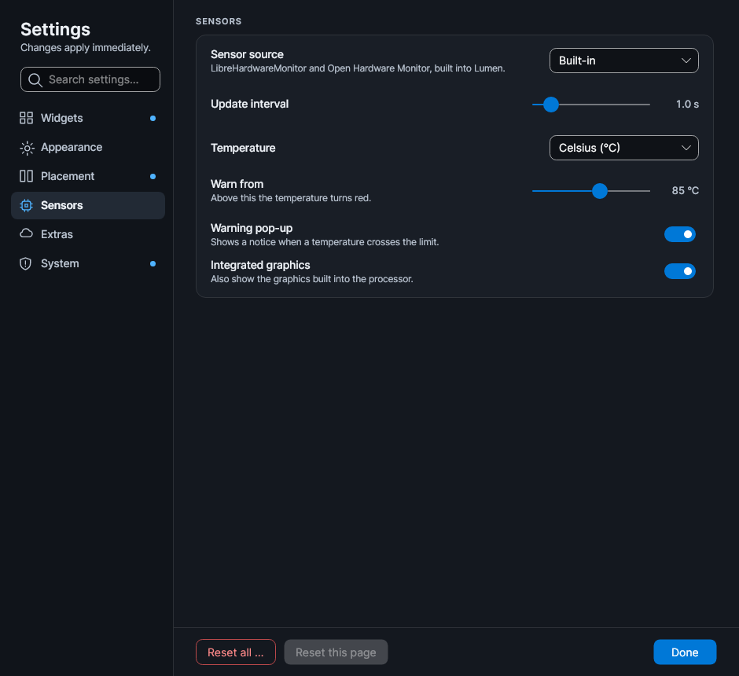

# Lumen 2.1.0

Portable `Lumen-2.1.0.exe` – no installation, .NET included, six languages.

## Sensors

- **AIDA64 or HWiNFO as sensor source** (optional, *Settings → Sensors → Sensor source*: Built-in,
  Automatic, AIDA64, HWiNFO). Lumen reads their shared memory; while one of them answers,
  LibreHardwareMonitor and Open Hardware Monitor pause, so only one program talks to the sensor chips
  and Lumen needs no administrator rights. If the source stops, Lumen falls back to the built-in
  sensors on its own, and switching back and forth keeps every widget and setting.
- **CPU temperature** is the mainboard's CPU sensor for every source, not the die diode.
- **CPU clock** is the average of all cores, in every source.
- **Drives** are matched to Windows disks by serial number, so drive letters, used space, read and
  write rates and temperatures stay right whichever source is active.

## Styles

- **Every widget now has every style** (except notes): Standard, Ring, Minimal, Bar, Graph, Tile.
- **Five new compact styles:** Compact (one slim line with a small chart), Status (a dot, name and
  value), Gauge (half-circle gauge), Segments (segment meters) and Dual ring (temperature and load
  in one ring).
- **A tidy bar:** rows are evenly filled, cards are as wide as they need to be, nothing is cut off,
  and a lone half-width tile no longer stretches across a row.

## Settings

- **Six topics** – Widgets, Appearance, Placement, Sensors, Extras, System.
- **Search** across all settings; every hit opens its topic.
- **Live preview** of colours, glass, text size and typeface.
- Widgets grouped (Hardware, Info, Hidden), with a small picture of each style.
- A dot on every topic you changed, *Reset this page*, and a confirmation before *Reset all*.
- **Typeface:** Inter (built in), Segoe UI, Segoe UI Variable, Bahnschrift, narrow Bahnschrift or
  monospace.
- **Themes as files:** save the whole look as `*.lumentheme` and load it back – or share it. No
  layout and no personal data inside.

## Reliability

- **Freeze watch:** if the sidebar stops answering for 20 seconds, Lumen writes it to
  `lumen-crash.log` and restarts itself (at most three times in half an hour).
- **Error report:** one ZIP on the desktop with error log, sensor lists, settings and system facts –
  from *Settings → System* or the tray menu. Notes, places, coordinates, the ping target and own
  names are removed; nothing is sent.
- **Lighter:** the process list and system counts are only read while their widget shows; a hidden
  sidebar reads every 5 seconds and draws nothing; leaner memory use after start.
- **Tests:** every style is rendered as bar and sidebar; the build fails if a layout never comes to
  rest or a picture differs from its approved reference.

  
  

The EXE is not code-signed, so Windows SmartScreen may ask once ("More info" → "Run anyway").
`SHA256SUMS.txt` lists the checksums. Licence: MIT.
