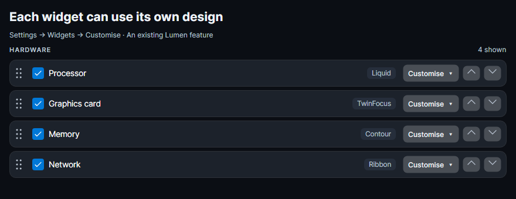
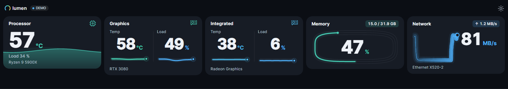
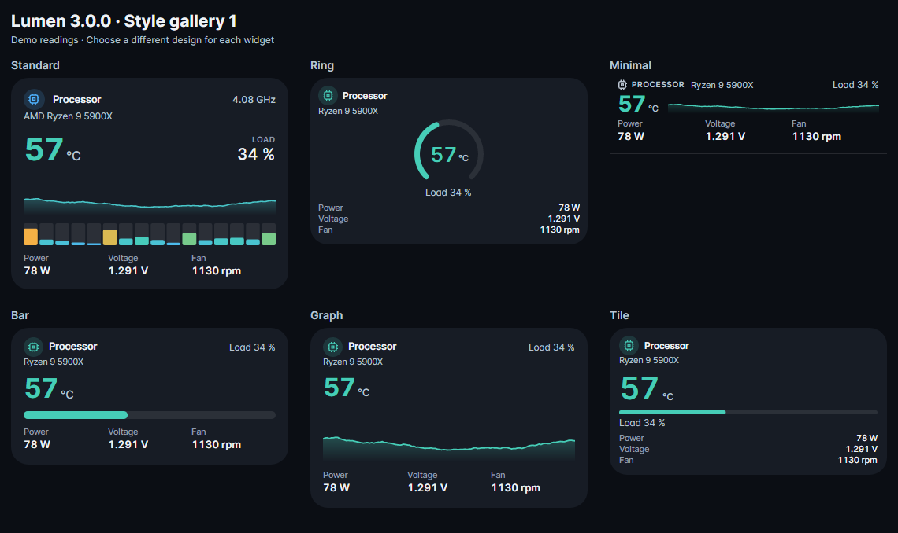
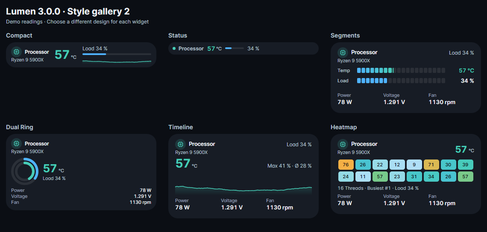
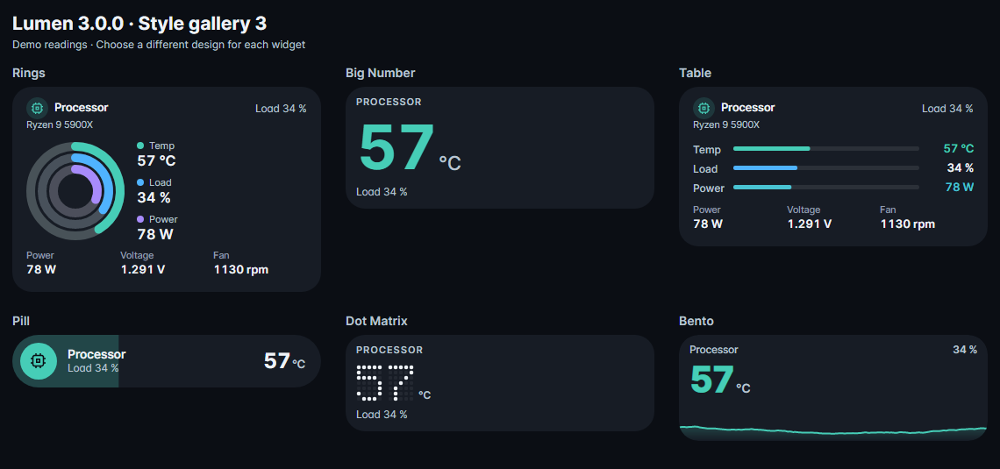
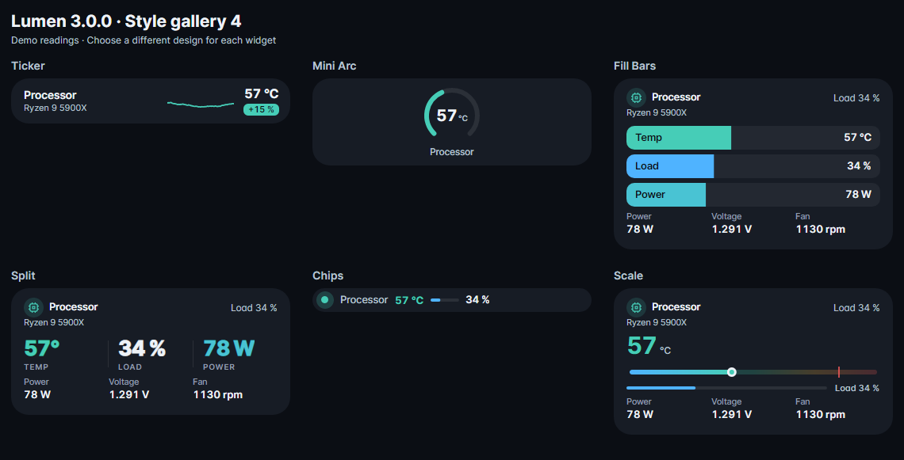
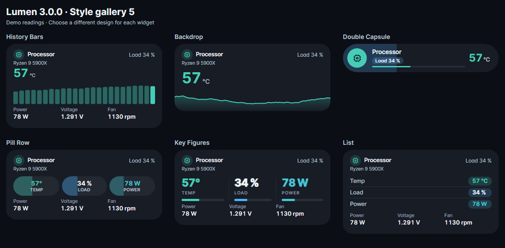
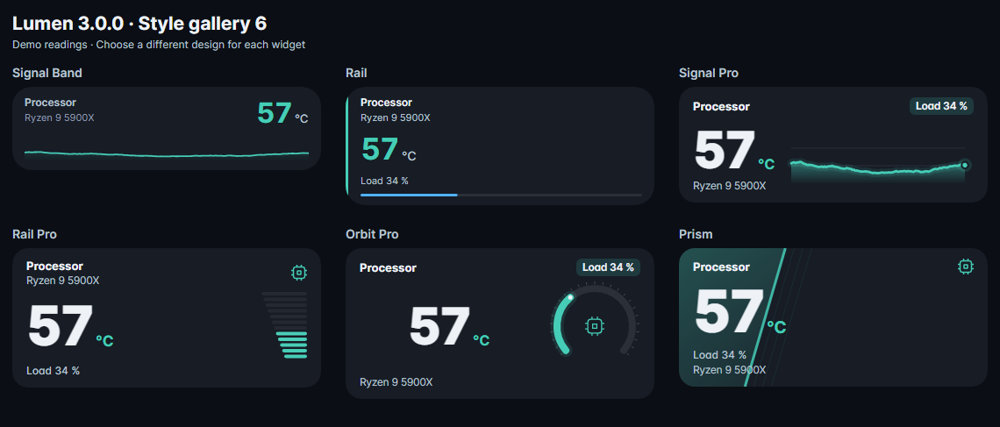
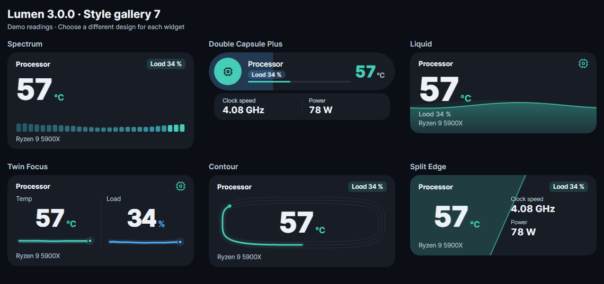
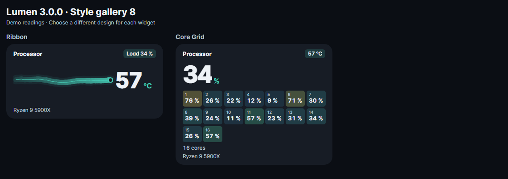

# Lumen 3.0.0

**44 widget designs. Bold readings. Vertical sidebars and horizontal bars.**

Lumen 3.0.0 expands the design collection with large numerical displays, fluid fills, layered contours, history ribbons, per-core grids and an independent Double Capsule Plus layout with additional readings.

## Highlights

- **44 selectable designs**, including Liquid, Twin Focus, Contour, Split Edge, Ribbon, Core Grid, Signal Pro, Rail Pro, Orbit Pro, Prism, Spectrum and Double Capsule Plus.
- Vertical and horizontal layouts with dark and light themes.
- Improved horizontal layout stability and a corrected Double Capsule indicator.
- More informative local error reports with executable path, layout, activity, session state and log-read status.
- Executable location and **Open folder** under Settings → System.

## Choose each widget's design individually

**Each widget can use its own design — mix and match styles across your sidebar.** This per-widget choice was already available in earlier releases.

Go to **Settings → Widgets → Customise** on an individual widget. You can also use **Style for all widgets** for a uniform look.

## Sensor support

- **LibreHardwareMonitor** and **Open Hardware Monitor** are integrated.
- **AIDA64** is supported as an optional shared-memory sensor source. Enable shared memory in AIDA64's External Applications settings and select it under Settings → Sensors.
- HWiNFO shared memory and automatic fallback are also supported.

Available readings depend on the hardware, permissions and drivers. External sensor applications are not included in the download.

## Downloads

- **Lumen-3.0.0.exe** — portable Windows x64 executable, .NET included.
- **Lumen-3.0.0-Portable.zip** — executable and included licence notices.
- **Lumen-3.0.0-Source.zip** — complete source, build files, tests and documentation.
- **Lumen-3.0.0-Screenshots.zip** — all design gallery images, dark and light variants and mixed-widget examples.
- **SHA256SUMS.txt** — download checksums.

Close any older running Lumen instance before starting the new EXE. Existing settings can be kept or copied beside the new executable.

## Images of every design

All images below use demo readings. Every selectable design is included; light-theme and individual images are included in the screenshots archive.

## Verification

The source passes the repository test suite and the extended layout/data regression suite, including all selectable styles, missing sensor values, separate histories and per-core grids. Screenshot generation uses the actual application controls. Error reports and diagnostics remain local; no data is uploaded automatically.

