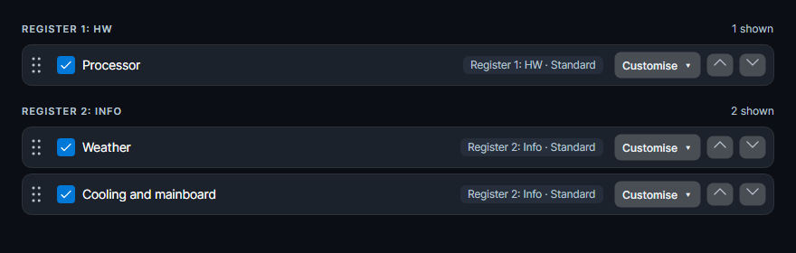

# Lumen 3.0.1

A maintenance release that makes register settings match the widgets shown in your sidebar. Your existing settings are preserved.

## Register settings that match your sidebar

- Settings now group visible widgets by their actual register, using the same assignment rules as the sidebar. A cooling widget assigned to INFO appears under INFO in both places.
- Register headings and selectors show the register number and custom name. Registers with identical names remain distinguishable.
- Moving a widget to another register immediately updates its settings group, summary and sidebar placement. Row and column summaries also refresh immediately.
- Sorting works within the actual register across all widget types, matching the order shown by the sidebar. Hidden widgets retain their register assignments.
- Empty registers remain visible in settings with a widget count and guidance.

Reducing the register count keeps the original assignments: widgets from higher registers temporarily appear on the last active register. Increasing the count restores their original placement. Existing settings do not need to be reset.

Validation: 330 automated tests passed, including register assignment, immediate UI updates, duplicate names, hiding, reordering and persistence; 687 layout regression cases passed with 1,485 additional assertions. Layout coverage includes left, right, top and bottom placement.

## Included features

- All 44 widget designs, with vertical and horizontal layouts.
- Choose a different design for each widget. This per-widget selection was already available in earlier releases.
- Sensor support for LibreHardwareMonitor, Open Hardware Monitor, AIDA64 shared memory and HWiNFO shared memory.
- [Browse all widget designs](https://github.com/nemesis122/Lumen-HWMonitoring-Sidebar/blob/v3.0.1/docs/style-gallery.md).

## Downloads and updating

- **Lumen-3.0.1.exe** — the Windows executable.
- **Lumen-3.0.1-Portable.zip** — executable and license notices.
- **Lumen-3.0.1-Source.zip** — full source for this release.
- **Lumen-3.0.1-Screenshots.zip** — all widget design screenshots.
- **SHA256SUMS.txt** — download checksums.

Close Lumen before replacing the executable. Keep your existing `lumen-settings.json`; a reset is not required.
