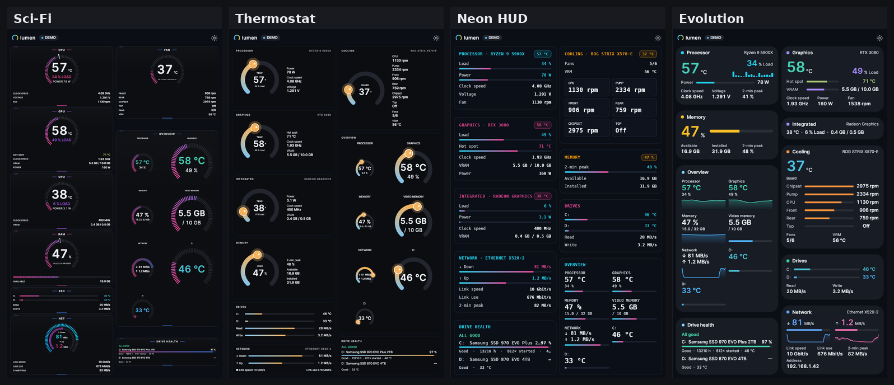
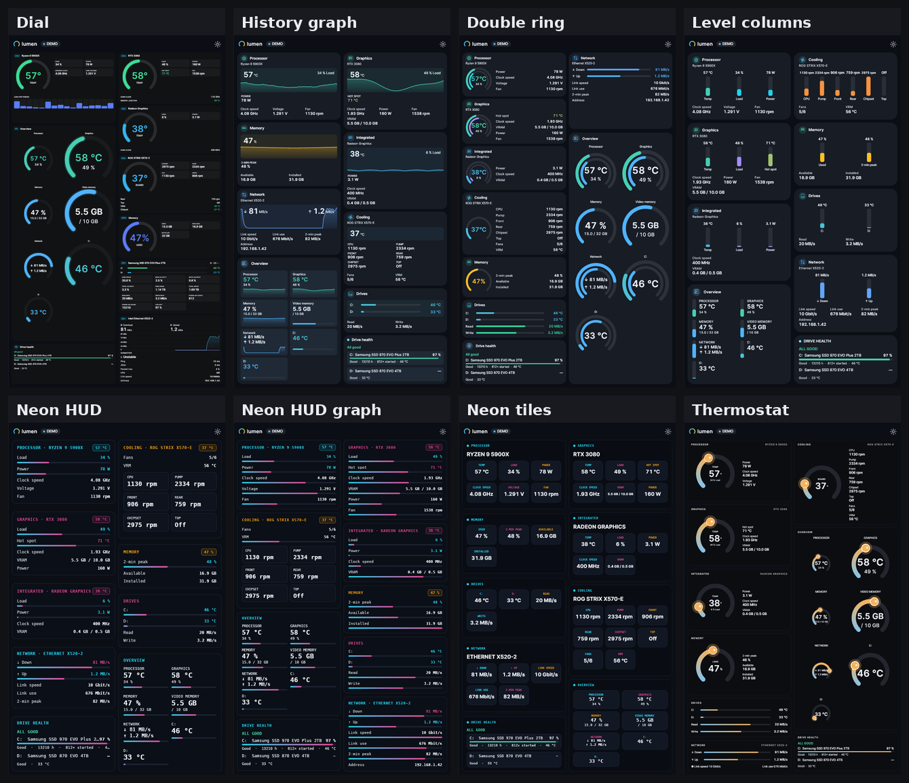
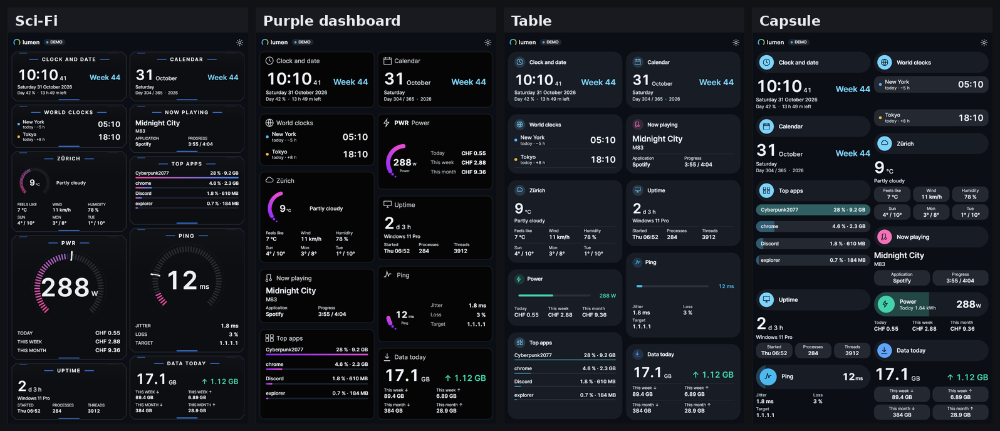
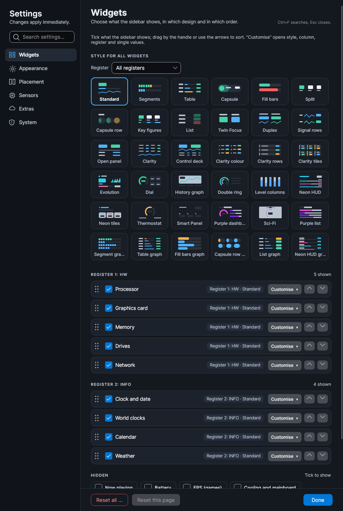
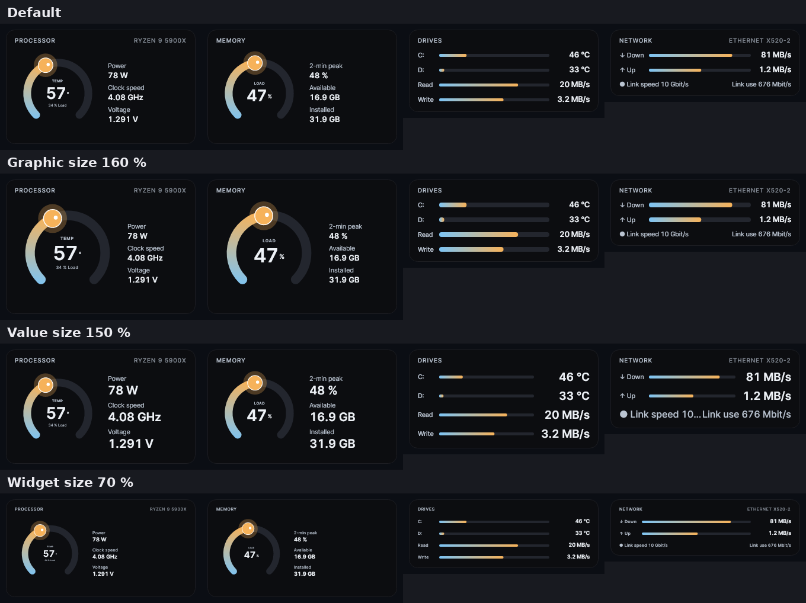
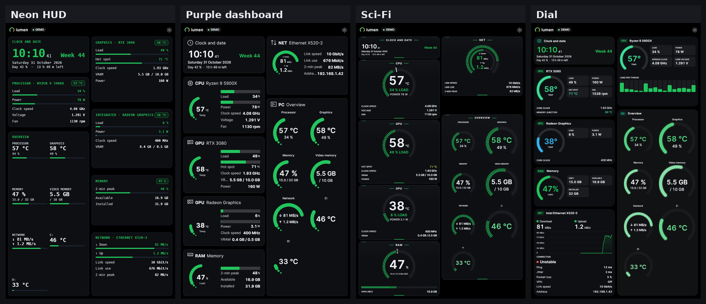
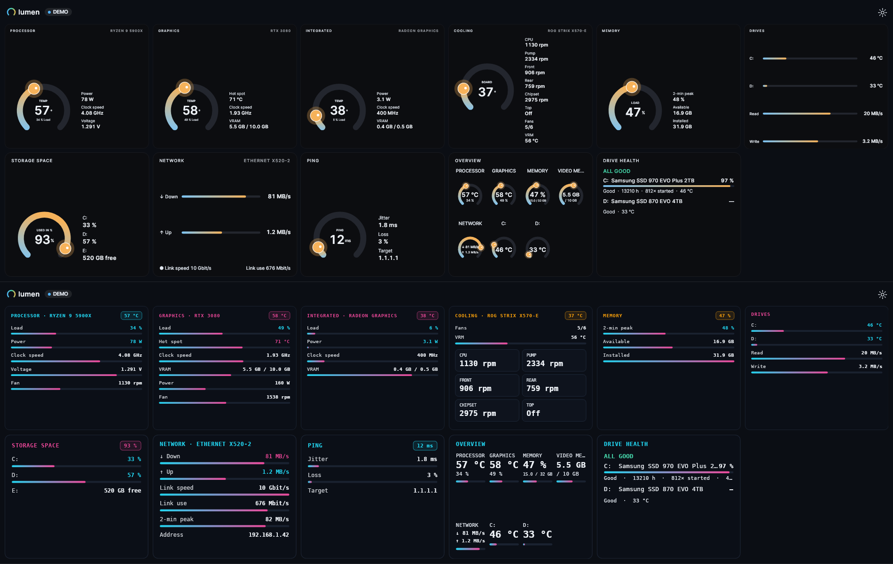

# Lumen 4.0.0 – Every Widget, Every Design

A major release: a new design collection, every widget drawn in the look of the design you pick, design per register, independent size controls, a horizontal bar that stays full size, and a long list of fixes for jumping layouts, missing translations and uneven columns.

## Highlights

- **36 designs** – 26 of them new in 4.0.0, including Sci-Fi, Thermostat, Neon HUD, Neon tiles, Smart Panel, Purple dashboard, Evolution, Dial, Double ring, the Clarity family and six "graph" variants. The ten favourites from 3.0.x stay (Standard, Segments, Table, Capsule, Fill bars, Split, Capsule row, Key figures, List, Twin Focus).
- **Every widget follows every design** – clock, calendar, weather, now playing, top apps, data usage, uptime, overview and drive health now use the frame, fonts and colours of the chosen design.
- **Design per register** – give the HW register one design and the INFO register another with one click.
- **Size controls** – widget size, graphic size, main value size, list value size and label size, per widget or for all widgets at once.
- **Nothing jumps** – columns end flush at the bottom and widgets keep their place when values change.
- **Ready on first start** – English by default, two registers (HW and INFO) with a sensible set of widgets.

## New designs

| Design | What it looks like |
| --- | --- |
| **Duplex**, **Signal rows**, **Open panel** | Two main values side by side with their curves, every further value as a row |
| **Clarity**, **Clarity colour**, **Clarity rows**, **Clarity tiles**, **Control deck** | Compact registers with every reading aligned, grouped by device, with a small history |
| **Evolution** | Accent colour per widget, the main value big, thin bars for the rest, warning colour when hot |
| **Dial** | A gauge with tiles for the other values, one page per drive |
| **History graph** | The value on top of its own history curve |
| **Double ring** | Two rings (temperature and load), the other values beside them |
| **Level columns** | Upright level columns per value |
| **Neon HUD** | Monospaced HUD with neon gradient bars |
| **Neon tiles** | Readings in neon-framed tiles |
| **Thermostat** | A thermostat knob with the values beside it |
| **Smart Panel** | Big number top right, coloured markers for each reading |
| **Purple dashboard** / **Purple list** | Black card, purple-to-pink sweep ring or bars |
| **Sci-Fi** | Chamfered frame, tick ring with peak mark, digital numbers |
| **Segment graph**, **Table graph**, **Fill bars graph**, **Capsule row graph**, **List graph**, **Neon HUD graph** | The base design with every further value as its own bar line |

**[Browse all 36 designs in dark and light](https://github.com/nemesis122/Lumen-HWMonitoring-Sidebar/blob/v4.0.0/docs/style-gallery.md)**

## Every widget in every design

Info widgets used to fall back to a generic layout in many designs, showed meaningless bars (a "progress bar" for the time of day) or raw values such as `partly-cloudy`. Now:

- **Clock, world clocks, calendar** – time or day as the big number, week and date as text, no bars.
- **Weather** – temperature big (inside the design's ring for ring designs), condition in words, feels like, wind, humidity and a three-day forecast.
- **Now playing** – title and artist, application and progress.
- **Top apps** – always the list of apps, each with its CPU bar in the design's style, CPU and RAM per app.
- **Data usage** – today big, upload beside it, this week and this month below.
- **Uptime** – uptime big, Windows version, start time, processes and threads.
- **Drive health** – every drive with life left in the design's bar, verdict, hours, starts and temperature.
- **Overview** – the whole PC as mini widgets in the design's look (rings, bars or curves).

## Drives and network everywhere

- **Every drive is shown** in every design, line by line – no more "hottest drive only".
- **Download and upload** are shown the same way in every design: equal size, side by side or one above the other.
- Thermostat and Double ring show read/write and download/upload as bar lines in the same style as the drives.

## Settings

- **Style per register** – Settings → Widgets → *Style for all widgets* → choose *All registers* or one register, then click a design.
- **Sizes for all widgets** – Settings → Appearance: widget size, graphic size, main value size, value size and label size at once; each widget can still be changed under *Customise*.
- **Readable design names** in English (Capsule, Fill bars, Key figures, Signal rows …).

## Colours and background

Designs with their own colours (Dial, Neon HUD, Neon tiles, Thermostat, Smart Panel, Purple, Sci-Fi, overview and info widgets) now follow the background and colour scheme you pick. With the default background and *By state* they keep their own look.

## Horizontal bar

- Tiles are aligned at the top of each row.
- The overview's rings sit side by side in the bar; previously a wide overview made every ring as tall as the card was wide and shrank the whole row.

## Fixed

**Layout and jumping**
- Columns end flush at the bottom in every design, in one and two columns, with 2-column "even" mode.
- Widgets no longer move when values change: tested with rates from bytes to megabytes, fans starting and stopping, hot and cool readings – nothing moves more than 3 px.
- Evolution: a hot (red) card no longer grows by 2 px and pushes everything below it down; the warning edge is drawn inside.
- Evolution: the warning edge no longer changes the content width (values dropped from three columns to two).
- Double ring: "2-min peak" no longer disappears when the download reaches its peak (the card got shorter).
- History graph: no more flip-flopping chart heights.
- Values such as "1392 rpm" no longer wrap onto a second line and back.
- Thermostat: values beside the dial always stand under their names – no more switching between one and two lines while resizing; the graphic size slider now works.
- Dial: the gauge stays at the top when nothing is below it.
- Capsule: fixed spacing between drive lines.

**Text and translation**
- No word is broken in the middle any more ("Leistun g", "Frametim e", "Cyberpunk2 077"); when name and value do not fit, the value moves under the name.
- All readings in the Clarity, Duplex, Signal rows and Open panel designs are translated (Link speed, Internal IP, Temperature, Read, Model, Free, Used / total …).
- Weather conditions in words in every language ("Partly cloudy" instead of `partly-cloudy`).
- English widgets say "Temp" instead of "Temperature".
- Purple dashboard no longer shows "FPS FPS"; Neon tiles no longer repeat the title.
- Dial: short names DISK, DATA and SYS instead of cut-off words.

**Values shown once**
- Every value is shown exactly once per widget (the ping jitter was shown twice, memory "39 %" twice in Sci-Fi).
- Hidden sensors stay hidden in every design.

**Sci-Fi**
- Larger text, every line in the ring is labelled ("POWER 78 W"), the 2-minute peak is a mark on the ring, the big number turns amber or red when hot or nearly full, network on two rings (download outside, upload inside), no dividing line.

## Breaking changes

- **Retired designs:** 34 designs from 3.0.x are no longer offered: Ring, Minimal, Bar, Graph, Tile, Compact, Status, Dual ring, Timeline, Heatmap, Rings, Big number, Dot matrix, Bento, Ticker, Mini arc, Chips, Scale, History bars, Backdrop, Pill duo, Pill duo plus, Signal band, Rail, Signal Pro, Rail Pro, Orbit Pro, Prism, Spectrum, Liquid, Contour, Split Edge, Ribbon and Core Grid. Their look lives on in the new collection. Widgets that used one of them start with *Standard*; pick a new design under Settings → Widgets. All other settings are kept.
- **Default language** on a first start is English; existing settings keep their language.

## Validation

- 1,527 automated tests, including new tests for: no bar on clock and calendar, all app names in Top apps, no English word in a German sidebar for every widget in every design, no word broken in the middle, drive health in every design, bar rows that stay full size, design per register, colours following background and scheme.
- 1,299 layout regression cases with about 20,000 assertions.
- Every widget in every design rendered and checked in dark and light, English and German, one and two columns, and in the horizontal bar.

## Downloads and updating

- **Lumen-4.0.0.exe** – the Windows executable (portable, no installation, no separate .NET needed).
- **Lumen-4.0.0-Portable.zip** – executable and licence notices.
- **Lumen-4.0.0-Source.zip** – full source for this release.
- **Lumen-4.0.0-Screenshots.zip** – all design screenshots.
- **SHA256SUMS.txt** – download checksums.

Close Lumen before replacing the executable. Keep your existing `lumen-settings.json`; a reset is not required.
