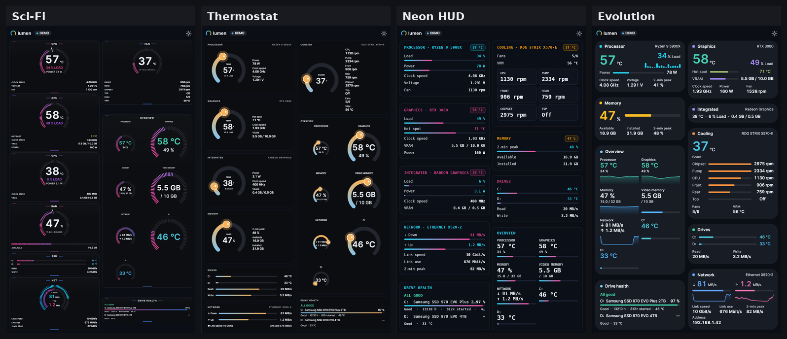

# Lumen 4.0.1 – Steady Values

A maintenance release for 4.0.0. After a second full check of every widget in every design, a few places still moved while values changed. They are fixed. Your settings are kept; no reset is needed.

## Fixed

- **Bars no longer grow and shrink with the number beside them.** When a value changed width – "0" ↔ "1130 rpm", "9.6 MB/s" ↔ "61 MB/s" – the bar next to it got longer and shorter. The value column now keeps the widest width it has shown (per widget, row and value size). Affected were, among others, Evolution (cooling), Segment graph, Table graph, List graph and the drive lines in every design. Changing the value size starts afresh.
- **Fans keep their place.** Evolution and Dial sorted fans by speed, so a fan that sped up swapped places with another. Fans now stay in the order the sensors report them.
- **Dial: a stopped fan no longer shrinks its tile.** The tile kept its curve only while the fan was running, so everything below moved up and down. The tile now keeps its height.
- **History graph and Level columns (network): "2-min peak" no longer disappears.** Whenever the download reached its 2-minute peak, the peak line was dropped as a "repeated value" for that moment and the values below jumped. Peak readings now always keep their line (the same fix as Double ring in 4.0.0).

## How it was checked

- Every design, every widget, with values swinging wildly (rates from bytes to megabytes, fans starting and stopping, hot and cool readings), in one and two columns.
- Movement measured not only for the cards but also **inside** them (bars and labels): nothing moves by more than 3 px any more, apart from units such as "ms" or "MB/s" that sit directly behind their number.
- 1,527 automated tests and 1,299 layout regression cases passed.

All features of 4.0.0 are included – see the [4.0.0 release notes](https://github.com/nemesis122/Lumen-HWMonitoring-Sidebar/blob/v4.0.1/docs/release-notes/v4.0.0.md) and the [design gallery](https://github.com/nemesis122/Lumen-HWMonitoring-Sidebar/blob/v4.0.1/docs/style-gallery.md).

## Downloads and updating

- **Lumen-4.0.1.exe** – the Windows executable (portable, no installation, no separate .NET needed).
- **Lumen-4.0.1-Portable.zip** – executable and licence notices.
- **Lumen-4.0.1-Source.zip** – full source for this release.
- **Lumen-4.0.1-Screenshots.zip** – all design screenshots.
- **SHA256SUMS.txt** – download checksums.

Close Lumen before replacing the executable. Keep your existing `lumen-settings.json`; a reset is not required.
