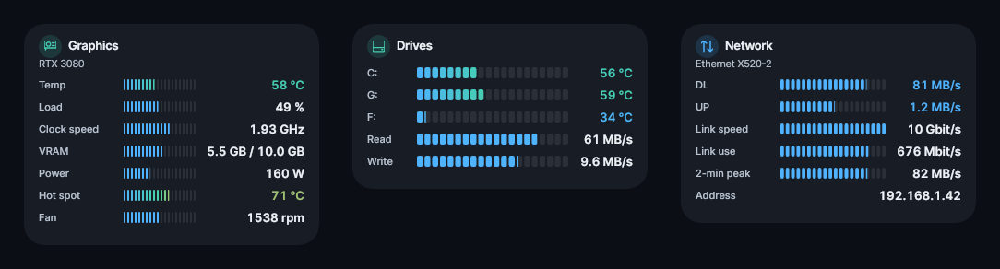

# Lumen 4.0.2 – No More Jumping

A maintenance release for 4.0.x. It fixes the Evolution design moving by a pixel every second, keeps widgets steady when a sensor briefly stops reporting, and lines up every bar inside a widget. Your settings are kept; no reset is needed.

## Fixed

**Evolution no longer jumps**
- **The network card's lower part no longer moves up and down every second.** The height of the curves was reset on every update and then rounded to whole pixels for your display scale, so the curve and everything below it moved by 1 px back and forth. Curves now keep the height they got once; only changing the graphic size changes them.
- **The download/upload numbers and the big number keep their width.** "9.6 MB/s" ↔ "61 MB/s" no longer pushes the lanes to the side; each number keeps the widest width it has shown, right-aligned.
- **A hot card keeps its size.** The red warning edge is drawn inside the card, so it never changes the content's width or height.
- **Fans keep their order** in Evolution and Dial instead of being re-sorted by speed.

**Sensors that drop out for a moment**
- Some sensors (power, clocks, a drive's temperature, a fan, a network adapter) report nothing for one or two readings now and then. Lines disappeared and came back, and the card shrank and grew with them.
- Lumen now holds the last value of a sensor for up to 15 readings when it briefly reports nothing, and keeps a line in place while it is empty for a moment. A sensor that is really gone disappears after that.

**Every bar of a widget lines up**
- All lines in a widget now share one name width and one value width, so every bar starts and ends at the same place – the main lines, the further lines and the drive lines alike.
- Applies to Segments, Segment graph, Table graph, Fill bars graph, Capsule row graph, List graph, Neon HUD graph, Thermostat and Double ring.
- The widths only grow, so lines never move back and forth while values change.

**Also**
- Dial: a tile whose fan stops keeps its height.
- "2-min peak" is never dropped as a repeated value, in any design.

## How it was checked

- Every design, every widget, with values swinging wildly and sensors dropping out at random, in one and two columns.
- Movement measured for the cards and inside them (bars, numbers, labels), including repeated back-and-forth movement: none left.
- A new test checks for every graph design and every hardware widget that all bars start and end within 1.5 px of each other.
- 1,573 automated tests and 1,299 layout regression cases passed.

All features of 4.0.0 are included – see the [4.0.0 release notes](https://github.com/nemesis122/Lumen-HWMonitoring-Sidebar/blob/v4.0.2/docs/release-notes/v4.0.0.md) and the [design gallery](https://github.com/nemesis122/Lumen-HWMonitoring-Sidebar/blob/v4.0.2/docs/style-gallery.md).

## Downloads and updating

- **Lumen-4.0.2.exe** – the Windows executable (portable, no installation, no separate .NET needed).
- **Lumen-4.0.2-Portable.zip** – executable and licence notices.
- **Lumen-4.0.2-Source.zip** – full source for this release.
- **Lumen-4.0.2-Screenshots.zip** – all design screenshots.
- **SHA256SUMS.txt** – download checksums.

Close Lumen before replacing the executable. Keep your existing `lumen-settings.json`; a reset is not required.
