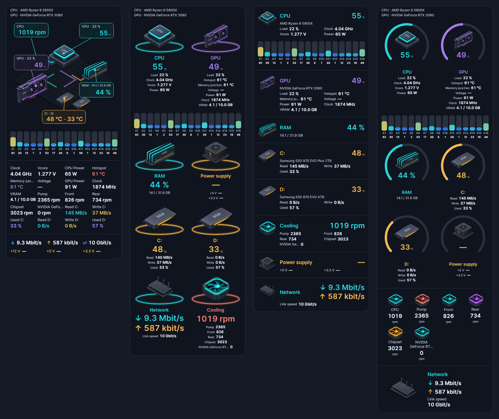
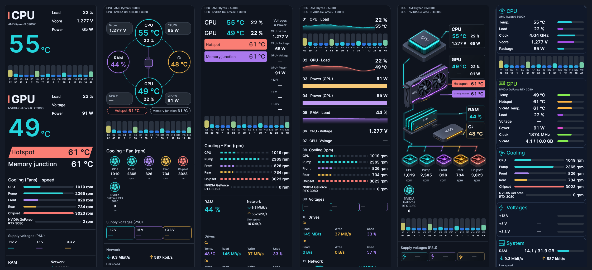
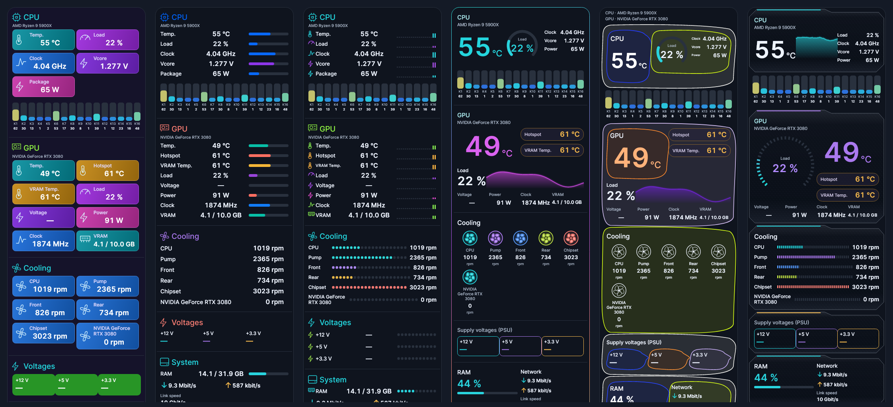
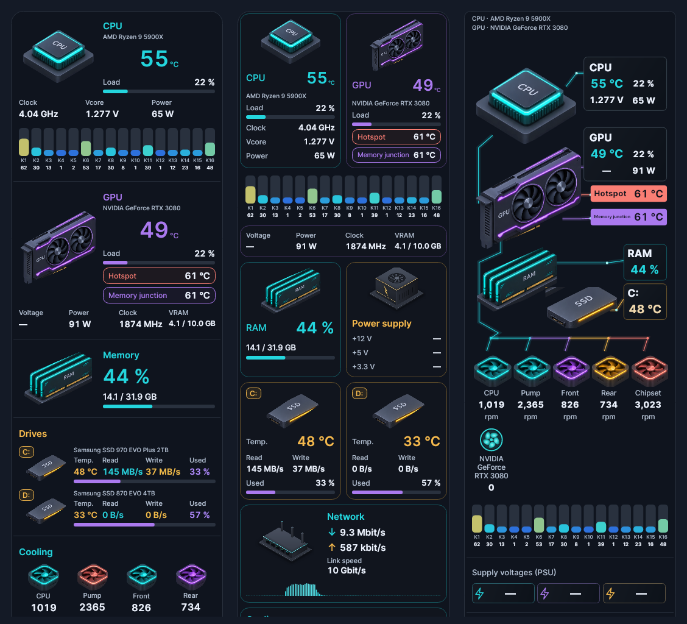
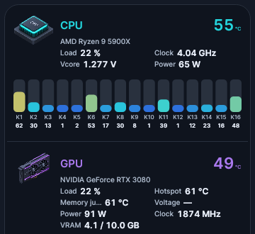

# Lumen 4.2.0 – All-in-One

This release adds **All-in-One (AIO) designs**: one card shows the complete PC (CPU, GPU, RAM, drives, cooling, power supply and network). There are **18 AIO designs**, six of them new isometric designs with 3D hardware illustrations. Three new widget designs are also included, bringing the total to **81 selectable designs**.

## All-in-One designs

- Choose an AIO design for the hardware widgets and Lumen combines them into **one card**. Clocks, calendar, weather and the other info widgets stay as they are.
- **Widget switches control the card:** switching off CPU, GPU, Cooling, Memory, Drives or Network in the widget list hides that part of the AIO card.
- **Every sensor is selectable:** under *Customise*, every AIO value can be switched on or off in every AIO design, including individual fans, GPU memory junction, drive read/write/used and the network link speed.
- **Fans:** every fan that exists is shown, including fans that are currently at 0 rpm; fan headers without a fan are hidden.
- **Drives:** read, write, used and temperature are shown for every drive, including C:, aligned in columns.
- All AIO designs are dark and follow the sidebar's **opacity and transparency** like the standard designs.
- **Stable layout:** values keep their place and size while they change, so the card does not jump; drive values sit in fixed columns and download/upload always have the same size.
- The cards have no design title, "Live" badge or settings button: the sidebar header already provides them. A name you give the card is still shown.

| | |
|---|---|
|  |  |

**Classic AIO designs:** Type Block, Orbit Network, Thermal Grid, Signal Rack, Isometric Core, Precision, Chromatic, Studio Light, Instrument, Aurora Fusion, Pop Console and Carbon Pulse.

**Isometric AIO designs (with 3D part illustrations):**

- **Isometric Atlas:** one row per part with its illustration and values.
- **Isometric Tiles:** parts in tiles side by side.
- **Isometric Rig:** all parts on an isometric board with value tags; every other value is shown in a labelled grid below.
- **Isometric Pedestals:** every part on a glowing pedestal with its main value.
- **Isometric Compact:** one slim row per part, suitable for narrow sidebars.
- **Isometric Rings:** every part inside its own ring gauge.

## CPU core load

All AIO designs show the **load of every CPU core** as a row of bars directly below the CPU. With many cores in a narrow sidebar, the bars wrap into evenly filled rows. The bars can be switched off under *Customise → AIO · CPU · Core load*.

## Three new widget designs

**Splitflap**, **Measure Tape** and **Hardware Map** are available for the individual widgets.

## Validation

- **5,336 tests passed**, with no failures or skipped tests. New tests switch every AIO sensor off and on in every AIO design, check the core load bars, and run every AIO design with strongly changing values (0 ↔ 3.3 GB/s, 9 ↔ 100 °C, readings that drop out) to make sure nothing moves.
- **2,919 extended layout/data cases passed**, comprising **20,058 assertions**.
- All AIO designs were rendered with demo data in English and German at 240, 260, 300 and 360 px width, with one and two GPUs, and visually checked. Simulated configurations do not replace physical testing on every device.

## Downloads

- `Lumen-4.2.0.exe`: self-contained Windows x64 application.
- `Lumen-4.2.0-Portable.zip`: application and licence files.
- `Lumen-4.2.0-Source.zip`: source code for this release.
- `Lumen-4.2.0-Screenshots.zip`: design previews, including the AIO designs.
- `SHA256SUMS.txt`: checksums for the release downloads.

Close an older running instance before starting the new EXE. No separate .NET installation is required. Saved settings are kept.
