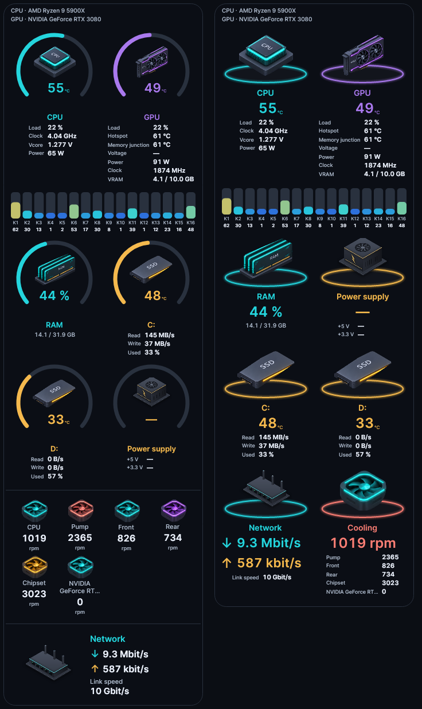
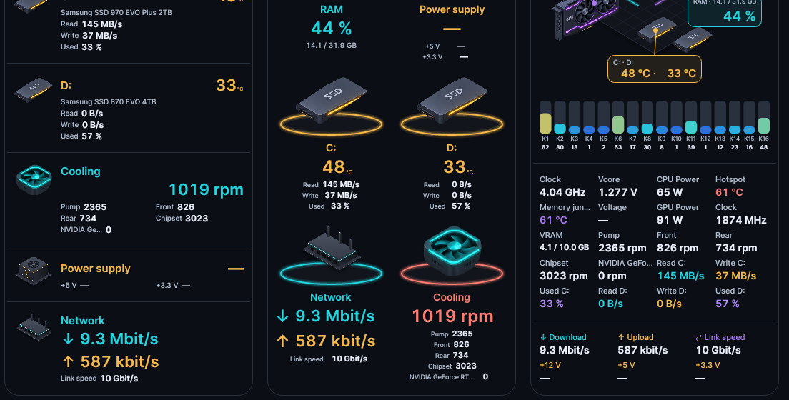

# Lumen 4.2.1 – All-in-One

A refinement release for the All-in-One (AIO) designs: values no longer move, labels and values are aligned, and every reading keeps a readable size.

## Values stay in place

- **Every measured value has a fixed room** the size of its widest form (for example "888 %", "8888 rpm", "88.8 Mbit/s"). When digits or units change ("5 %" → "21 %", "0 B/s" → "368 KB/s", "125 kbit/s" → "1.57 Gbit/s"), nothing beside or below the value moves, in all 18 AIO designs.
- Readings that have no value yet ("—") already keep the room for their later value.
- Values that sit right-aligned, such as the big temperature or fan speed, keep their unit in place.
- Where the widest form does not fit a narrow column, the value is scaled down once by a steady amount instead of growing and shrinking with every update.

## Network

- **Isometric Compact and Pedestals:** the ↓/↑ arrows have their own column and the rates are left-aligned beside them, as in Isometric Tiles and Rings. The arrows no longer shift when the rates change.
- **Isometric Compact:** network and cooling have their own full-width line below the name, so the rates and fan speed keep their full size.
- **Isometric Rig:** download, upload, link speed and the power-supply rails use the same grid as the values above them (name above, value below).
- Thermal Grid and Signal Rack: rates no longer wrap onto a second line.

## Aligned labels and values

- **Isometric Rings and Pedestals:** Load, Clock, Vcore, Power, Read, Write, Used and the rail voltages are left-aligned under each other, with their values aligned beside them.
- **Isometric Compact:** drive read, write and used values are shown one per line at full size.
- **Studio Light, Instrument and Precision:** labels such as "Write", "Voltage" or "VRAM Temp." get more room and keep their size; the meter narrows instead.
- Labels with several words, such as long fan names, wrap between the words instead of becoming tiny; Type Block no longer breaks "Hotspot" in the middle of the word.

## Validation

- **5,336 tests passed**, with no failures or skipped tests.
- A new test runs every AIO design with strongly changing values (0 ↔ 3.3 GB/s, 9 ↔ 100 °C, everyday network rates such as 1.4 Mbit/s ↔ 106 Mbit/s ↔ 125 kbit/s, readings that drop out) and checks that no value or label moves up, down or sideways and that no size changes, at 240, 260 and 320 px, in English and German.
- **2,919 extended layout/data cases passed**, comprising **20,058 assertions**.
- All 18 AIO designs were rendered with demo data and checked visually.

## Downloads

- `Lumen-4.2.1.exe`: self-contained Windows x64 application.
- `Lumen-4.2.1-Portable.zip`: application and licence files.
- `Lumen-4.2.1-Source.zip`: source code for this release.
- `Lumen-4.2.1-Screenshots.zip`: design previews.
- `SHA256SUMS.txt`: checksums for the release downloads.

Close an older running instance before starting the new EXE. No separate .NET installation is required. Saved settings are kept.
