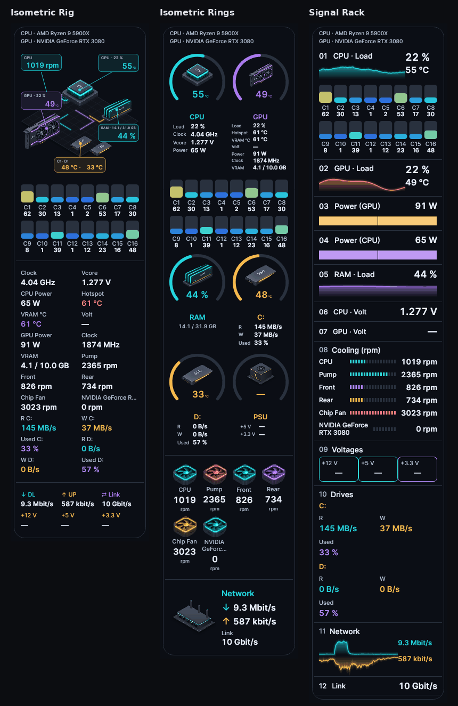
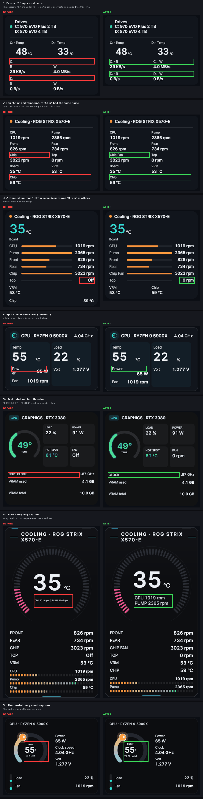

# Lumen 4.3.0 – All-in-One

A clean-up release: Lumen now uses English only and shorter labels, shows only the main graphics card by default, and fixes display issues in the widget designs.

## English only

- **The interface is now English only.** German, French, Italian, Spanish and Portuguese have been removed. Existing settings switch to English automatically.
- The CPU core bars in the AIO designs are labelled **C1, C2, …** instead of the German "K1, K2, …".

## Short labels

- Labels are shorter in every design: **CPU**, **GPU**, **RAM**, **DL / UP**, **Temp**, **Volt**, **Vcore**, **R / W** (read/write), **Fans**, **PSU**, **Link** and **VRAM °C**.
- **Hotspot**, **Clock** and **Power** keep their full names.
- Headings use the same short names, for example "Fans" instead of "Cooling (Fans) – speed".

## Main graphics card by default

- **Only the main graphics card is shown by default.** Additional graphics cards can be switched on individually under *Customise*.
- An integrated graphics chip without temperature, hotspot or voltage readings no longer adds empty rows.

## Fan count off by default

- The "Fans 2/2" line is **off by default** in every design that has it. Switch it on under *Customise → Running fans*.
- Existing settings are updated the same way.

## Drives in narrow AIO designs

- At narrow widths (below 300 px), the AIO drive table uses **two columns**: R · W, then Temp · Used. All values keep a readable size.
- **Isometric Rig:** the drive tag shows at most two drives instead of squeezing every drive into one small tag.

## Widget design fixes

- **Drives:** the extra "C:" line under "C: · Temp" is gone. Each rate names its own drive ("C: · R", "C: · W").
- **Cooling:** the chipset fan is now called "Chip Fan", so it no longer has the same name as the chipset temperature "Chip".
- **Stopped fans** show **"0 rpm"** in every design. Before, some designs showed "Off" or "Stopped".
- **Split Lens:** labels such as "Power" no longer break inside the word ("Pow-er").
- **Dial:** labels no longer run into their value, and small captions are larger.
- **Sci-Fi:** a long caption under the ring wraps onto two readable lines instead of becoming tiny.
- **Thermostat:** the captions inside the ring are larger.

## Steadier layout

- **Hardware Map network:** download and upload no longer switch once between stacked and side by side, which moved the widgets below.
- **Fit density:** both columns now end at the same height, within about 1 px.

## Validation

- **4,615 tests passed**, with no failures or skipped tests. New tests cover short names, the main-GPU default, integrated graphics without sensors and the fan count default.
- **2,919 extended layout/data cases passed**, comprising **20,058 assertions**.
- The changed designs were rendered with demo data and checked visually.

## Downloads

- `Lumen-4.3.0.exe`: self-contained Windows x64 application.
- `Lumen-4.3.0-Portable.zip`: application and licence files.
- `Lumen-4.3.0-Source.zip`: complete source code.
- `Lumen-4.3.0-Screenshots.zip`: all gallery and release images.
- `SHA256SUMS.txt`: checksums for all files.
