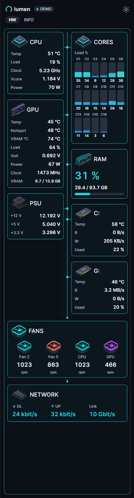
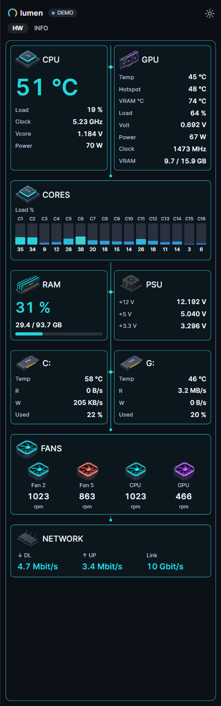
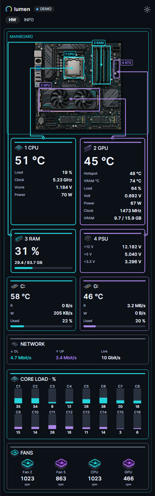
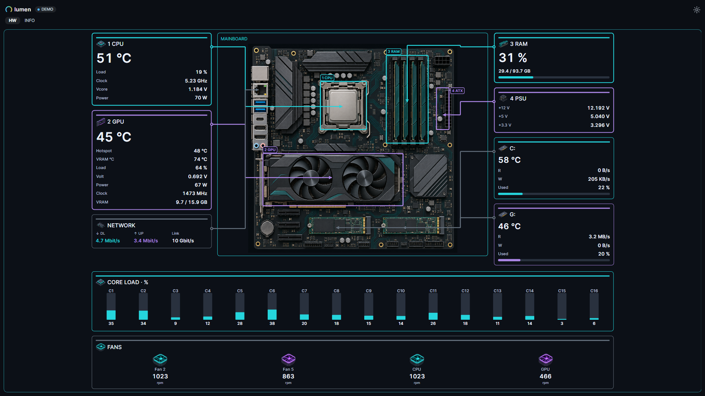
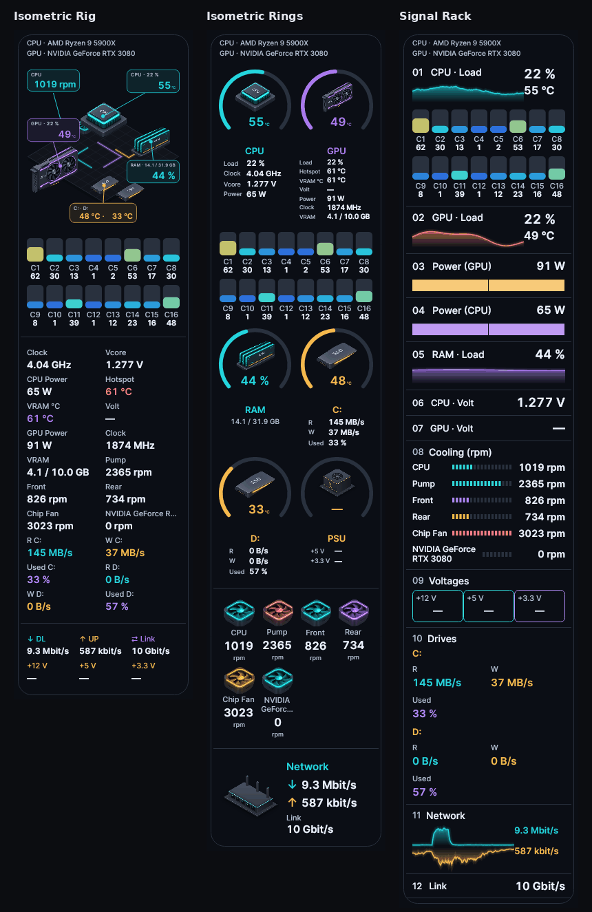

# Lumen 4.4.0 – Mainboard

Four Mainboard layouts, per-design main-widget choices and matching extra widgets for every available AIO design.

## Mainboard layouts

- **Mainboard**: linked hardware panels with live core-load columns.
- **Mainboard Cores**: CPU/GPU above a full-width core strip, followed by RAM/PSU, drives, fans and network. Core bars wrap at narrow widths or larger scaling.
- **Mainboard Map**: a board diagram above the hardware values, with matching component contours and connections. VRAM usage stays beside its label.
- **Mainboard Map Desktop**: a whole-monitor dashboard with values around the board. Artwork is capped at 600 logical pixels high and the dashboard at 1400 logical pixels wide, keeping readings legible.

The four designs are at the end of Settings → Widgets. The board illustration is generic, not a detected model. Screenshots use demo readings.

| Mainboard | Mainboard Cores | Mainboard Map |
| --- | --- | --- |
|  |  |  |

## Remember main widgets for each design

A newly selected ordinary design starts with **five HW widgets** (CPU, GPU, RAM, drives, network) and **four INFO widgets** (clock, world clocks, calendar, weather). A new AIO/Mainboard design adds cooling/mainboard and power: **seven HW plus four INFO widgets**.

Your own checks are stored for each design. Switching to a new design uses its defaults; returning to a customized design restores its own main-widget selection. The active selection survives restarts, and selecting the same design again preserves current edits. Register-specific design changes leave the other register alone.

This rule only covers these eleven main widgets. Extra widgets, individual sensor choices, widget order and register assignments are not reset.

## Matching AIO extras and clearer connections

Clock, world clocks, calendar, weather, media, battery, FPS, top apps, system, storage space, ping, data usage, notes, drive health and timer have matching AIO frames and retain their native readings and controls. They no longer silently use the Standard frame while the selector shows an AIO name.

Mainboard PCB traces are interrupted around full-width panels, including with glass enabled. Network values fit within their own download/upload/link columns.

## Design cleanup

Removed from both design selectors:

- Mainboard Typography, Data Matrix, Instruments and Strips.
- AIO Pop Console and AIO Chromatic.
- Aperture.

There are **82 selectable designs**, including **20 AIO designs**. Old design IDs remain readable. Profiles using removed designs fall back to Standard while retaining their other widget preferences.

## Validation

- 232 targeted xUnit cases passed locally using an in-process runner; the local VSTest child process could not connect in this environment.
- Native sidebar and SettingsWindow previews were inspected, including the 5+4 and 7+4 selections and desktop layouts at 1920×1080 and 2560×1440.
- The GitHub release workflow runs the complete test suite and extended layout/data regressions before publishing downloads.

## Downloads

- `Lumen-4.4.0.exe`: self-contained Windows x64 application.
- `Lumen-4.4.0-Portable.zip`: executable and licence files.
- `Lumen-4.4.0-Source.zip`: complete source code.
- `Lumen-4.4.0-Screenshots.zip`: gallery and release screenshots.
- `SHA256SUMS.txt`: download checksums.

Close an older Lumen instance before starting the new executable. Keep your existing settings to retain your current choices.
