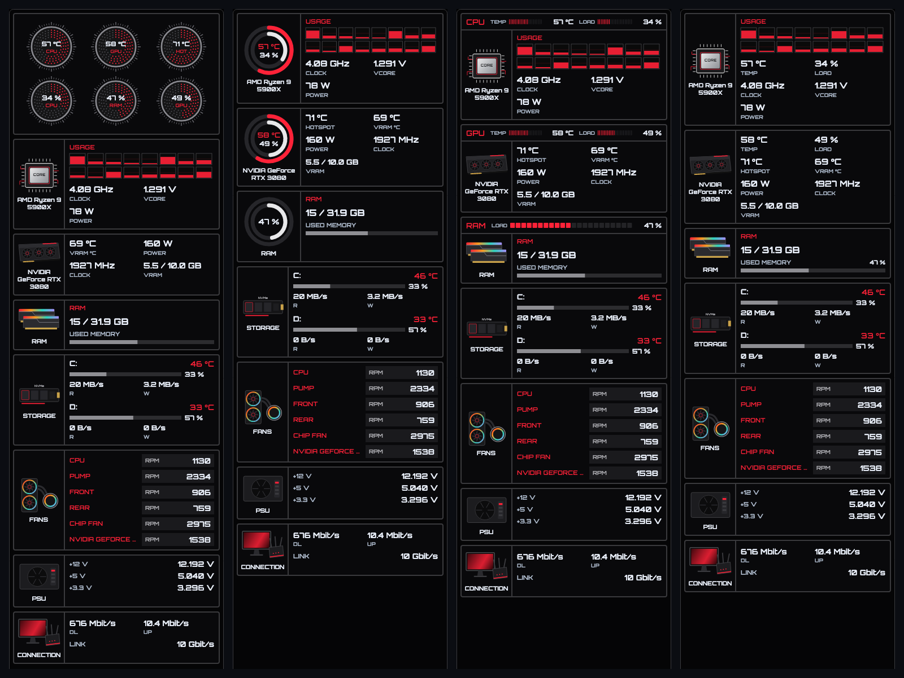
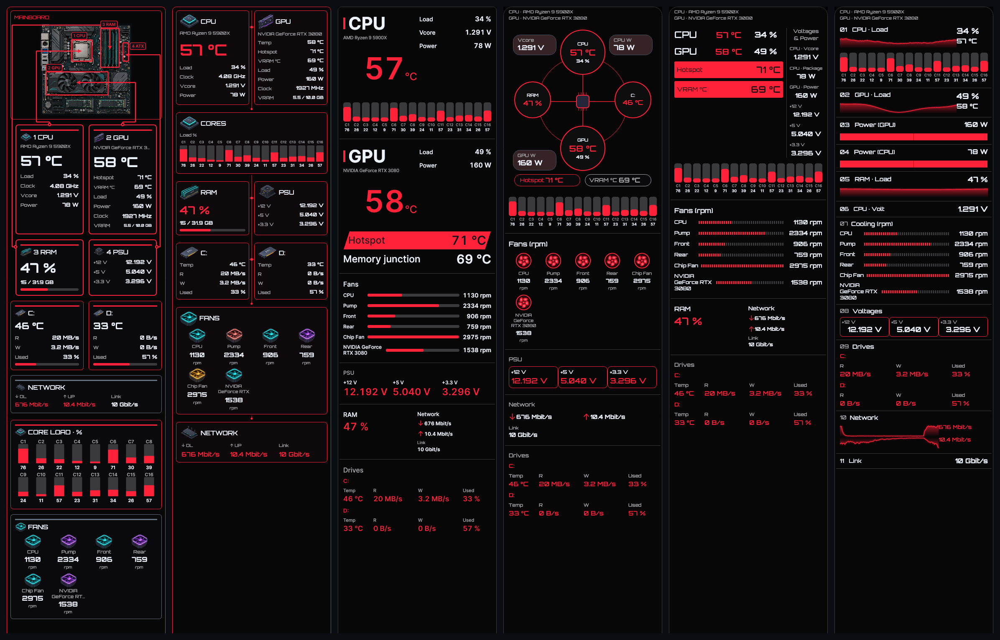
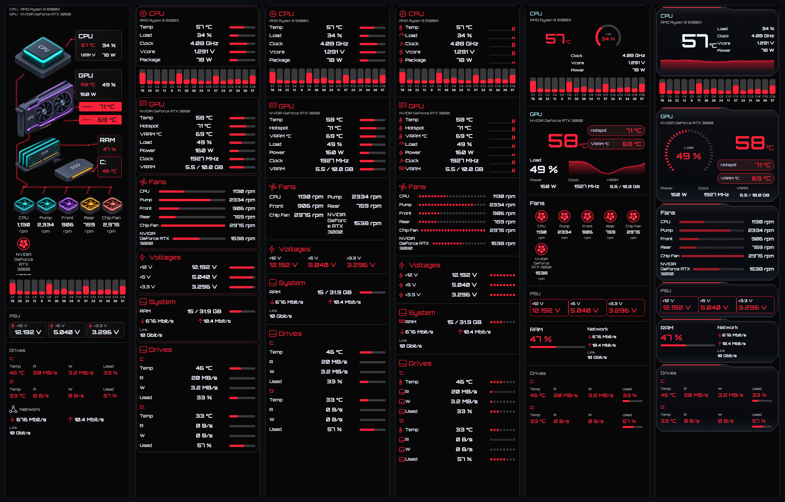
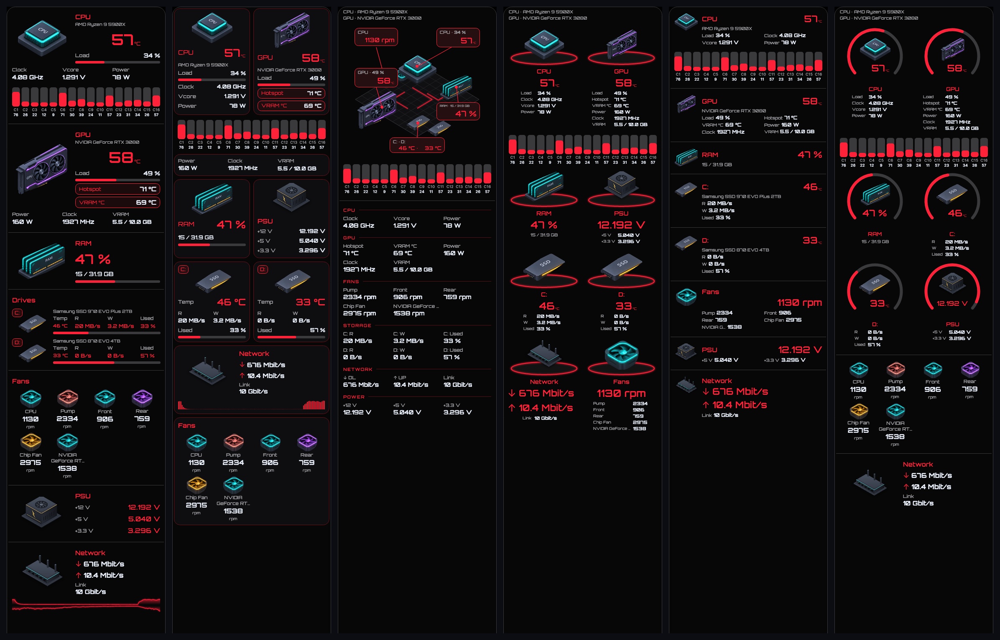
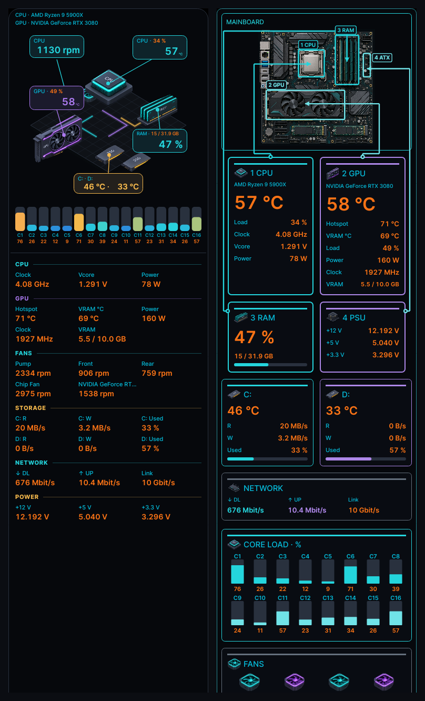
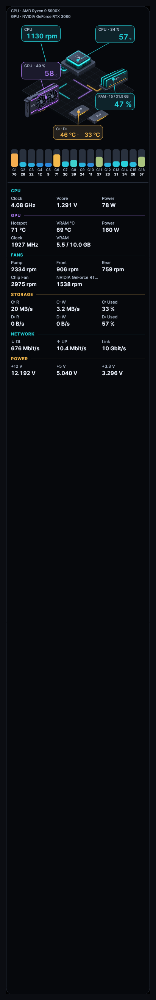

# Lumen 4.5.0 – Redline

Four Panel designs, a Red version of every AIO design, the Orbitron typeface and your own colours for values and labels in every design.

## Panel designs

Four new AIO designs show each part (CPU, GPU, RAM, storage, fans, PSU, network) as a panel with a picture on the left and the readings on the right:

- **Panel**: six dials across the top, then the parts.
- **Panel Rings**: a load ring beside each part.
- **Panel Header**: a temperature and load bar in each part's title.
- **Panel Plain**: temperature and load as plain values.

Panel designs use larger text and show only values by default. Graphs can be switched on in the widget's sensor list.

## Red designs

Every AIO design is also available as a **Red** version (18 designs, for example **Isometric Rings Red**, **Orbit Network Red**, **Signal Rack Red** and **Carbon Pulse Red**). They use dark grey cards, the Orbitron typeface and **one red throughout**. Rings, bars, frames, fan icons and wires all use the same red, never a darker red beside a light red or pink. The pictures (CPU, GPU, RAM, SSD, fans) keep their own colours.

The Red designs follow directly after the other AIO designs in Settings → Widgets.

All 18 Red designs (demo readings):

Mainboard Map Red, Mainboard Cores Red, Type Block Red, Orbit Network Red, Thermal Grid Red and Signal Rack Red:

Isometric Core Red, Precision Red, Studio Light Red, Instrument Red, Aurora Fusion Red and Carbon Pulse Red:

Isometric Atlas Red, Isometric Tiles Red, Isometric Rig Red, Isometric Pedestals Red, Isometric Compact Red and Isometric Rings Red:

## Your colours for values and labels

Settings → Appearance → Colours has two new rows:

- **Value colour**: numbers and amounts, such as 57 °C, 34 % and 15 / 31.9 GB, including the core values under the core bars.
- **Label colour**: names and captions, such as CPU, AMD Ryzen 9 5900X, Load, Clock and Temp.

Choose white, light grey, grey, black or any of the colour-scheme colours. Every text takes the chosen colour at full strength. Accent colours and warnings (hot readings in amber and red) stay as they are. The first swatch keeps the design's own text colours.

## Typeface and colours in every design

- **Orbitron** is a new built-in typeface (Settings → Appearance → Typeface).
- The chosen typeface and colour scheme now reach every design, including the AIO designs and their extra widgets.

## Other improvements

- **Integrated graphics** are shown completely in every design.
- **Isometric Rig** shows its further values in named groups: CPU, GPU, Fans, Storage, Network and Power, instead of one long list.
- **Sci-Fi**: a long title fits the card instead of running out of it.
- **Red tones**: rings, bars, frames, fan icons, core bars and wires in the Red designs no longer come out in a darker red, light red or pink; the GPU load ring in Carbon Pulse Red is no longer blue.
- **Panel designs**: high load is shown in the same red instead of a lighter pink.

## Design cleanup

Removed from the design selectors: **Pure widgets**, **Pure Widgets Right**, **Capsule row graph**, **Fill bars graph** and **Mainboard**. Mainboard Cores, Mainboard Map and Mainboard Map Desktop remain.

There are now **99 selectable designs**, including **41 AIO designs**. Profiles using a removed design fall back to Standard and keep their other widget settings.

## Validation

- **5,999 tests passed**, with no failures or skipped tests. New tests cover the value and label colours in every AIO design.
- **3,567 extended layout/data cases passed**, comprising **21,679 assertions**.
- All 99 designs were rendered with demo data and checked for the chosen typeface, colour scheme, value and label colours and text scaling. The Red designs were checked pixel by pixel for a second red tone.

## Downloads

- `Lumen-4.5.0.exe`: self-contained Windows x64 application.
- `Lumen-4.5.0-Portable.zip`: application and licence files.
- `Lumen-4.5.0-Source.zip`: complete source code.
- `Lumen-4.5.0-Screenshots.zip`: all gallery and release images.
- `SHA256SUMS.txt`: checksums for all files.

Close an older Lumen instance before starting the new executable. Your settings are kept.
