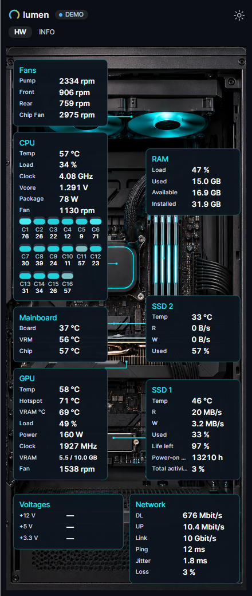
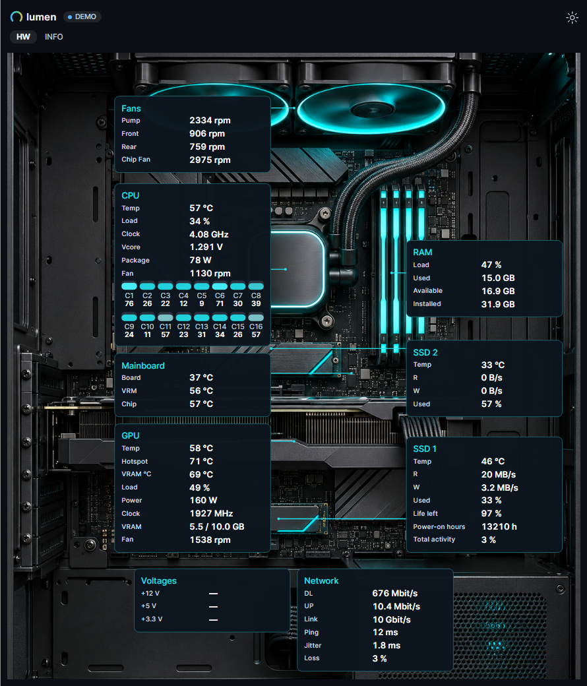

# Lumen 4.5.1 – Fonts, colours and flexible layouts

Stable Windows release with **104 selectable designs**, including **46 All-in-One designs**, 22 additional bundled font families, separate fonts for each text group, a new full-case hardware view and clearer GPU sensor settings.

## Layout: up to six columns and six registers

- **One to six columns** can be selected in Placement. The sidebar is not limited to one or two columns.
- Set the **column width from 240 to 440 logical pixels**. Text scaling and automatic fitting also affect the displayed dimensions.
- Use **one to six registers**, give them your own names and assign widgets to the desired register and column. For example, keep hardware on **HW** and clocks, weather and other information on **INFO**.
- **Automatic density** fits selected widgets to the available work area above the taskbar without scrolling. **Comfortable** and **Compact** retain their scrolling behaviour.
- The retained dashboard designs distribute their sensor panels across the configured columns and use extra vertical space inside the layout.
- **Whole screen** uses the available monitor area; the columns share its width.
- Selecting a dashboard preserves the existing width, columns, registers, register names, density and full-screen choice.
- The existing placement controls remain available: screen and edge selection, horizontal bars, always on top, reserved desktop space, click-through, floating cards and hiding the sidebar in full-screen applications.

## Fonts: assign titles, labels, values and graphs separately

Settings → Appearance → Text now offers a **base typeface** and independent choices for:

- **Titles** – widget and section headings.
- **Labels** – sensor names and captions.
- **Values** – temperatures, percentages, clock rates, voltages, speeds and other readings.
- **Graphs and scales** – graph labels and scales.

Choose **Base typeface** for any group that should follow the global font. Font choices are global for each text group, so there is no need to edit every widget individually. Text size and the existing per-widget title/value/label/graphic sizing controls remain available.

### 22 additional bundled font families

| Style | Fonts |
| --- | --- |
| Clear and readable | Roboto, Open Sans, Lato, Noto Sans, Source Sans 3 |
| Technical | Rajdhani, Exo 2, Oxanium, Chakra Petch |
| Monospaced numbers | Roboto Mono, JetBrains Mono, IBM Plex Mono, Share Tech Mono |
| Strong headings | Bebas Neue, Anton, Oswald, Barlow Condensed, Black Ops One |
| Graffiti and marker | Rubik Spray Paint, Rubik Wet Paint, Permanent Marker, Rock Salt |

Together with Inter, Segoe UI, Segoe UI Variable, Bahnschrift, Bahnschrift Narrow, Mono and Orbitron, the picker offers **29 font options**. The additional families are bundled; installing them in Windows is not required. Windows-provided fonts use the existing fallback families when unavailable. Included font licences are in the portable ZIP and source archive.

The selected entry and dropdown previews stay readable on dark and light backgrounds. Changing the base font no longer makes the selected text disappear into a dark field.

## Colours and appearance

- Assign your own **Value colour** and **Label colour** globally.
- Use the existing colour presets, Windows accent, monochrome mode or a custom colour value.
- Set **individual widget accents** and use the theme options of designs that support them.
- Dark and light themes, text sizing, background selection and the existing appearance controls remain available.
- Design-specific status and accent colours continue to work; the neutral value/label texts follow their assigned colours.
- The new Cyan Glas cards use almost opaque dark surfaces, restrained accents and compact label/value pairs for better readability over the hardware picture.

## New retained designs

| Design | What it shows |
| --- | --- |
| **Cyan Glas** | Full-case background with native live sensor cards and component connections. The refined one- and two-column views use compact dark cards; two columns have a separate case image. |
| **Mainboard Card** | Mainboard illustration, CPU/GPU/RAM component labels and live hardware panels. |
| **Double Table** | Paired hardware groups with aligned sensor readings. |
| **Quadrants** | Grouped hardware panels arranged into a structured overview. |
| **Network Center** | Network history and readings alongside the rest of the selected hardware data. |

In Cyan Glas, sensor values are real UI controls over the picture, not numbers embedded in an image. Connections are recalculated after arranging the layout. Network and voltage summaries form a bottom dock without misleading component arrows. Selected readings remain available; default model names can be read from the card-title tooltip, while custom names and the names needed to distinguish multiple GPUs remain visible. Separate drive cards have distinct labels and M.2 connection locations.

The case and board pictures contain no GeForce RTX branding or illustration footer. Design names have no concept-number prefixes. Pictures represent the hardware layout; sensor availability and the reported model names come from the selected sensor source. The refined case composition is intended for one or two columns; the sidebar's wider layout settings remain available.

The thirteen discarded preview designs are excluded from the final picker: Technik Amber, Minimal Weiß, Grün Terminal, Blaue Module, Rot Performance, Violett Orbit, Industrie Stahl, Kompakt Sensoren, Große Werte, Sensor Table, Two Halves, Summary + Details and Case Plan. Settings from these previews, including the earlier Min–Max preview, migrate to Cyan Glas without resetting sensor choices, fonts or placement. Existing persisted design IDs are not renumbered.

## Sensor selection and multiple devices

- Keep the hardware groups and individual sensors you want; the designs reuse the existing sensor switches.
- GPU options in Settings identify **each detected GPU by number and model name**, including additional and integrated GPUs. They work with the reported NVIDIA, AMD and Intel device names rather than a fixed card name.
- Additional GPUs and drives have separate cards and stable sensor identities. Equal model names do not merge devices or sensor selections.
- CPU fan readings join the CPU card, GPU fans join the corresponding GPU card, and mainboard temperatures have their own group.
- Available readings include CPU/GPU temperatures, load, frequencies, voltages, power, VRAM, core loads, RAM usage and capacity, cooling, mainboard sensors, drive temperatures and transfer rates, network rates and link speed.
- The detailed dashboards additionally expose RAM used/free/total, reported mainboard temperatures, reported drive health/activity/operating hours and available ping/jitter/loss readings.
- Missing sensor data is not invented. Which readings are present depends on the hardware and selected provider. A stopped fan can still display **0 rpm**.

## Fixes and update compatibility

- Fixed the selected-font contrast on dark dropdowns.
- Preserved separate title/label/value/graph fonts across live updates.
- Improved dashboard use of multiple columns and available height up to the taskbar.
- Fixed wrapping RAM summary values that could change row heights in narrow Thermal Grid views.
- Preserved width, density and register settings when selecting dashboard designs.
- Retained per-device GPU names and stable sensor keys in Settings.
- Kept existing settings and profile compatibility while removing the unwanted preview designs.

## Program screenshots

These are captures of the implemented controls with demo telemetry.

| Cyan Glas: one column | Cyan Glas: two columns |
| --- | --- |
|  |  |

## Validation

All **6,973 repository tests pass**, including layout checks through six columns, font/colour assignment, live sensor updates, device identity, profile migration and design selection. The extended layout/data regression tool also passes: **3,747 cases, zero failures, and 22,139 diagnostic assertions**. The release workflow runs both checks before publishing.

## Download and update

Download **Lumen-4.5.1.exe** or **Lumen-4.5.1-Portable.zip** for Windows x64. No additional .NET installation is required.

1. Close Lumen.
2. Replace the old executable with the new one; keep **lumen-settings.json**.
3. If using a different folder, copy the existing settings file to it.
4. Start Lumen and select the desired design in Settings → Widgets.

The release also provides the source archive, screenshots and **SHA256SUMS.txt**. These packages contain the same stable version, **4.5.1**; this is not a beta or prerelease.

### Kurzüberblick auf Deutsch

**Bis zu sechs Spalten und sechs benennbare Register**, 240–440 px Spaltenbreite, automatische Höhenanpassung bis zur Taskleiste oder Scrollen über die Dichtewahl. **29 Schriftoptionen**, davon 22 zusätzlich mitgelieferte Familien; Titel, Labels, Werte und Graphen lassen sich unabhängig zuweisen. Dazu eigene Wert- und Label-Farben, Widget-Akzente, individuelle Sensor-Auswahl und eindeutige Bezeichnungen für mehrere GPUs und Laufwerke. Cyan Glas sowie Mainboard Card, Double Table, Quadrants und Network Center ergänzen die Auswahl. Beim Update bleibt **lumen-settings.json** erhalten.
