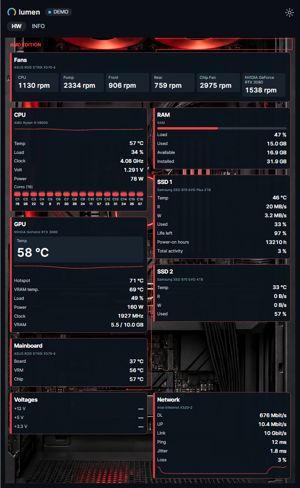
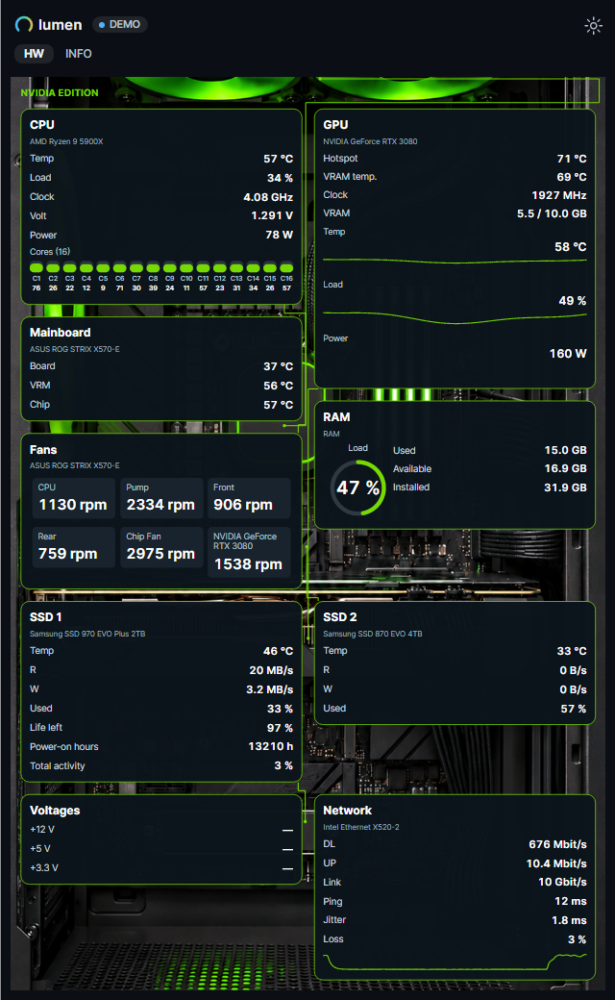
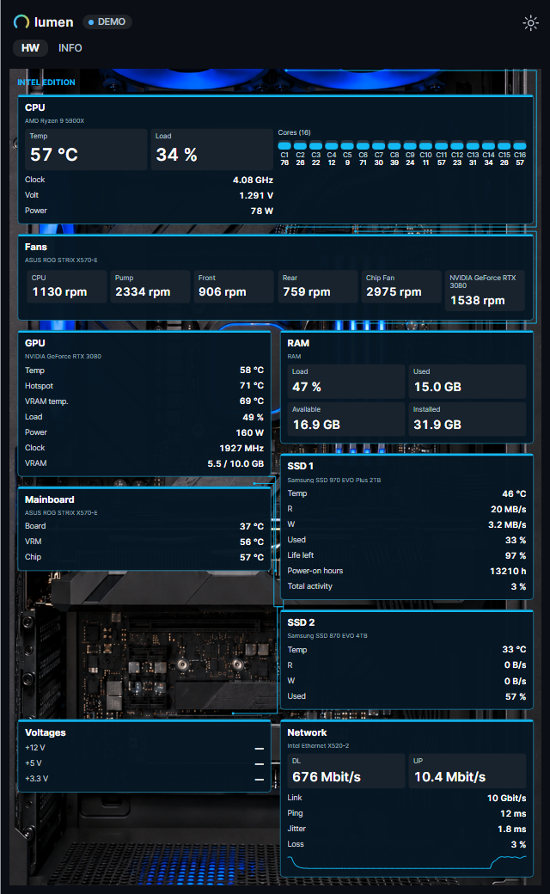
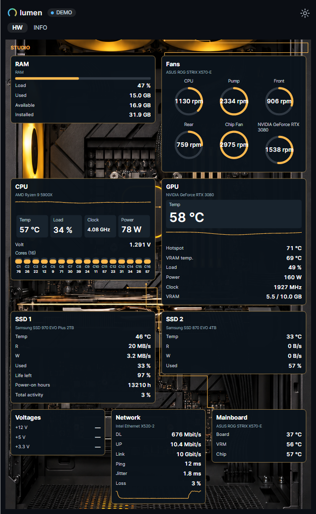
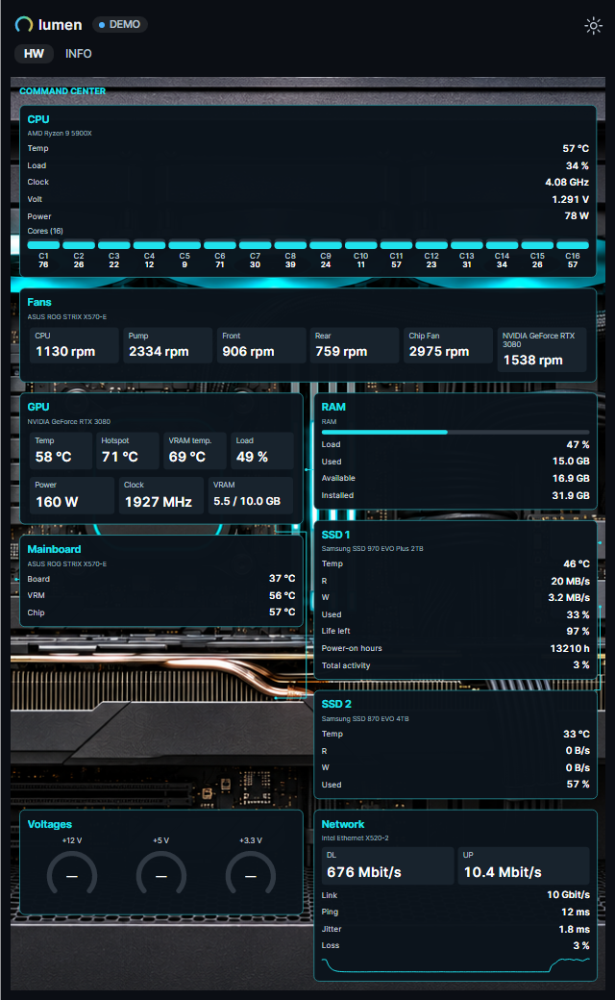
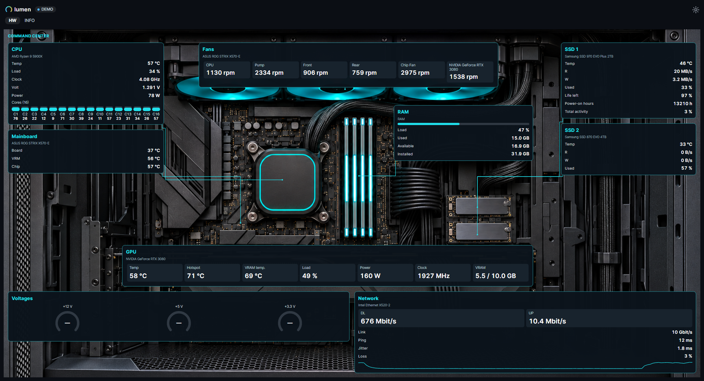

# Lumen 4.5.2 – Case editions, sensor colours and wider layouts

Stable Windows release with **109 selectable designs**, including **51 All-in-One
designs**. This update adds five live case editions, extends column width to
**640 logical pixels**, and introduces independent widget and sensor colour
overrides across the existing designs.

## Five new case editions with different native widgets

| Design | Layout and widgets |
| --- | --- |
| **Case · AMD Edition** | Red accent rails, CPU readings and core bars, CPU/GPU histories and a large GPU temperature. |
| **Case · NVIDIA Edition** | Green rounded cards, a RAM ring, GPU readings and separate temperature/load/power history panels. |
| **Case · Intel Edition** | Blue header accents, large CPU temperature/load tiles beside the core bars, RAM value tiles and separate GPU/drive cards. |
| **Case · Studio** | Amber accents, fan rings, CPU history and summary tiles, large GPU temperature and grouped drive/footer panels. |
| **Case · Command Center** | Cyan case view, a wide GPU metric strip, voltage instruments and network summaries. A dedicated wide arrangement is used with sufficient space in whole-screen/multiple-column mode. |

All five use clean case backgrounds with **native, live sensor cards, text and
graphs**. Measurements are not baked into the pictures. The layouts have different
widget arrangements and presentations, rather than only different accent colours.

- Select them in **Settings → Widgets**.
- Enable **Placement → Whole screen** for the wide Command Center; it also adapts
  to a normal sidebar. Selecting an edition does not enable whole-screen mode or
  change the number of columns automatically.
- Edition names describe the appearance. They do **not** require an AMD, NVIDIA
  or Intel system: detected hardware names and sensor identities remain in use.
- Additional selected GPUs and drives retain their own cards and readings.
- Component connections are routed around cards. A line is omitted when its
  matching component is covered or outside the visible picture, rather than
  pointing at an unrelated component. Network and voltage summaries do not get
  misleading component arrows.
- Existing title/model-name switches, custom names, sensor selection, typefaces,
  colour overrides and sizing controls remain available.

## Wider layouts: 240–640 px, one to six columns

- **Placement → Width** now accepts **240–640 logical pixels per column** in
  10 px steps. The previous maximum was 440 px.
- The same extended range applies to **Widget width** in horizontal placement.
- **One to six columns** and **one to six named registers** remain configurable.
  Assign widgets to the desired register and column, for example HW and INFO.
- The actual sidebar window is limited to the monitor's available working width,
  so several wide columns do not push the window outside the work area.
- **Automatic density** fits the available height above the taskbar.
  **Comfortable** and **Compact** keep the existing scrolling behaviour.
- Whole-screen mode uses the available monitor area. Existing monitor, edge,
  reserved-space, floating, click-through, always-on-top and hide-in-full-screen
  controls remain available.
- Existing widths and placement choices are preserved. Change Width to 640
  explicitly if you want the new maximum.

## Colours: global defaults, individual widgets and individual sensors

Use **Appearance → Colours** for global defaults, **Widgets → Customise → Colours**
for one widget, or the small colour button beside a selected sensor for that reading.

- Assign **title, label, value and graph/bar colours** independently at widget level.
- Assign a sensor's **value, label and graph colours**, where that sensor has the
  corresponding presentation. Two separately bound graph series, such as network
  download/upload, can use different colours.
- Choose a palette swatch or enter a HEX value.
- Overrides inherit in the order **sensor → widget → global → design**. Each role
  inherits independently; changing a temperature value does not recolour its label.
- **Use global colours**, **Like global**, **Like widget**, **Restore global colours**
  and **Reset sensor colours** make inheritance and resets explicit.
- In All-in-One views, CPU, GPU, RAM and other sections use the corresponding
  hardware widget's colour settings, with Overview supplying shared defaults.
- Automatic temperature warning colours can be enabled, disabled or inherited
  globally, per widget or per sensor. Disable them if a chosen colour should stay
  in use when the temperature rises.
- Profiles and exported themes retain the overrides. Older theme files without
  these fields preserve existing colour choices when imported.

Global value/label defaults retain the earlier behaviour of recolouring neutral
text while preserving design accents. Widget and sensor overrides can also
recolour accented text. Background artwork keeps the edition's physical lighting.

## Colour assignment and layout fixes

- Fixed Panel and Black bars, core cells and gauges that previously retained
  theme colours or fixed grey fills instead of their assigned override.
- Preserved sensor bindings on native graphs, additional sensor rows and
  individual volume bars, so sensor-specific colours reach the correct element.
- Repeated readings, including RAM amount/load in AIO views, share the same
  sensor override. Removing it restores the inherited widget/design appearance.
- History/bar option colour buttons set graph colours; a reading-specific
  override takes precedence.
- Notes retain the assigned value colour while editing.
- Improved automatic height fitting at wide widths and after responsive reflow;
  columns finish at the available work-area bottom, including small rounding
  differences.
- Fixed repeated layout calculations with narrow case widgets and extreme sizes.
- Stabilised changing memory values so they do not shift neighbouring content.
- Kept enlarged case rings inside their cards at narrow widths.
- Mainboard readings retain distinct sensor labels. Custom hardware names and
  visibility switches are respected in the new editions.

## Fonts and existing customisation remain available

The **29 font options** from 4.5.1 remain included, with clear, technical,
monospaced, bold and graffiti/marker styles. Choose a base typeface and independent
global fonts for **Titles**, **Labels**, **Values**, and **Graphs and scales** in
**Appearance → Text**. A group can follow the base typeface.

The 22 additional bundled families from 4.5.1 remain bundled; they do not need to
be installed separately in Windows. Existing text-size and per-widget title,
value, label and graphic-size controls continue to work with the new layouts.
This release does not claim additional font families beyond 4.5.1.

## Sensor selection and compatibility

- Keep the hardware groups and readings you want. Colour buttons do not toggle
  sensor selection.
- GPU choices use each detected device's number/model and stable identity,
  including additional and integrated graphics. Equal model names do not merge
  devices.
- Available data includes CPU/GPU temperatures, load, frequencies, voltages,
  power, VRAM, CPU cores, RAM capacity, cooling/mainboard, drive temperatures,
  read/write rates, reported drive health/activity/operating hours, network rates,
  link speed and available ping/jitter/loss readings.
- Sensor availability depends on hardware and provider. Missing measurements
  remain unavailable; a stopped fan can still show **0 rpm**.
- Existing profiles, fonts, register names, placement and sensor choices remain
  compatible. Previously removed preview designs stay removed and retain their
  existing migration behaviour. Persisted design IDs are not renumbered.

## Application screenshots

These captures show the implemented application with **demo telemetry**.

| AMD Edition | NVIDIA Edition | Intel Edition |
| --- | --- | --- |
|  |  |  |

| Studio | Command Center as a sidebar |
| --- | --- |
|  |  |

## Validation

Before release, **7,690 repository tests passed** in the complete local run,
followed by **17 passing targeted scroll/GPU tests** that include 15 additional
cases: **7,705 distinct passing repository test cases** in total. The extended
regression tool passed **3,927 cases and 22,599 diagnostic assertions**, with
zero failures. The release workflow reruns the complete repository suite and
extended regressions before building and publishing the Windows packages.

Checks cover the selectable designs, colour inheritance/reset, fonts, live
updates, multiple-device identity, settings migration, layout stability and
height fitting. The five editions were rendered with 1–6 columns, 300/440/640 px
column widths and multiple window heights; Comfortable/Compact scrolling and
different GPU manufacturers were checked separately. Automated rendering uses
demo data, not measurements from every possible physical hardware configuration.

## Download and update

Download **Lumen-4.5.2.exe** or **Lumen-4.5.2-Portable.zip** for Windows x64.
No additional .NET installation is required. Source, screenshots and
**SHA256SUMS.txt** are also included in the release assets.

1. Quit Lumen through its tray icon before replacing the executable.
2. Replace the old EXE and keep **lumen-settings.json**.
3. If moving to another folder, copy your existing settings file there.
4. Start Lumen and choose a design in Settings → Widgets.

This is the regular **4.5.2** release, not a beta or prerelease.

## Änderungen auf Deutsch

- **Fünf neue Case-Designs:** AMD Edition, NVIDIA Edition, Intel Edition, Studio
  und Command Center mit unterschiedlichen echten Live-Widgets. Zusammen jetzt
  **109 Designs**, davon **51 All-in-One-Designs**.
- **Spaltenbreite von 240 bis 640 px**, weiterhin **bis zu sechs Spalten und sechs
  benennbare Register**. Vollbild nutzt den verfügbaren Monitorbereich.
- **Automatische Dichte bis zur Taskleiste**; Comfortable und Compact behalten
  das vorhandene Scroll-Verhalten bei. Vorhandene Platzierung bleibt erhalten.
- **Farben global, pro Widget und pro Sensor:** Titel, Labels, Werte und
  Diagramme/Balken getrennt zuweisen; Palette oder HEX verwenden. Sensorfarben
  haben Vorrang vor Widgetfarben, diese vor globalen Vorgaben und dem Design.
- **Vererbung und Zurücksetzen** sowie automatische Warnfarben je Ebene;
  Speicherung in Profilen und exportierten Themes.
- **Farbfehler behoben:** Panel-/Black-Balken, Kernanzeigen, Ringe, native Graphen,
  zusätzliche Sensorzeilen, Laufwerksbalken, wiederholte RAM-Werte und Notizen.
- **Layout korrigiert:** stabilere Höhenanpassung und Größenwechsel, keine
  springenden Speicherwerte, vergrößerte Ringe bleiben innerhalb der Karten.
  Verbindungslinien berücksichtigen sichtbare Bauteile und andere Widgets.
- **Andere GPUs funktionieren ebenfalls:** tatsächliche Namen und Sensoren von
  AMD, NVIDIA und Intel; zusätzliche GPUs und Laufwerke bleiben getrennt.
- **29 Schriftoptionen weiterhin enthalten:** gut lesbar, technisch, Mono,
  kräftig und Graffiti/Marker. Titel, Labels, Werte und Graphen lassen sich
  unabhängig global zuweisen. Die Schriftfamilien stammen bereits aus 4.5.1.
- **Bestehende Einstellungen behalten:** Schriftarten, Farben, Sensor-Auswahl,
  Register und Platzierung. Beim Update die **lumen-settings.json** aufbewahren.
