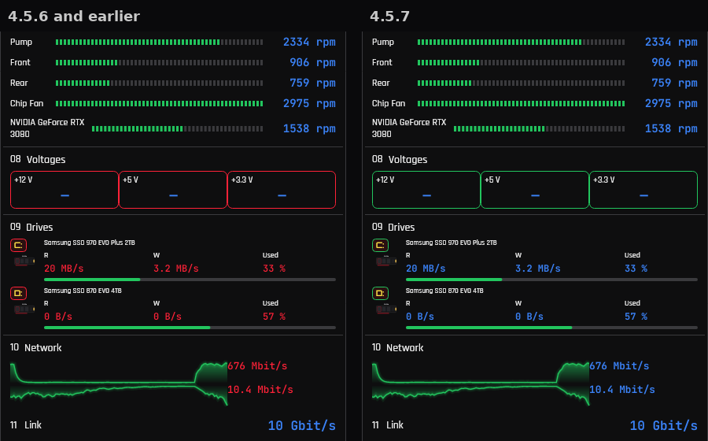
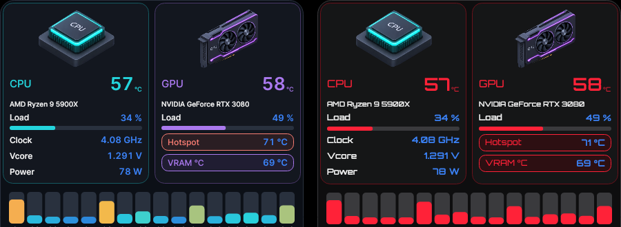

# Lumen 4.5.7 – Colour fixes for drives, network and voltages

- **Value colour now reaches drives, network and voltages.** Since 4.5.5, several AIO designs drew drive read/write/used values (and the network values in Signal Rack and some Isometric designs) in the design's own accent, so a value colour chosen in Appearance did not apply to them. These readings now follow the chosen value colour in every AIO design, including the Red editions. Without a chosen colour they keep the design's look, and hot drive temperatures still turn amber or red.
- **Voltage boxes and drive letters follow the graph colour.** The outlines of the voltage boxes and of the drive letter badges (C:, G: …) now take the graph colour, like the meters and charts next to them.
- **Isometric Tiles: CPU and GPU line up.** In Isometric Tiles and Isometric Tiles Red, the GPU title, temperature and load sat about 12 px lower than the CPU. Both pictures now share one slot of the same height, at every width and graphic size.

## Auf Deutsch

- **Wertefarbe gilt jetzt auch für Laufwerke, Netzwerk und Voltages.** Seit 4.5.5 wurden in mehreren AIO-Designs die Laufwerkswerte (und in Signal Rack und einigen Isometric-Designs auch die Netzwerkwerte) in der Akzentfarbe des Designs gezeichnet. Eine eingestellte Wertefarbe wurde dort nicht übernommen. Jetzt folgen diese Werte in allen AIO-Designs, auch den Red-Varianten, der gewählten Wertefarbe. Ohne eigene Farbe bleibt das Design wie gehabt, heisse Laufwerke werden weiterhin amber oder rot.
- **Voltages-Kästchen und Laufwerksbuchstaben folgen der Grafikfarbe.** Die Rahmen der Voltages-Kästchen und der Laufwerksbuchstaben (C:, G: …) übernehmen jetzt die Grafikfarbe, wie Balken und Verläufe daneben.
- **Isometric Tiles: CPU und GPU auf einer Linie.** In Isometric Tiles und Isometric Tiles Red sassen GPU-Titel, Temperatur und Load rund 12 px tiefer als bei der CPU. Beide Bilder haben jetzt gleich viel Platz, bei jeder Breite und Grafikgrösse.

## Screenshots · Vorschauen

These previews are rendered by Lumen using demonstration readings. · Lumen rendert diese Vorschauen mit Beispieldaten.

**Signal Rack Red with a blue value colour and a green graph colour · Signal Rack Red mit blauer Werte- und grüner Grafikfarbe**

**Isometric Tiles and Isometric Tiles Red · CPU und GPU auf gleicher Höhe**

