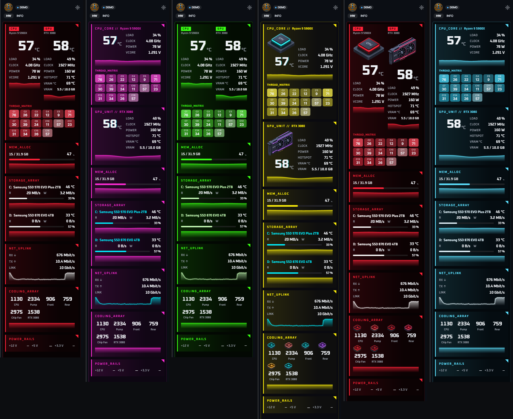
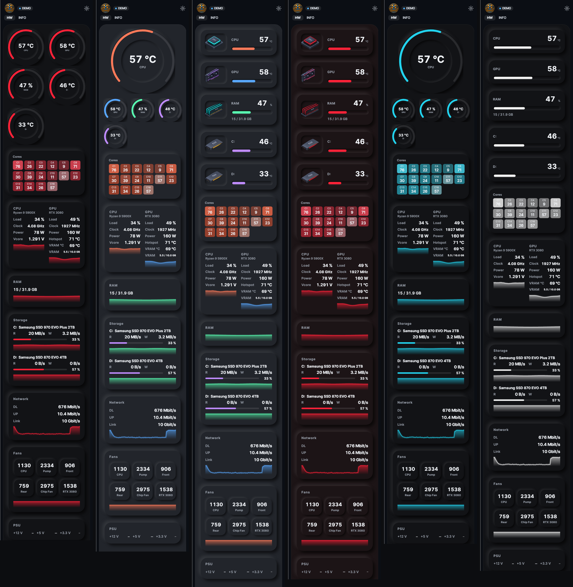
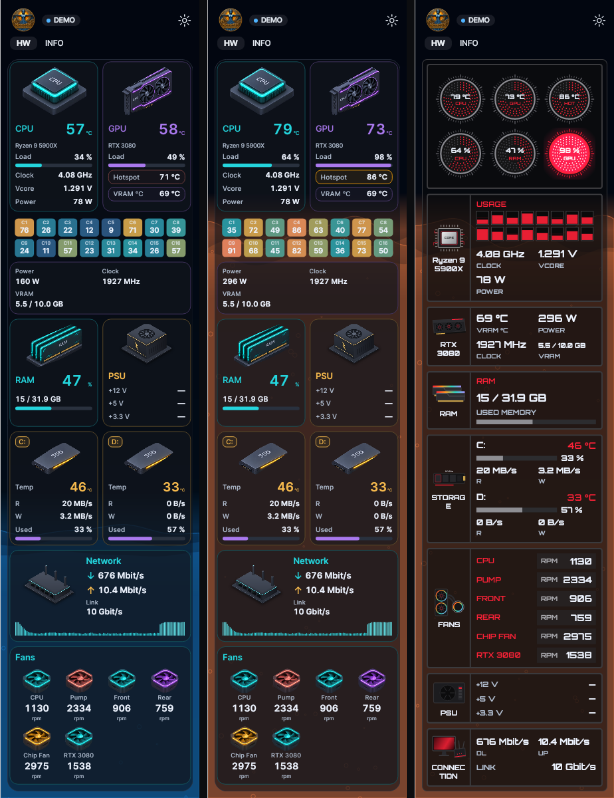

# Lumen 5.1.0 – Cyberpunk, Neumorph and a living Ocean background

- **6 Cyberpunk designs.** Arasaka, Netrunner, Militech, Afterlife, Redline and Black Ice: dark panels with a coloured edge and a cut corner, large glowing numbers and uppercase captions in Oxanium. Arasaka, Militech and Redline show processor and graphics side by side; Afterlife and Redline include the hardware illustrations (Redline in the one red).
- **6 Neumorph designs.** Black Red, Hero, Parts, Red Parts, Cyan and Mono: soft raised panels and pressed-in wells drawn from the card colour. Black Red shows rings for CPU, GPU, RAM and every drive; Hero and Cyan one large processor ring with smaller rings below; Parts, Red Parts and Mono one bar per part (Parts and Red Parts with the hardware illustrations in a well).
- **Like every AIO design.** All 12 show every sensor of the PC (every graphics card including integrated graphics, every drive, every fan, the power supply rails, per-core temperatures when chosen), the core heatmap, the history charts with their own switches, the chosen value and label colours and fonts, an accent colour chosen in Appearance instead of the design colours, the opacity setting and an own background. Values keep their place when the digits change.
- **Live background "Ocean" (Settings → Effects → Live background).** Animated water behind the cards of every design: the water level follows the CPU temperature (blue when cool, turquoise when warm, orange when hot), waves and rising bubbles follow the load of processor or graphics card. Everything glides; the animation runs at 30 frames per second and pauses while the sidebar is hidden. Off by default; with it on, the opacity slider sets how much water shows through the cards.
- **Tested.** The new designs were checked on five kinds of PC (demo, Intel with NVIDIA, APU laptop, big rig with two graphics cards plus integrated graphics, four drives and eight fans, and a minimal PC), at widths from 240 to 420 px and widget sizes from 0.6 to 2: every reading is shown once, no text overlaps or leaves the card, every sensor switch changes only its own items. All 11,250 tests pass.

## Auf Deutsch

- **6 Cyberpunk-Designs.** Arasaka, Netrunner, Militech, Afterlife, Redline und Black Ice: dunkle Panels mit farbiger Kante und abgeschrägter Ecke, grosse leuchtende Zahlen und Grossbuchstaben in Oxanium. Arasaka, Militech und Redline zeigen CPU und GPU nebeneinander; Afterlife und Redline mit den Hardware-Grafiken (Redline im einen Rot).
- **6 Neumorph-Designs.** Black Red, Hero, Parts, Red Parts, Cyan und Mono: weiche, erhabene Panels und eingedrückte Mulden aus der Kartenfarbe. Black Red zeigt Ringe für CPU, GPU, RAM und jedes Laufwerk; Hero und Cyan einen grossen CPU-Ring mit kleineren Ringen darunter; Parts, Red Parts und Mono einen Balken pro Bauteil (Parts und Red Parts mit den Hardware-Grafiken in einer Mulde).
- **Wie jedes AIO-Design.** Alle 12 zeigen jeden Sensor des PCs (jede Grafikkarte inkl. iGPU, jedes Laufwerk, jeden Lüfter, die Netzteil-Spannungen, Kerntemperaturen falls gewählt), die Kern-Heatmap, die Verläufe mit eigenen Schaltern, die gewählten Werte- und Bezeichnungsfarben und Schriften, eine in Darstellung gewählte Akzentfarbe statt der Designfarben, die Deckkraft und einen eigenen Hintergrund. Werte bleiben an ihrem Platz, wenn sich die Stellenzahl ändert.
- **Lebendiger Hintergrund „Ocean“ (Einstellungen → Effekte → Live background).** Animiertes Wasser hinter den Karten jedes Designs: Der Wasserstand folgt der CPU-Temperatur (blau wenn kühl, türkis wenn warm, orange wenn heiss), Wellen und aufsteigende Blasen folgen der Last von CPU oder Grafikkarte. Alles gleitet; die Animation läuft mit 30 Bildern pro Sekunde und pausiert, solange die Sidebar verborgen ist. Standardmässig aus; eingeschaltet bestimmt der Deckkraft-Regler, wie viel Wasser durch die Karten scheint.
- **Getestet.** Die neuen Designs wurden auf fünf PC-Arten geprüft (Demo, Intel mit NVIDIA, APU-Laptop, grosser Rechner mit zwei Grafikkarten plus iGPU, vier Laufwerken und acht Lüftern, Minimal-PC), bei Breiten von 240 bis 420 px und Widget-Grössen von 0,6 bis 2: Jeder Wert erscheint einmal, kein Text überlappt oder ragt aus der Karte, jeder Sensor-Schalter ändert nur seine eigenen Elemente. Alle 11.250 Tests sind grün.

## Screenshots · Vorschauen

These previews are rendered by Lumen using demonstration readings. · Lumen rendert diese Vorschauen mit Beispieldaten.

**Cyberpunk: Arasaka, Netrunner, Militech, Afterlife, Redline, Black Ice**

**Neumorph: Black Red, Hero, Parts, Red Parts, Cyan, Mono**

**Ocean live background: Isometric Tiles at idle and under gaming load, Panel under load · Leerlauf und Gaming-Last**

[Previous release / Vorherige Version 5.0.2](https://github.com/nemesis122/Lumen-HWMonitoring-Sidebar/releases/tag/v5.0.2)
