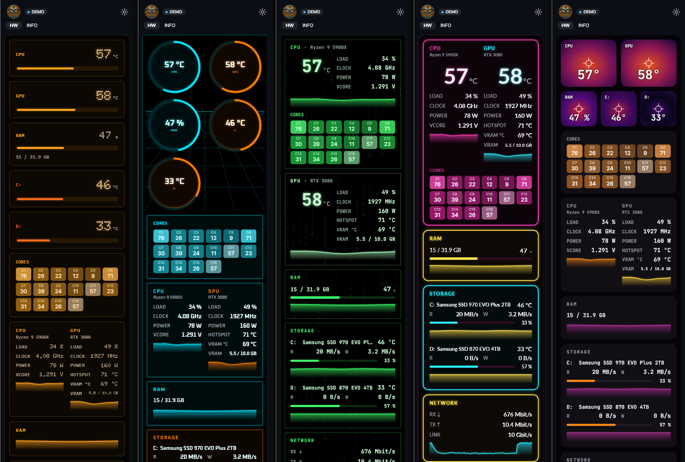
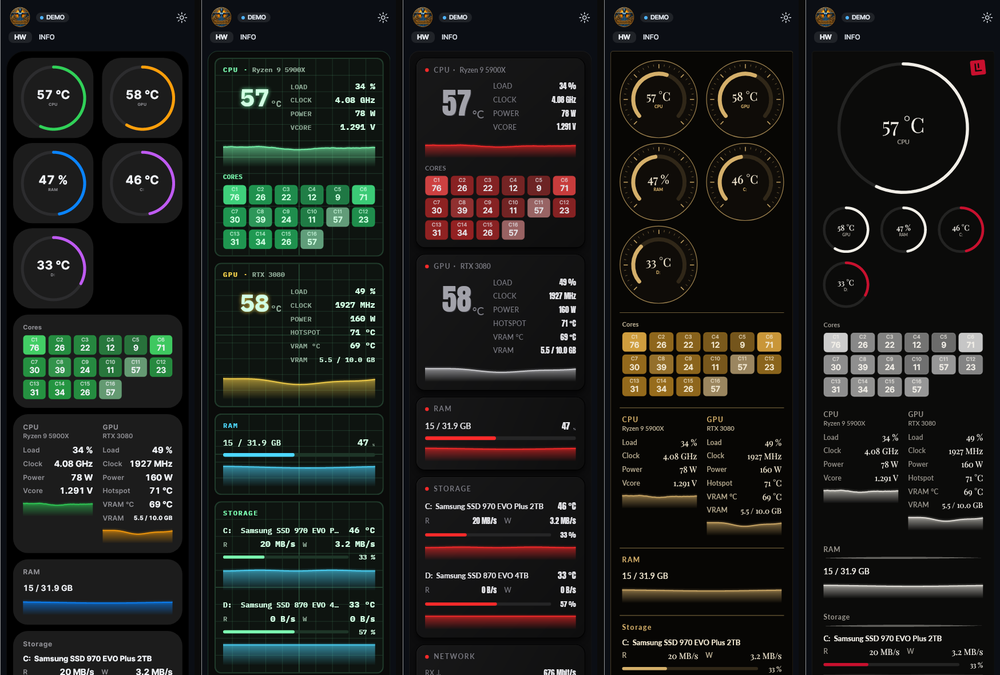
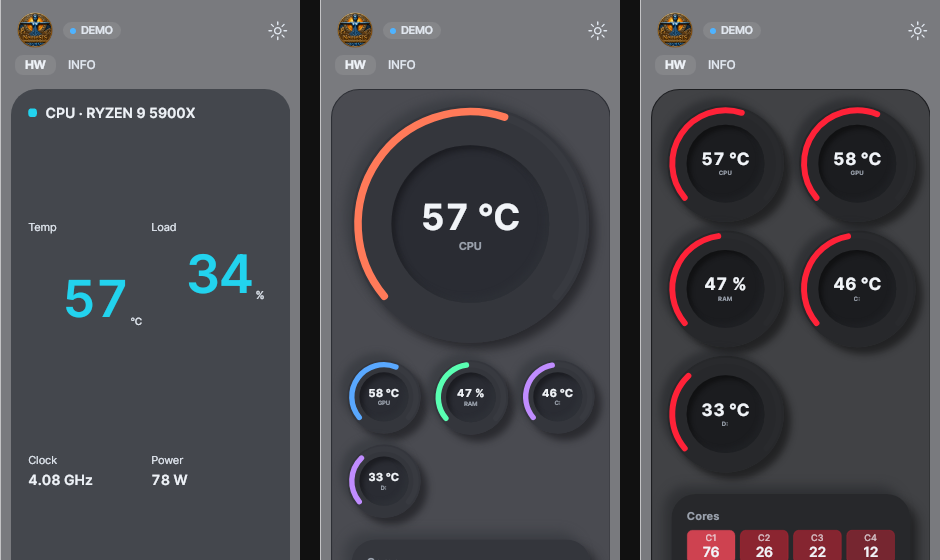

# Lumen 5.2.0 – Ten new art designs and every switch checked

**Ten new AIO designs, all on black:** LED Dot Matrix, Tron Grid, Code Rain, Tokyo Neon, Thermal Camera, Phone Widgets, Oscilloscope, Stealth, Black & Gold and Sumi-e Ink (145 designs in all). Like every AIO design they show the whole PC in one card, every value bound to its sensor: the sensor switches, the history switches, the colours, fonts and sizes of Appearance and an own accent colour work in all of them.

- **LED Dot Matrix** – an amber departure board with dot-matrix numbers (Doto font) and a bar per part.
- **Tron Grid** – glowing cyan and orange rings over a perspective grid.
- **Code Rain** – green terminal panels over faint falling code.
- **Tokyo Neon** – processor and graphics side by side behind neon tubes in pink, cyan and yellow.
- **Thermal Camera** – tiles that glow in the iron palette of their temperature, with spot-meter crosshairs.
- **Phone Widgets** – rounded tiles with coloured rings, like a phone home screen.
- **Oscilloscope** – phosphor screens with a graticule and the history as traces.
- **Stealth** – matte black plates, embossed grey numbers, one red dot.
- **Black & Gold** – watch dials with gold ticks and a serif face (Playfair Display).
- **Sumi-e Ink** – white brush rings, brush-stroke dividers and a red seal.

A release check of 5.1.0 also clicked every sensor switch (history charts included) of all designs off and on again in the real Settings window, and changed and reset every appearance control. These are the fixes it led to:

- **No more lost memory in Settings.** Every change in Settings could keep up to 3 MB that was never freed (the "External IP" line of the network widget), and a closed Settings window stayed in memory.
- **Ticked means shown.** In many AIO designs, RAM used/free/installed, mainboard temperatures, drive life/hours/activity and ping/jitter/loss were ticked although the design did not show them; they only appeared after unticking and ticking again. They now start unticked and appear as soon as you tick them. Values of a second graphics card that is switched off are no longer shown ticked either.
- **Cooling history (AIO)** could not be shown as ticked after clicking it.
- **History switches only where they do something.** 604 of 980 "History chart" switches had no effect (designs without curves, Panel designs without drive or cooling history, one combined chart in History Graph). Settings now lists only the history switches each design really draws.
- **"History chart · Load" alone** now also switches on the chart it is drawn in, and "History chart" with all curves off switches its curves on – before, nothing appeared.
- **Dial:** download and upload history can be switched off one by one; the small curves follow the history switches.
- **Large main values (200 %):** Clean Dark, Compact Pro and Performance View no longer draw temperature and load over each other or past the card; Neumorph Hero, Cyan Hero and Black Red keep the values inside their rings; Isometric Compact keeps the power-supply rail inside the card.
- **Neumorph rings** have a round soft shadow instead of a square one.
- **New tests:** an end-to-end check through the Settings window for all 145 designs, a check that every listed history switch changes its design (vertical and as a bar), and a memory check for the Settings window.

## Auf Deutsch

**Zehn neue AIO-Designs, alle auf Schwarz:** LED Dot Matrix, Tron Grid, Code Rain, Tokyo Neon, Thermal Camera, Phone Widgets, Oscilloscope, Stealth, Black & Gold und Sumi-e Ink (insgesamt 145 Designs). Wie jedes AIO-Design zeigen sie den ganzen PC in einer Karte, jeder Wert an seinen Sensor gebunden: Sensor-Schalter, Verlaufs-Schalter, Farben, Schriften und Grössen der Darstellung und eine eigene Akzentfarbe funktionieren in allen.

- **LED Dot Matrix** – eine bernsteinfarbene Abfahrtstafel mit Punktmatrix-Zahlen (Schrift Doto) und einem Balken pro Bereich.
- **Tron Grid** – leuchtende Ringe in Cyan und Orange über einem Perspektiv-Gitter.
- **Code Rain** – grüne Terminal-Panels über leise fallendem Code.
- **Tokyo Neon** – Prozessor und Grafik nebeneinander hinter Neonröhren in Pink, Cyan und Gelb.
- **Thermal Camera** – Kacheln, die in der Eisen-Palette ihrer Temperatur glühen, mit Messkreuz.
- **Phone Widgets** – abgerundete Kacheln mit farbigen Ringen, wie ein Handy-Startbildschirm.
- **Oscilloscope** – Phosphor-Bildschirme mit Raster und dem Verlauf als Kurven.
- **Stealth** – mattschwarze Platten, geprägte graue Zahlen, ein roter Punkt.
- **Black & Gold** – Uhren-Zifferblätter mit goldenen Strichen und Serifenschrift (Playfair Display).
- **Sumi-e Ink** – weisse Pinselringe, Pinselstrich-Trenner und ein rotes Siegel.

Ein Release-Test von 5.1.0 hat ausserdem im echten Einstellungsfenster in allen Designs jeden Sensor-Schalter (auch die History-Charts) aus- und wieder eingeschaltet und jede Darstellungs-Einstellung verstellt und zurückgesetzt. Daraus kommen diese Korrekturen:

- **Kein Speicherverlust mehr in den Einstellungen.** Jede Änderung konnte bis zu 3 MB Speicher belegen, der nie mehr frei wurde (Zeile „External IP“ beim Netzwerk), und ein geschlossenes Einstellungsfenster blieb im Speicher.
- **Angehakt heisst angezeigt.** In vielen AIO-Designs waren RAM belegt/frei/installiert, Mainboard-Temperaturen, Lebensdauer/Stunden/Aktivität der Laufwerke und Ping/Jitter/Verlust angehakt, obwohl das Design sie nicht zeigte; erst nach Ab- und wieder Anhaken erschienen sie. Jetzt sind sie zu Beginn nicht angehakt und erscheinen, sobald man sie anhakt. Werte einer ausgeschalteten zweiten Grafikkarte erscheinen ebenfalls nicht mehr angehakt.
- **Kühlungs-Verlauf (AIO)** wurde nach dem Anklicken nie als angehakt gezeigt.
- **Verlaufs-Schalter nur, wo sie etwas bewirken.** 604 von 980 Schaltern „History chart“ hatten keine Wirkung (Designs ohne Kurven, Panel-Designs ohne Laufwerks- oder Kühlungsverlauf, eine gemeinsame Kurve in History Graph). Die Einstellungen zeigen jetzt nur noch die Verlaufs-Schalter, die das Design wirklich zeichnet.
- **„History chart · Load“ allein** schaltet jetzt auch den Chart ein, in dem die Kurve liegt, und „History chart“ mit allen Kurven aus schaltet die Kurven ein – vorher erschien nichts.
- **Dial:** Download- und Upload-Verlauf lassen sich einzeln ausschalten; die kleinen Kurven folgen den Verlaufs-Schaltern.
- **Grosse Hauptwerte (200 %):** Clean Dark, Compact Pro und Performance View zeichnen Temperatur und Last nicht mehr übereinander oder über den Kartenrand; Neumorph Hero, Cyan Hero und Black Red halten die Werte in ihren Ringen; Isometric Compact hält die Netzteil-Spannung in der Karte.
- **Neumorph-Ringe** haben einen runden weichen Schatten statt eines eckigen.
- **Neue Tests:** ein Durchgangstest über das Einstellungsfenster für alle 145 Designs, ein Test, dass jeder angezeigte Verlaufs-Schalter sein Design verändert (senkrecht und als Leiste), und ein Speichertest für das Einstellungsfenster.

## Screenshots · Vorschauen

These previews are rendered by Lumen using demonstration readings. · Lumen rendert diese Vorschauen mit Beispieldaten.

**LED Dot Matrix, Tron Grid, Code Rain, Tokyo Neon, Thermal Camera**

**Phone Widgets, Oscilloscope, Stealth, Black & Gold, Sumi-e Ink**

**Fixes: Clean Dark with main values at 200 %, Neumorph Hero and Black Red with round shadows · Korrekturen: Clean Dark mit Hauptwerten auf 200 %, Neumorph Hero und Black Red mit runden Schatten**

[Previous release / Vorherige Version 5.1.0](https://github.com/nemesis122/Lumen-HWMonitoring-Sidebar/releases/tag/v5.1.0)
