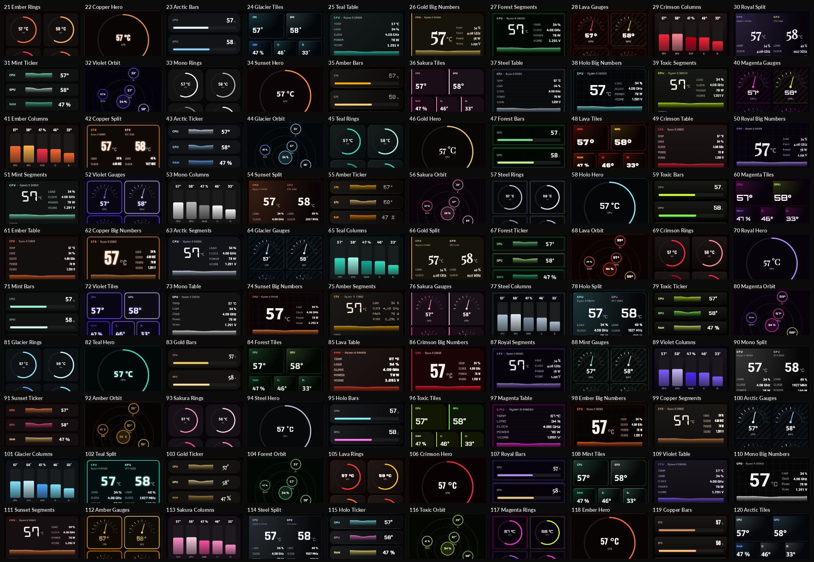
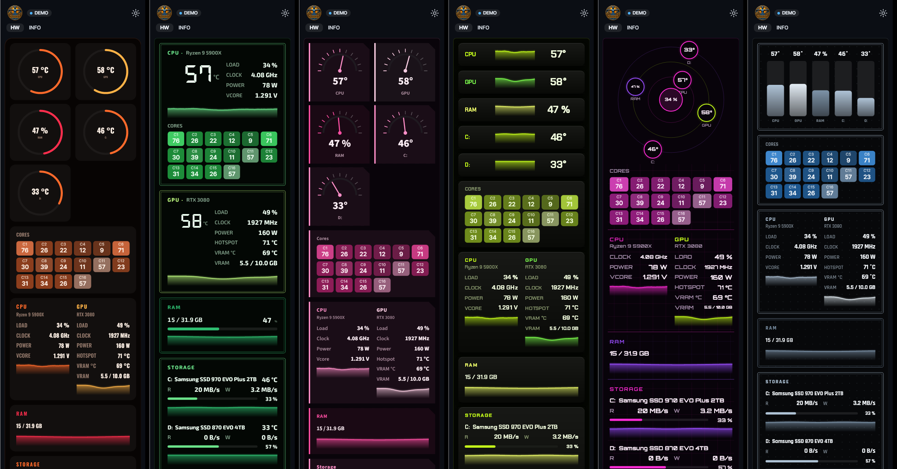

# Lumen 5.3.0 – 100 new gallery designs

**100 new AIO designs, all on black (245 designs in all).** Each one combines a layout with a colour world, a panel style and a quiet background pattern:

- **12 layouts:** Rings, Hero ring, Bars, Tiles, Table, Big Numbers, Seven-segment (DSEG7 font), Gauges with needles, Columns, Split, Ticker rows with a curve each, Orbit.
- **20 colour worlds:** Ember, Glacier, Forest, Royal, Mono, Sakura, Toxic, Copper, Teal, Lava, Mint, Sunset, Steel, Magenta, Arctic, Gold, Crimson, Violet, Amber, Holo.
- **10 panel styles:** flat, outline, glass, glow, bevel, cut corner, pill, underline, double border, dashed – with grid, scan-line, glow, dot or stripe patterns.

Like every AIO design they show the whole PC in one card, every value bound to its sensor: the sensor switches, the history switches, the colours, fonts and sizes of Appearance and an own accent colour work in all of them. The design picker names them as in the drafts (for example "Ember Rings", "Toxic Ticker", "Magenta Orbit").

- **Checked like 5.2.0:** every reading of five kinds of PC inside the card without overlaps at 300 and 420 px, chosen colours and fonts, accent colour and opacity, values that do not jump, every sensor and history switch and every appearance control through the Settings window, and every listed history switch changing its design. Every sensor and appearance setting was also checked on a PC with Intel and NVIDIA, a laptop APU and a PC with two graphics cards.
- The LED Dot Matrix, Code Rain, Oscilloscope and Thermal Camera previews in the design picker are up to date.
- **Fixed:** on a PC with two graphics cards, ticking the fan of the second card in an AIO design left the switch off and showed nothing; it now brings that card onto the AIO card, like ticking one of its values.

## Auf Deutsch

**100 neue AIO-Designs, alle auf Schwarz (insgesamt 245 Designs).** Jedes verbindet ein Layout mit einer Farbwelt, einem Panel-Stil und einem dezenten Hintergrundmuster:

- **12 Layouts:** Ringe, Hero-Ring, Balken, Kacheln, Tabelle, Riesenzahlen, 7-Segment (Schrift DSEG7), Tachos mit Nadel, Säulen, Zweispaltig, Ticker-Zeilen mit eigener Kurve, Orbit.
- **20 Farbwelten:** Ember, Glacier, Forest, Royal, Mono, Sakura, Toxic, Copper, Teal, Lava, Mint, Sunset, Steel, Magenta, Arctic, Gold, Crimson, Violet, Amber, Holo.
- **10 Panel-Stile:** flach, Umriss, Glas, Glow, Relief, schräge Ecke, Pille, Unterstrich, Doppelrand, gestrichelt – mit Raster, Scanlines, Leuchten, Punkten oder Streifen.

Wie jedes AIO-Design zeigen sie den ganzen PC in einer Karte, jeder Wert an seinen Sensor gebunden: Sensor-Schalter, Verlaufs-Schalter, Farben, Schriften und Grössen der Darstellung und eine eigene Akzentfarbe funktionieren in allen. Die Design-Auswahl nennt sie wie die Entwürfe (z. B. „Ember Rings“, „Toxic Ticker“, „Magenta Orbit“).

- **Geprüft wie 5.2.0:** jeder Wert von fünf PC-Arten in der Karte ohne Überlappung bei 300 und 420 px, gewählte Farben und Schriften, Akzentfarbe und Deckkraft, Werte ohne Springen, jeder Sensor- und Verlaufs-Schalter und jede Darstellungs-Einstellung über das Einstellungsfenster, und jeder angezeigte Verlaufs-Schalter verändert sein Design. Alle Sensor- und Darstellungs-Einstellungen wurden zusätzlich auf einem PC mit Intel und NVIDIA, einem Laptop-APU und einem PC mit zwei Grafikkarten geprüft.
- Die Vorschaubilder von LED Dot Matrix, Code Rain, Oscilloscope und Thermal Camera in der Design-Auswahl sind aktualisiert.
- **Behoben:** Auf einem PC mit zwei Grafikkarten blieb der Lüfter-Schalter der zweiten Karte in einem AIO-Design nach dem Anhaken aus und zeigte nichts; jetzt holt er diese Karte in die AIO-Karte, wie das Anhaken eines ihrer Werte.

## Screenshots · Vorschauen

These previews are rendered by Lumen using demonstration readings. · Lumen rendert diese Vorschauen mit Beispieldaten.

**All 100 gallery designs · Alle 100 Galerie-Designs**

**Ember Rings, Forest Segments, Sakura Gauges, Toxic Ticker, Magenta Orbit, Steel Columns**

[Previous release / Vorherige Version 5.2.0](https://github.com/nemesis122/Lumen-HWMonitoring-Sidebar/releases/tag/v5.2.0)
