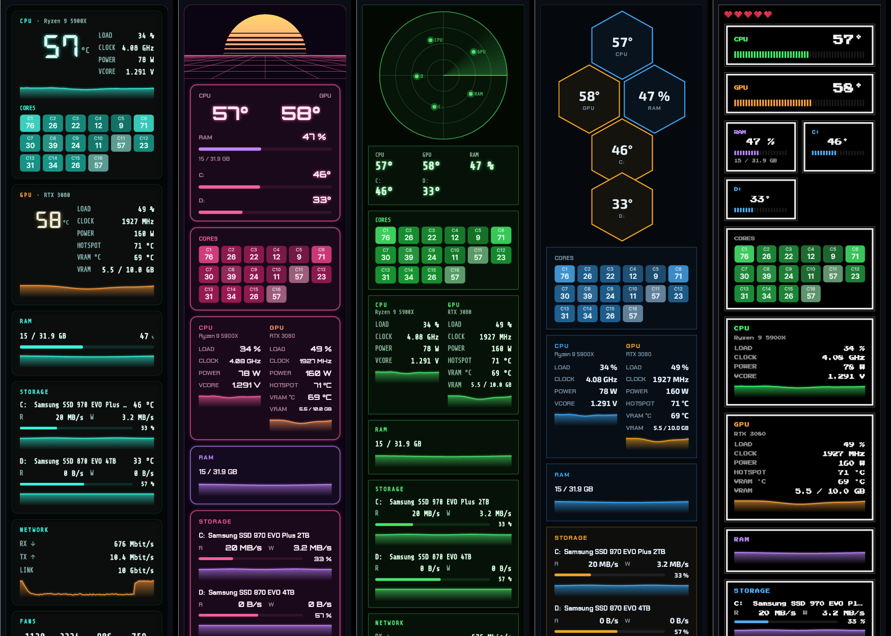
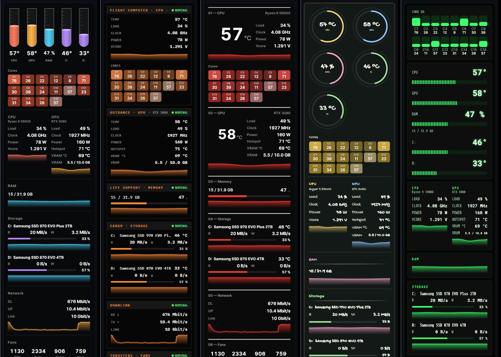

# Lumen 5.4.0 – Ten studio designs

**Ten new AIO designs from the drafts 11–20, each with a layout of its own (255 designs in all):**

- **VFD Stereo** – glowing seven-segment digits like a hi-fi display, teal and amber.
- **Synthwave** – a striped sunset over a neon grid, processor and graphics large, the rest as bars.
- **Radar** – a radar scope with one blip per part (further out the hotter it runs), the readings below.
- **Hex Grid** – the parts in a honeycomb of hexagons.
- **8-Bit Pixel** – pixel font (Press Start 2P), hearts, block bars like a health bar.
- **Lab Tubes** – one test tube per part, filled to its reading.
- **Mission Control** – a flight console: flight computer, guidance, life support, thrusters, each "NOMINAL".
- **Swiss** – huge numbers, numbered sections and thin rules.
- **Chalkboard** – handwriting (Gochi Hand) and chalk rings.
- **Equalizer** – the processor cores as a band equalizer, LED bars for every part.

Like every AIO design they show the whole PC in one card with every value bound to its sensor: the sensor switches, the history switches, colours, fonts, sizes and an own accent colour work in all of them.

- **Checked like 5.3.0:** every reading of five kinds of PC inside the card without overlaps at 300 and 420 px, chosen colours and fonts, accent colour and opacity, values that do not jump, every sensor and history switch and every appearance setting through the Settings window on all five kinds of PC, and every history switch changing its design.

## Auf Deutsch

**Zehn neue AIO-Designs aus den Entwürfen 11–20, jedes mit eigenem Layout (insgesamt 255 Designs):**

- **VFD Stereo** – leuchtende 7-Segment-Ziffern wie ein HiFi-Display, Türkis und Bernstein.
- **Synthwave** – gestreifte Sonne über einem Neon-Gitter, Prozessor und Grafik gross, der Rest als Balken.
- **Radar** – ein Radarschirm mit einem Punkt pro Bauteil (je wärmer, desto weiter aussen), die Werte darunter.
- **Hex Grid** – die Bauteile in einer Wabe aus Sechsecken.
- **8-Bit Pixel** – Pixelschrift (Press Start 2P), Herzen, Blockbalken wie eine Lebensanzeige.
- **Lab Tubes** – ein Reagenzglas pro Bauteil, gefüllt bis zu seinem Wert.
- **Mission Control** – eine Flugkonsole: Flight Computer, Guidance, Life Support, Thrusters, jeweils „NOMINAL“.
- **Swiss** – riesige Zahlen, nummerierte Abschnitte und feine Linien.
- **Chalkboard** – Handschrift (Gochi Hand) und Kreide-Ringe.
- **Equalizer** – die Prozessorkerne als Equalizer, LED-Balken für jedes Bauteil.

Wie jedes AIO-Design zeigen sie den ganzen PC in einer Karte, jeder Wert an seinen Sensor gebunden: Sensor-Schalter, Verlaufs-Schalter, Farben, Schriften, Grössen und eine eigene Akzentfarbe funktionieren in allen.

- **Geprüft wie 5.3.0:** jeder Wert von fünf PC-Arten in der Karte ohne Überlappung bei 300 und 420 px, gewählte Farben und Schriften, Akzentfarbe und Deckkraft, Werte ohne Springen, jeder Sensor- und Verlaufs-Schalter und jede Darstellungs-Einstellung über das Einstellungsfenster auf allen fünf PC-Arten, und jeder Verlaufs-Schalter verändert sein Design.

## Screenshots · Vorschauen

These previews are rendered by Lumen using demonstration readings. · Lumen rendert diese Vorschauen mit Beispieldaten.

[Previous release / Vorherige Version 5.3.0](https://github.com/nemesis122/Lumen-HWMonitoring-Sidebar/releases/tag/v5.3.0)
