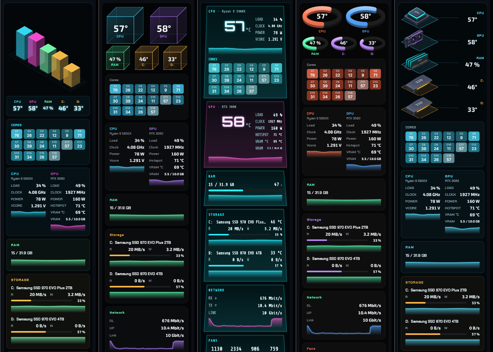
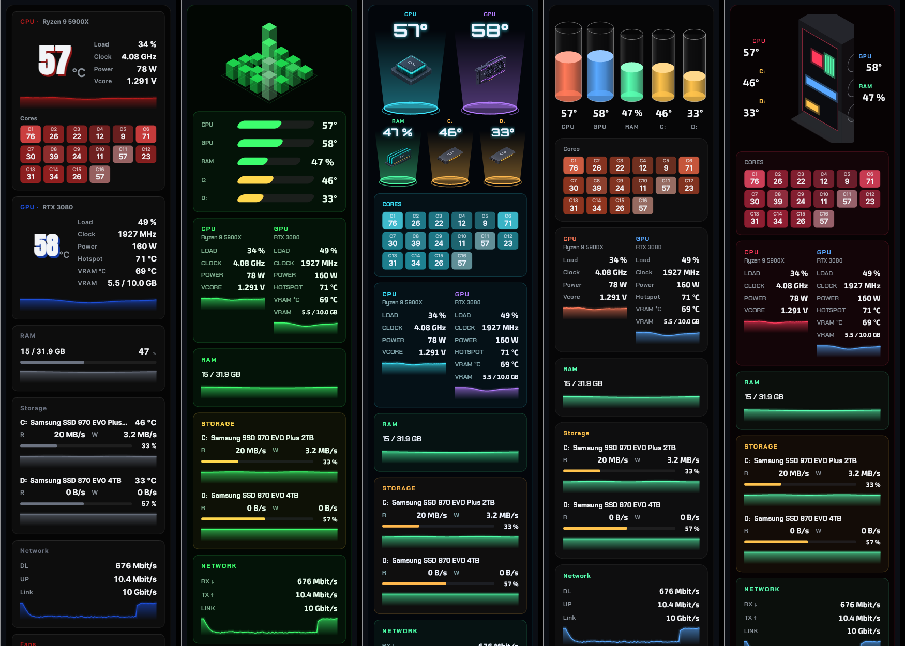

# Lumen 5.5.0 – Ten 3D designs

**Ten new AIO designs in 3D, all on black (265 designs in all):**

- **Iso Skyline** – every part an isometric tower on a floor grid, as tall as its reading.
- **Glass Cubes** – the readings on the front of glass cubes; processor and graphics large.
- **Perspective HUD** – glowing panels that lean back like a heads-up display.
- **Torus Rings** – thick 3D rings seen from above, filled along the reading.
- **Exploded Stack** – processor, graphics, memory and drives float on plates, each reading on its leader line.
- **Chrome Numbers** – huge numbers extruded in the colour of their part.
- **3D Bar Chart** – the processor cores as isometric columns, every part on a slanted 3D bar.
- **Hologram Pads** – each part projected above a glowing emitter with its reading.
- **Glass Cylinders** – glass tanks filled to their reading.
- **Iso Tower** – a PC case in 3D with its parts lit inside, the readings beside it.

Like every AIO design they show the whole PC in one card with every value bound to its sensor: the sensor switches, the history switches, colours, fonts, sizes and an own accent colour work in all of them.

- **Checked like 5.4.0:** every reading of five kinds of PC inside the card without overlaps at 300 and 420 px, chosen colours and fonts, accent colour and opacity, values that do not jump, every sensor and history switch and every appearance setting through the Settings window on all five kinds of PC, and every history switch changing its design.

## Auf Deutsch

**Zehn neue AIO-Designs in 3D, alle auf Schwarz (insgesamt 265 Designs):**

- **Iso Skyline** – jedes Bauteil ein isometrischer Turm auf einem Bodenraster, so hoch wie sein Wert.
- **Glass Cubes** – die Werte auf der Vorderseite von Glaswürfeln; Prozessor und Grafik gross.
- **Perspective HUD** – leuchtende Panels, die sich wie ein Head-up-Display nach hinten neigen.
- **Torus Rings** – dicke 3D-Ringe von schräg oben, gefüllt bis zum Wert.
- **Exploded Stack** – Prozessor, Grafik, Speicher und Laufwerke schweben auf Platten, jeder Wert an seiner Linie.
- **Chrome Numbers** – riesige Zahlen, plastisch in der Farbe ihres Bauteils.
- **3D Bar Chart** – die Prozessorkerne als isometrische Säulen, jedes Bauteil als schräger 3D-Balken.
- **Hologram Pads** – jedes Bauteil als Hologramm über einem leuchtenden Sockel mit seinem Wert.
- **Glass Cylinders** – Glaszylinder, gefüllt bis zum Wert.
- **Iso Tower** – ein PC-Gehäuse in 3D mit leuchtenden Bauteilen, die Werte daneben.

Wie jedes AIO-Design zeigen sie den ganzen PC in einer Karte, jeder Wert an seinen Sensor gebunden: Sensor-Schalter, Verlaufs-Schalter, Farben, Schriften, Grössen und eine eigene Akzentfarbe funktionieren in allen.

- **Geprüft wie 5.4.0:** jeder Wert von fünf PC-Arten in der Karte ohne Überlappung bei 300 und 420 px, gewählte Farben und Schriften, Akzentfarbe und Deckkraft, Werte ohne Springen, jeder Sensor- und Verlaufs-Schalter und jede Darstellungs-Einstellung über das Einstellungsfenster auf allen fünf PC-Arten, und jeder Verlaufs-Schalter verändert sein Design.

## Screenshots · Vorschauen

These previews are rendered by Lumen using demonstration readings. · Lumen rendert diese Vorschauen mit Beispieldaten.

[Previous release / Vorherige Version 5.4.0](https://github.com/nemesis122/Lumen-HWMonitoring-Sidebar/releases/tag/v5.4.0)
