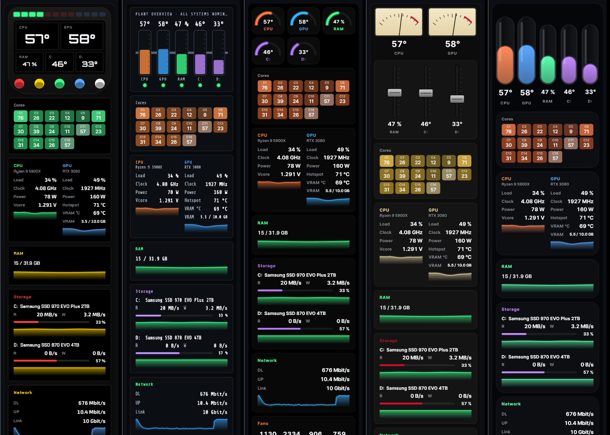
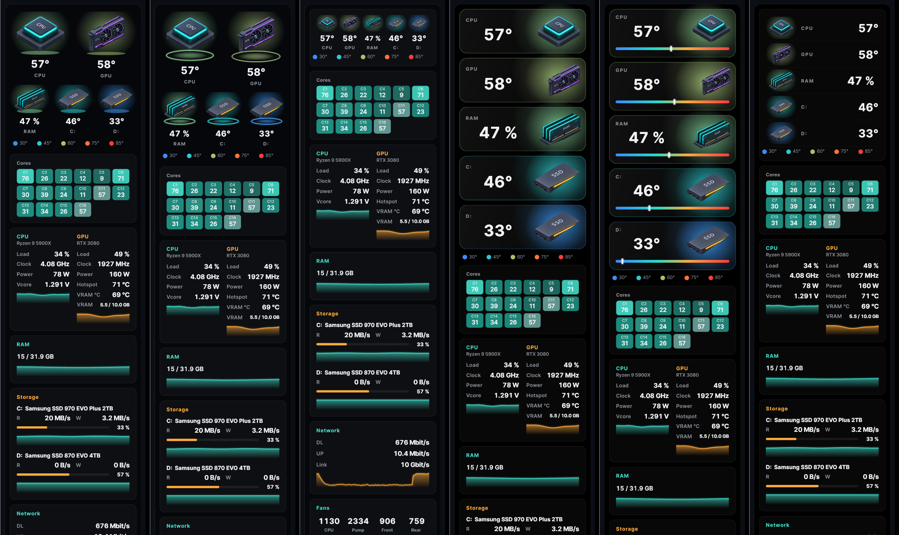

# Lumen 5.6.0 – Dashboards and Living PC

**Eleven new AIO designs on black (276 designs in all):**

- **Race Telemetry** – a racing steering wheel: shift lights that follow the processor load, every reading in its own box on the wheel's screen.
- **Control Room** – a plant overview: one tank per part, filled to its reading, joined by pipes, with status lamps.
- **Gauge Wall** – glowing half gauges in a grid, one per part.
- **Studio Mixer** – VU meters for processor and graphics, faders for memory and drives.
- **Capsule Glass** – tall glass capsules filled from the bottom.

**Living PC** – the parts glow in the colour of their temperature, from blue (cool) through teal and orange to red (hot):

- **Floating Parts** – the parts float in their heat glow, readings beneath.
- **Floating Podiums** – every part on a glowing pedestal.
- **Floating Strip** – all parts small in one row.
- **Part Cards** – one glass card per part, its picture glowing in the corner.
- **Part Cards Heat** – the cards with a temperature scale and a marker.
- **Part List** – a compact list with small pictures.

Like every AIO design they show the whole PC in one card with every value bound to its sensor: the sensor switches, the history switches, colours, fonts, sizes and an own accent colour work in all of them.

- **Checked like 5.5.0:** every reading of five kinds of PC inside the card without overlaps at 300 and 420 px, chosen colours and fonts, accent colour and opacity, values that do not jump, every sensor and history switch and every appearance setting through the Settings window on all five kinds of PC, and every history switch changing its design.
- **Tests:** the test PCs with other graphics cards (laptop with integrated graphics, Intel with NVIDIA, a PC with two cards) now carry history curves of their own cards, so the history switches of those cards are checked too.

## Auf Deutsch

**Elf neue AIO-Designs auf Schwarz (insgesamt 276 Designs):**

- **Race Telemetry** – ein Renn-Lenkrad: Schaltlichter folgen der Prozessorlast, jeder Wert in seinem eigenen Feld auf dem Display.
- **Control Room** – ein Leitstand: ein Tank pro Bauteil, gefüllt bis zum Wert, verbunden mit Rohren, mit Statuslampen.
- **Gauge Wall** – leuchtende Halbkreis-Anzeigen im Raster, eine pro Bauteil.
- **Studio Mixer** – VU-Meter für Prozessor und Grafik, Schieberegler für Speicher und Laufwerke.
- **Capsule Glass** – hohe Glaskapseln, von unten gefüllt.

**Living PC** – die Teile leuchten in der Farbe ihrer Temperatur, von Blau (kühl) über Türkis und Orange bis Rot (heiss):

- **Floating Parts** – die Teile schweben in ihrem Wärme-Schein, darunter die Werte.
- **Floating Podiums** – jedes Teil auf einem leuchtenden Sockel.
- **Floating Strip** – alle Teile klein in einer Zeile.
- **Part Cards** – eine Glaskarte pro Teil, das Bild leuchtet in der Ecke.
- **Part Cards Heat** – die Karten mit Temperatur-Skala und Marker.
- **Part List** – eine kompakte Liste mit kleinen Bildern.

Wie jedes AIO-Design zeigen sie den ganzen PC in einer Karte, jeder Wert an seinen Sensor gebunden: Sensor-Schalter, Verlaufs-Schalter, Farben, Schriften, Grössen und eine eigene Akzentfarbe funktionieren in allen.

- **Geprüft wie 5.5.0:** jeder Wert von fünf PC-Arten in der Karte ohne Überlappung bei 300 und 420 px, gewählte Farben und Schriften, Akzentfarbe und Deckkraft, Werte ohne Springen, jeder Sensor- und Verlaufs-Schalter und jede Darstellungs-Einstellung über das Einstellungsfenster auf allen fünf PC-Arten, und jeder Verlaufs-Schalter verändert sein Design.
- **Tests:** Die Test-PCs mit anderer Grafik (Laptop mit iGPU, Intel+NVIDIA, PC mit zwei Karten) haben jetzt Verlaufskurven ihrer eigenen Karten, so werden auch deren Verlaufs-Schalter geprüft.

## Screenshots · Vorschauen

These previews are rendered by Lumen using demonstration readings. · Lumen rendert diese Vorschauen mit Beispieldaten.

[Previous release / Vorherige Version 5.5.0](https://github.com/nemesis122/Lumen-HWMonitoring-Sidebar/releases/tag/v5.5.0)
