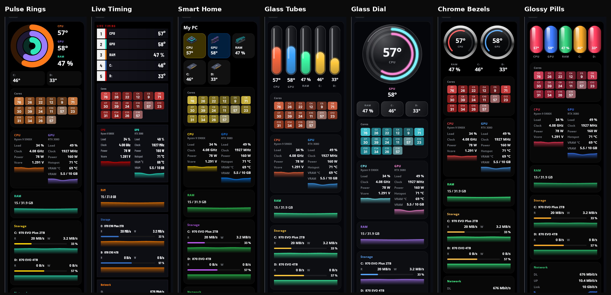

# Lumen 5.7.0 – Rings, Glass and a Full Audit

**Seven new AIO designs on black (283 designs in all):**

- **Pulse Rings** – three rings inside one another for processor, graphics and memory, every further part on a small tile.
- **Live Timing** – one row per part with position box, colour stripe, name and reading, like the timing tower of a race broadcast.
- **Smart Home** – every part a tile with its picture; processor and graphics are the tiles that are "on".
- **Glass Tubes** – clear tubes filled with glowing liquid up to each reading.
- **Glass Dial** – processor and graphics as two rings on one glass disc, the other parts on glass tiles.
- **Chrome Bezels** – processor and graphics on polished round gauges.
- **Glossy Pills** – a row of glossy capsules, the reading on each.

**A full audit of all 225 AIO designs on five kinds of PC** (desktop, Intel with NVIDIA, laptop with integrated graphics, a PC with two cards and four drives, a PC without administrator rights):

- **No sensor switch without effect.** Settings lists a switch only when this PC has something for it: "Core temperatures" only when the processor reports per-core temperatures, "Cooling" and its history only with fans, voltage rails only when the board has rail sensors, a history chart only for a part that has a reading. A test now flips every switch of every design on every test PC and fails when one changes nothing.
- **Mainboard temperatures in every design** – off until you switch "Mainboard" on; then every board temperature appears (each can still be unticked). Until now the switch was on but showed nothing in most designs. Board temperatures ticked by hand before keep showing.
- **No more "+12 V —".** A voltage rail the PC has no sensor for is left out instead of an empty row in every design; rails read with two decimals (12.08 V).
- **History without a temperature:** where the processor or graphics card reports no temperature (no administrator rights), the history shows the load instead of nothing.
- **No cut-off names:** integrated graphics read "iGPU", drives drop the maker ("970 EVO Plus 2TB"), long model names wrap onto a second line, a graphics fan reads "GPU Fan", "Hours" and "Activity" replace "Power-on hours" and "Total activity", and "Network" no longer breaks over two lines in the Panel designs.
- **Nothing smaller than 9 px:** captions in the ring, hero and gauge designs keep their size while only the number shrinks into the ring; tags, pills and memory cards of the Isometric, Mainboard Map, Thermal Grid, Orbit and Case Edition designs were laid out anew. A test checks every text of every design on every test PC: nothing cut off, no word broken, no label or value below 9 px.
- **Tests:** two test PCs now report per-core temperatures and voltage rails, so those values are checked in every design.

## Auf Deutsch

**Sieben neue AIO-Designs auf Schwarz (insgesamt 283 Designs):**

- **Pulse Rings** – drei Ringe ineinander für Prozessor, Grafik und Speicher, jedes weitere Teil auf einer kleinen Kachel.
- **Live Timing** – eine Zeile pro Teil mit Positionsfeld, Farbstreifen, Name und Wert, wie der Zeitenturm einer Rennübertragung.
- **Smart Home** – jedes Teil eine Kachel mit Bild; Prozessor und Grafik sind die „eingeschalteten“ Kacheln.
- **Glass Tubes** – klare Röhren, gefüllt mit leuchtender Flüssigkeit bis zum Wert.
- **Glass Dial** – Prozessor und Grafik als zwei Ringe auf einer Glasscheibe, die anderen Teile auf Glaskacheln.
- **Chrome Bezels** – Prozessor und Grafik auf polierten Rundinstrumenten.
- **Glossy Pills** – eine Reihe glänzender Kapseln, der Wert auf jeder.

**Komplette Prüfung aller 225 AIO-Designs auf fünf PC-Arten** (Desktop, Intel mit NVIDIA, Laptop mit iGPU, PC mit zwei Karten und vier Laufwerken, PC ohne Administratorrechte):

- **Kein Sensor-Schalter ohne Wirkung.** Die Einstellungen zeigen einen Schalter nur, wenn dieser PC etwas dafür hat: „Core temperatures“ nur, wenn der Prozessor Kern-Temperaturen meldet, „Cooling“ und sein Verlauf nur mit Lüftern, Spannungen nur mit Spannungs-Sensoren, ein Verlauf nur für ein Teil mit Wert. Ein Test schaltet jetzt jeden Schalter jedes Designs auf jedem Test-PC um und schlägt fehl, wenn sich nichts ändert.
- **Mainboard-Temperaturen in jedem Design** – aus, bis man „Mainboard“ einschaltet; dann erscheinen alle Mainboard-Temperaturen (jede einzeln abwählbar). Bisher war der Schalter an, zeigte aber in den meisten Designs nichts. Früher einzeln angehakte Werte bleiben.
- **Kein „+12 V —“ mehr.** Eine Spannung ohne Sensor wird weggelassen statt als leere Zeile in jedem Design; Spannungen mit zwei Nachkommastellen (12,08 V).
- **Verlauf ohne Temperatur:** Meldet Prozessor oder Grafik keine Temperatur (ohne Administratorrechte), zeigt der Verlauf die Last statt nichts.
- **Keine abgeschnittenen Namen:** iGPU statt „Integrated graphics“, Laufwerke ohne Hersteller („970 EVO Plus 2TB“), lange Modellnamen brechen auf eine zweite Zeile um, ein Grafiklüfter heisst „GPU Fan“, „Hours“ und „Activity“ statt „Power-on hours“ und „Total activity“, und „Network“ bricht in den Panel-Designs nicht mehr um.
- **Nichts kleiner als 9 px:** Beschriftungen in Ring-, Hero- und Tacho-Designs behalten ihre Grösse, nur die Zahl passt sich dem Ring an; Etiketten, Pillen und Speicherkarten der Isometric-, Mainboard-Map-, Thermal-Grid-, Orbit- und Case-Edition-Designs neu angeordnet. Ein Test prüft jeden Text jedes Designs auf jedem Test-PC: nichts abgeschnitten, kein Wort getrennt, keine Beschriftung und kein Wert unter 9 px.
- **Tests:** Zwei Test-PCs melden jetzt Kern-Temperaturen und Spannungen, damit diese Werte in jedem Design geprüft werden.

## Screenshots · Vorschauen

These previews are rendered by Lumen using demonstration readings. · Lumen rendert diese Vorschauen mit Beispieldaten.

[Previous release / Vorherige Version 5.6.0](https://github.com/nemesis122/Lumen-HWMonitoring-Sidebar/releases/tag/v5.6.0)
