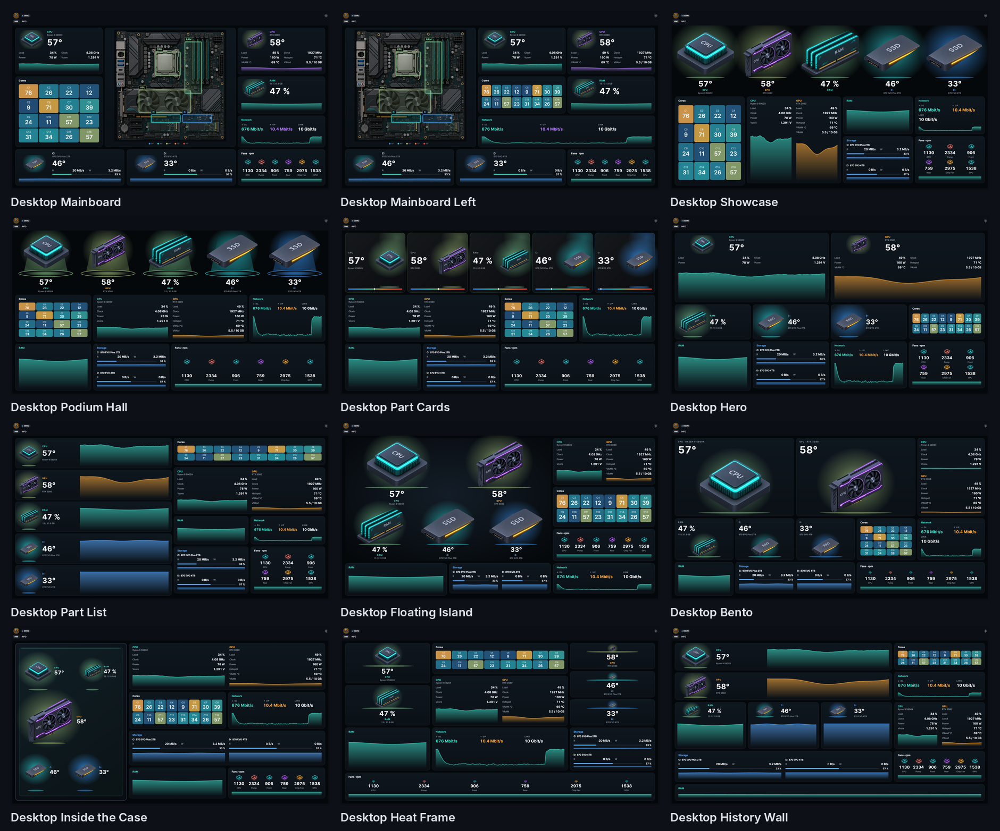
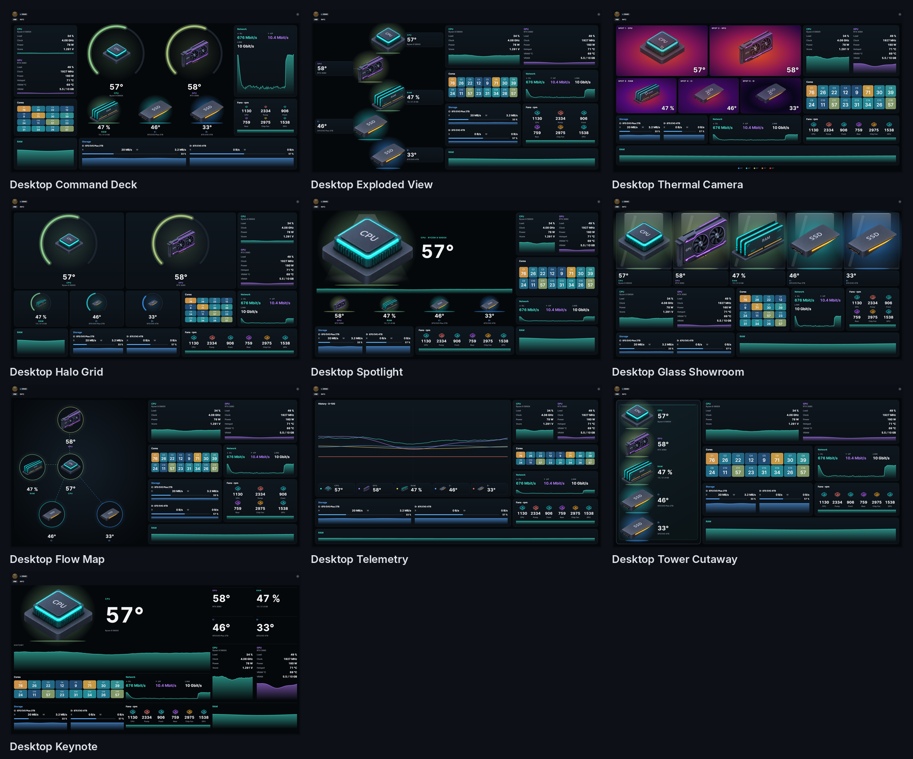

# Lumen 5.8.0 – Full-Screen Desktop Designs

**22 new desktop designs that fill the whole screen (305 designs in all).** Choosing one switches the sidebar to full screen, as Mainboard Map Desktop did; choosing another design switches back.

- **Mainboard:** Desktop Mainboard (board in the middle) and Desktop Mainboard Left. The processor, graphics card, memory and the first two drives glow on the board in the colour of their temperature.
- **Living PC:** Showcase, Podium Hall, Part Cards, Hero, Part List, Floating Island, Bento, Inside the Case, Heat Frame and History Wall. Every part is shown large with its glowing picture, and the details sit in panels beside it.
- **Effects:** Command Deck, Exploded View, Thermal Camera, Halo Grid, Spotlight, Glass Showroom, Flow Map, Telemetry, Tower Cutaway and Keynote.

**Made for every screen.** Each design has its own grid for wide screens (16:9, 21:9, 5:4) and for upright ones. The rows share the height, but a row never gets less than its texts need: only pictures, charts and core cells grow and shrink.

- When the parts do not fit, the design tries a more compact arrangement.
- If that is not enough, pictures and charts give up some of their height.
- Only after that is the design drawn smaller, and never below 75 %, so no text falls under 9 px.
- On a very low screen with a very large PC, the sidebar scrolls instead of shrinking the text further.
- When a part is missing (no graphics card, no voltage sensors, no fans), its neighbour takes the space, so there are no gaps.

**Every value once, every switch works.** The designs use the same sensors and switches as all AIO designs. The mainboard and the glowing pictures show temperatures as colour only, never as a second number. Anything else you tick ends up in "More".

**Tests:**
- A new test opens each of the 22 designs at six real screen sizes on five kinds of PC. The sizes are 1920 × 1040, 1536 × 824 (125 %), 2560 × 1400, 3440 × 1400, 1280 × 984 and 1080 × 1880.
- On each, it checks that the design fills the screen without scrolling, that every reading is shown, that no text is below 9 px or leaves the screen, and that no two texts overlap. The only exception is a PC with four drives and eight fans at 125 %, where the sidebar may scroll.
- The design checks of all AIO designs (sensor switches, jumping values, colours and fonts) now cover the new designs too.

**Fixes:** a list of values that was measured one way and laid out another (a pixel of rounding at the edge of a column count) could draw a value beside the wrong name; it now keeps the layout it was measured in.

## Auf Deutsch

**22 neue Desktop-Designs, die den ganzen Bildschirm füllen (insgesamt 305 Designs).** Wer eines wählt, schaltet die Sidebar auf Vollbild, wie bei Mainboard Map Desktop. Wer danach ein anderes Design wählt, schaltet wieder zurück.

- **Mainboard:** Desktop Mainboard (Board in der Mitte) und Desktop Mainboard Left. Prozessor, Grafikkarte, Speicher und die ersten zwei Laufwerke leuchten auf dem Board in der Farbe ihrer Temperatur.
- **Living PC:** Showcase, Podium Hall, Part Cards, Hero, Part List, Floating Island, Bento, Inside the Case, Heat Frame und History Wall. Jedes Teil wird gross mit seinem leuchtenden Bild gezeigt, die Details stehen in Feldern daneben.
- **Effekte:** Command Deck, Exploded View, Thermal Camera, Halo Grid, Spotlight, Glass Showroom, Flow Map, Telemetry, Tower Cutaway und Keynote.

**Für jeden Bildschirm gemacht.** Jedes Design hat ein eigenes Raster für Breitbild (16:9, 21:9, 5:4) und eines für Hochformat. Die Zeilen teilen sich die Höhe, aber keine Zeile bekommt weniger, als ihre Texte brauchen: Nur Bilder, Verläufe und Kern-Kacheln wachsen und schrumpfen.

- Passt nicht alles, versucht das Design eine kompaktere Anordnung.
- Reicht das nicht, geben Bilder und Verläufe Höhe ab.
- Erst danach wird das Design kleiner gezeichnet, aber nie unter 75 %, sodass kein Text unter 9 px fällt.
- Auf einem sehr niedrigen Bildschirm mit einem sehr grossen PC scrollt die Sidebar, statt die Schrift weiter zu verkleinern.
- Fehlt ein Teil (keine Grafikkarte, keine Spannungs-Sensoren, keine Lüfter), übernimmt der Nachbar den Platz, sodass keine Lücken entstehen.

**Jeder Wert einmal, jeder Schalter wirkt.** Die Designs nutzen dieselben Sensoren und Schalter wie alle AIO-Designs. Das Mainboard und die leuchtenden Bilder zeigen Temperaturen nur als Farbe, nie als zweite Zahl. Alles Weitere, was man anhakt, landet unter „More“.

**Tests:**
- Ein neuer Test öffnet jedes der 22 Designs in sechs echten Bildschirmgrössen auf fünf PC-Arten. Die Grössen sind 1920 × 1040, 1536 × 824 (125 %), 2560 × 1400, 3440 × 1400, 1280 × 984 und 1080 × 1880.
- Bei jeder prüft er, dass das Design den Bildschirm ohne Scrollen füllt, dass jeder Wert gezeigt wird, dass kein Text unter 9 px liegt oder den Bildschirm verlässt und dass sich keine zwei Texte überlappen. Die einzige Ausnahme ist ein PC mit vier Laufwerken und acht Lüftern bei 125 %: Dort darf die Sidebar scrollen.
- Die Design-Prüfungen aller AIO-Designs (Sensor-Schalter, springende Werte, Farben und Schriften) umfassen jetzt auch die neuen Designs.

**Korrekturen:** Eine Werteliste, die anders gemessen als angeordnet wurde (ein Pixel Rundung an der Grenze einer Spaltenzahl), konnte einen Wert neben den falschen Namen setzen. Sie behält jetzt die Anordnung, in der sie gemessen wurde.

## Screenshots · Vorschauen

These previews are rendered by Lumen using demonstration readings. · Lumen rendert diese Vorschauen mit Beispieldaten.

[Previous release / Vorherige Version 5.7.0](https://github.com/nemesis122/Lumen-HWMonitoring-Sidebar/releases/tag/v5.7.0)
