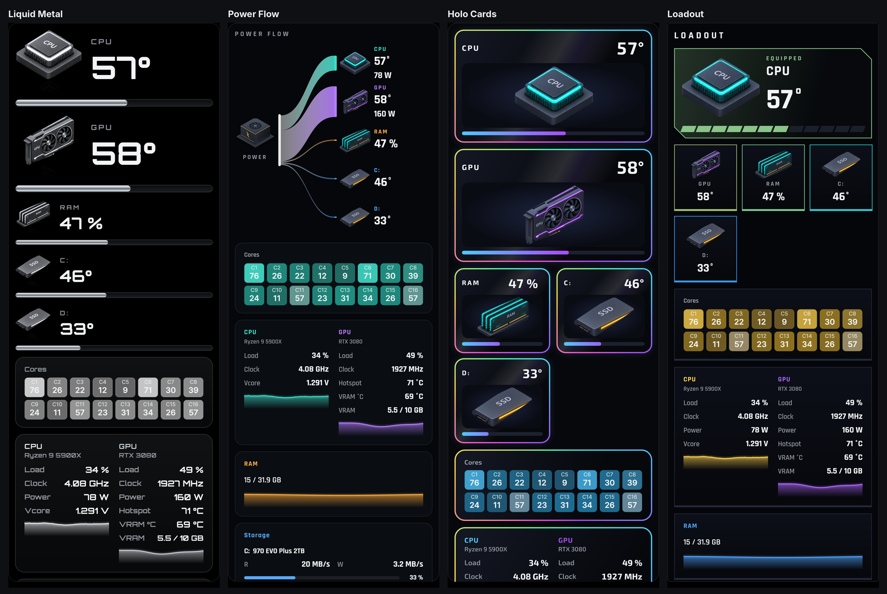
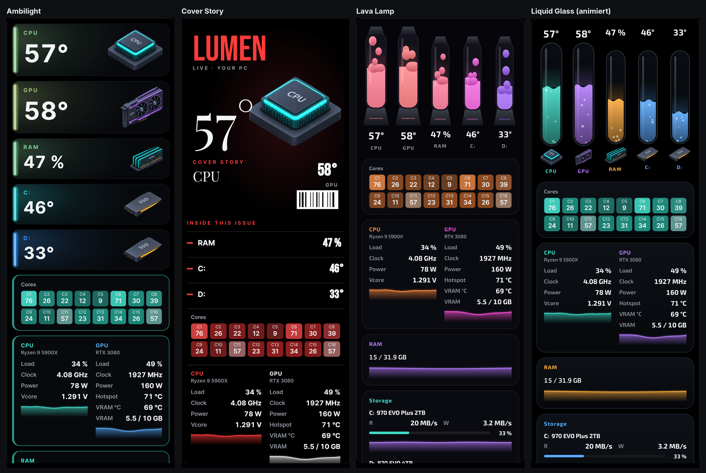
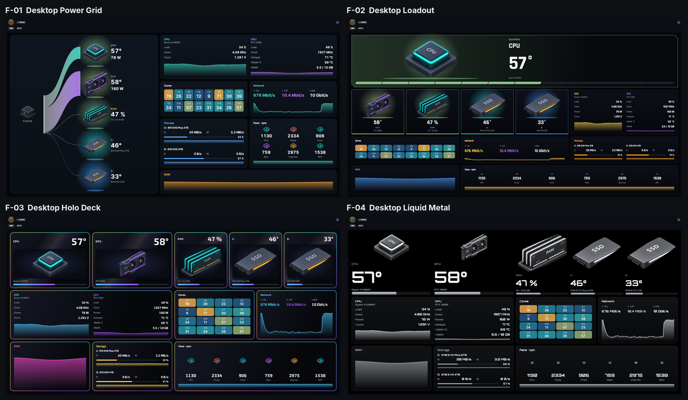
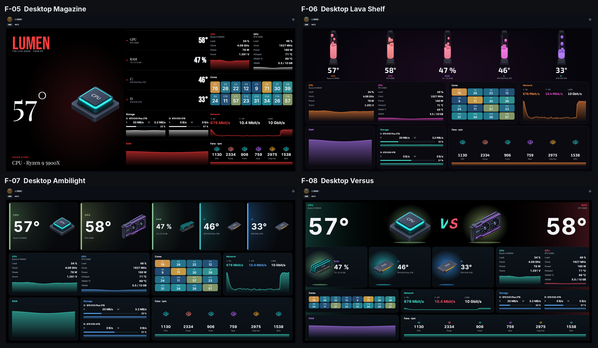
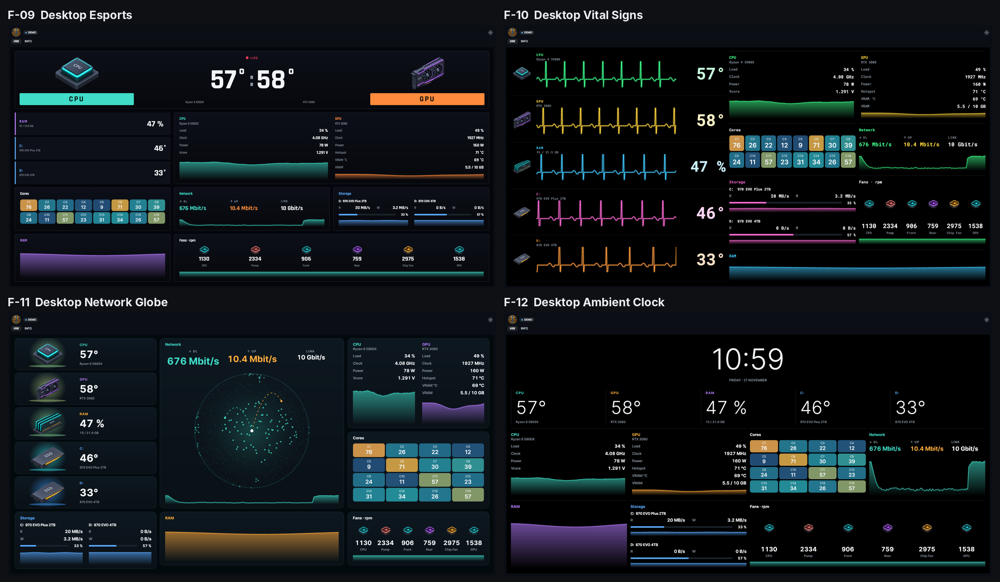
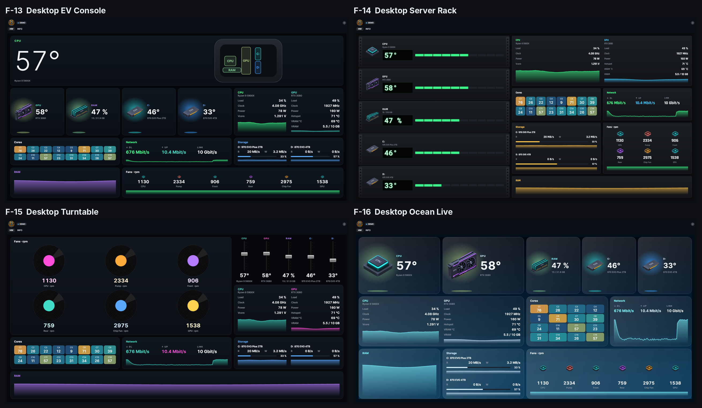
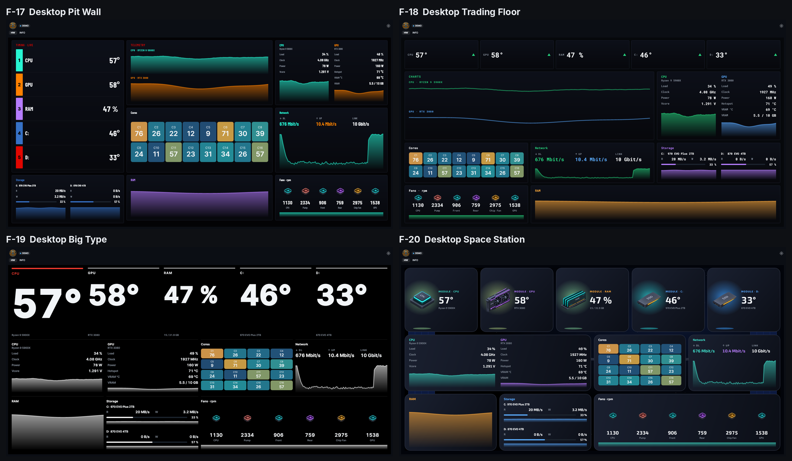

# Lumen 5.9.0 – 28 New Designs and the First Animated One

**28 new designs (333 designs in all): 8 for the sidebar, including Liquid Glass, the first animated design, and 20 that fill the whole screen.**

**New sidebar designs:**
- **Liquid Metal:** chrome tubes and parts redrawn in polished metal.
- **Power Flow:** power runs from the power supply to every part in bands as wide as its watts.
- **Holo Cards:** collector cards with a holographic foil.
- **Loadout:** a game-style loadout screen with segment bars.
- **Ambilight:** every card lit from behind in the colour of its temperature.
- **Cover Story:** a magazine cover with the processor as the headline.
- **Lava Lamp:** a lava lamp per part, warmer colours when it runs hotter.
- **Liquid Glass (animated):** a glass tube per part, filled up to the reading. The surface waves, bubbles rise, and a new reading glides into place instead of jumping. All tubes share one clock that runs only while the design is on screen, and they stand still when motion is switched off.

**New full-screen designs:** Power Grid, Loadout, Holo Deck, Liquid Metal, Magazine, Lava Shelf, Ambilight, Versus, Esports, Vital Signs, Network Globe, Ambient Clock, EV Console, Server Rack, Turntable, Ocean Live, Pit Wall, Trading Floor, Big Type and Space Station. Choosing one switches to full screen. Each one shows every sensor, not only the main readings: details, cores, memory, storage, network, fans and power supply.

**Made for every screen and every PC:**
- The full-screen designs fit every resolution: 16:9, 21:9, 5:4 and portrait.
- Every value is shown once, no text is below 9 px and no two texts overlap.
- With full screen turned off, they become a list in the 340 px sidebar and keep every name whole.
- Colour and font choices reach every value and label.

**Tests:**
- New tests cover the new designs on all five test PCs: every resolution, the 340 px sidebar, sensor switches, jumping values, colours and fonts, and the network history switch.
- Liquid Glass has its own tests: one tube per part, the level glides instead of jumping, the liquid really moves, and nothing moves when motion is switched off.
- The full suite of 30,236 tests passes.

## Auf Deutsch

**28 neue Designs (insgesamt 333): 8 für die Sidebar, darunter Liquid Glass als erstes animiertes Design, und 20, die den ganzen Bildschirm füllen.**

**Neue Sidebar-Designs:**
- **Liquid Metal:** Chrom-Röhren und Bauteile in poliertem Metall.
- **Power Flow:** Strom fliesst vom Netzteil zu jedem Teil, in Bändern so breit wie seine Watt.
- **Holo Cards:** Sammelkarten mit Hologramm-Folie.
- **Loadout:** ein Ausrüstungs-Bildschirm wie im Spiel, mit Segment-Balken.
- **Ambilight:** jede Karte von hinten beleuchtet, in der Farbe ihrer Temperatur.
- **Cover Story:** ein Magazin-Cover mit dem Prozessor als Schlagzeile.
- **Lava Lamp:** eine Lavalampe pro Teil, wärmere Farben, wenn es heisser läuft.
- **Liquid Glass (animiert):** eine Glasröhre pro Teil, gefüllt bis zum Wert. Die Oberfläche wellt sich, Bläschen steigen auf, und ein neuer Wert gleitet hin, statt zu springen. Alle Röhren teilen sich einen Takt, der nur läuft, solange das Design zu sehen ist. Ist Bewegung ausgeschaltet, steht alles still.

**Neue Vollbild-Designs:** Power Grid, Loadout, Holo Deck, Liquid Metal, Magazine, Lava Shelf, Ambilight, Versus, Esports, Vital Signs, Network Globe, Ambient Clock, EV Console, Server Rack, Turntable, Ocean Live, Pit Wall, Trading Floor, Big Type und Space Station. Wer eines wählt, schaltet auf Vollbild. Jedes zeigt alle Sensoren, nicht nur die Hauptwerte: Details, Kerne, Speicher, Laufwerke, Netzwerk, Lüfter und Netzteil.

**Für jeden Bildschirm und jeden PC gemacht:**
- Die Vollbild-Designs passen auf jede Auflösung: 16:9, 21:9, 5:4 und Hochformat.
- Jeder Wert steht einmal da, kein Text liegt unter 9 px, und keine zwei Texte überlappen sich.
- Ohne Vollbild werden sie in der 340 px breiten Sidebar zur Liste, und jeder Name bleibt ganz.
- Die Farb- und Schriftwahl erreicht jeden Wert und jede Beschriftung.

**Tests:**
- Neue Tests prüfen die neuen Designs auf allen fünf Test-PCs: jede Auflösung, die 340 px breite Sidebar, Sensor-Schalter, springende Werte, Farben und Schriften sowie den Schalter für den Netzwerk-Verlauf.
- Liquid Glass hat eigene Tests: eine Röhre pro Teil, der Stand gleitet statt zu springen, die Flüssigkeit bewegt sich wirklich, und bei ausgeschalteter Bewegung bewegt sich nichts.
- Die komplette Testsuite mit 30.236 Tests ist grün.

## Screenshots · Vorschauen

These previews are rendered by Lumen using demonstration readings. · Lumen rendert diese Vorschauen mit Beispieldaten.

[Previous release / Vorherige Version 5.8.0](https://github.com/nemesis122/Lumen-HWMonitoring-Sidebar/releases/tag/v5.8.0)
