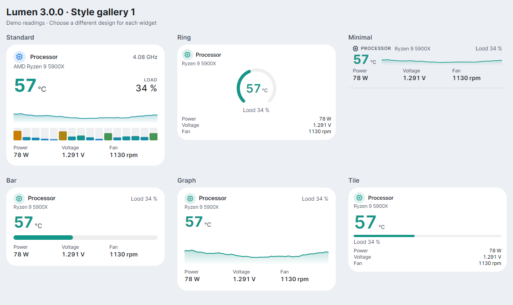
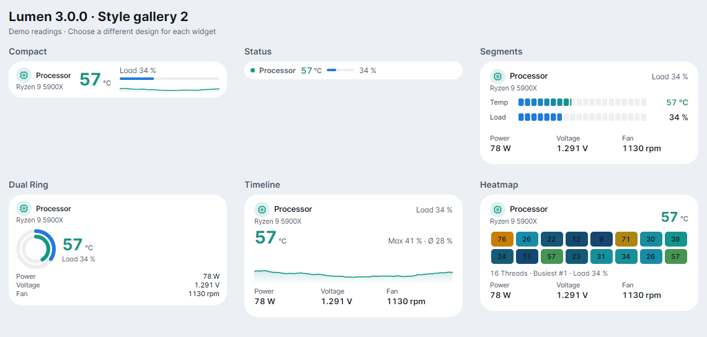
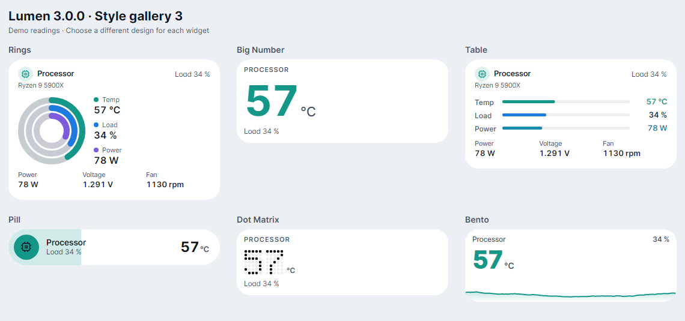
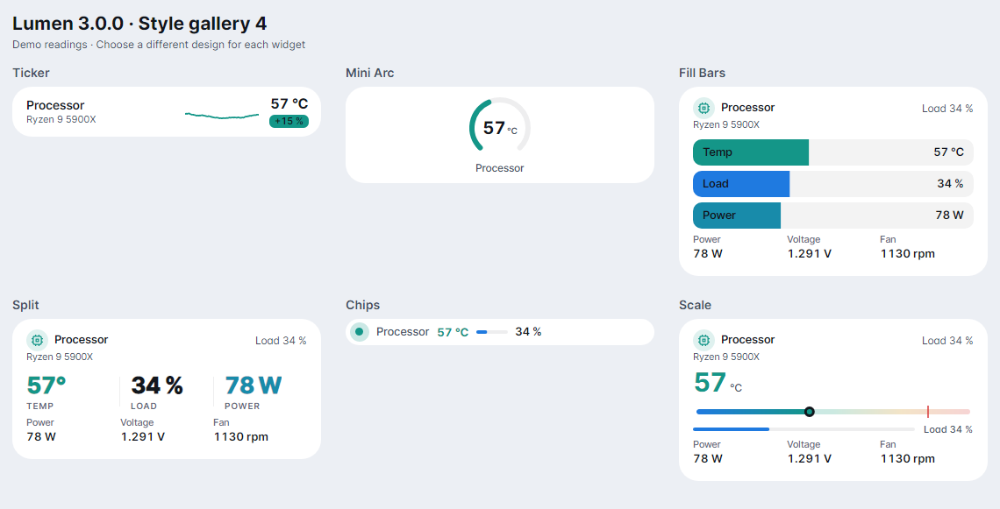
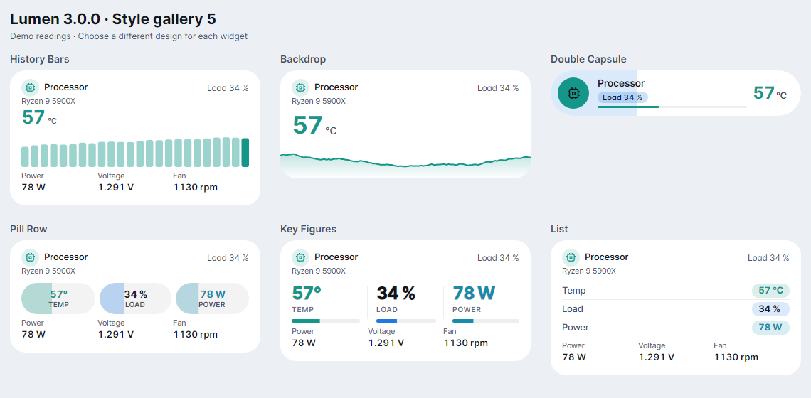
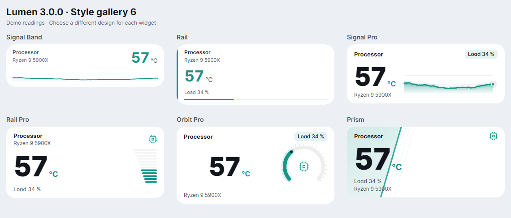
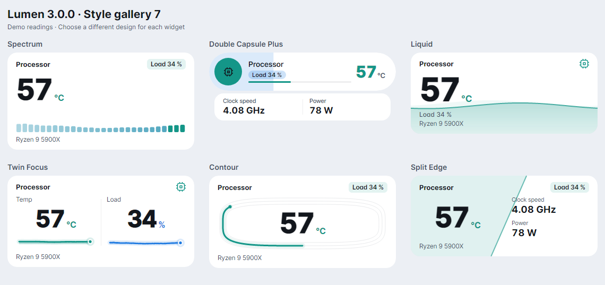
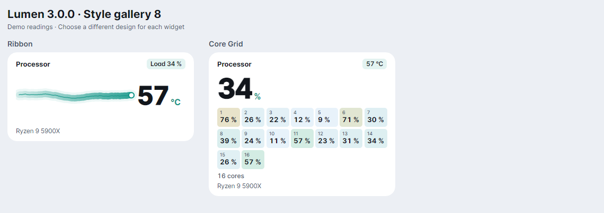

# Lumen 3.0.0 — all widget designs

All 44 selectable designs, rendered from the application with demo readings. Every widget can use its own design. This per-widget choice was already available in earlier releases.

[Back to the README](../README.md) · [Release downloads](https://github.com/nemesis122/Lumen-HWMonitoring-Sidebar/releases/tag/v3.0.0)

## Dark theme

## Light theme

## Individual images

The [Lumen 3.0.0 screenshots archive](https://github.com/nemesis122/Lumen-HWMonitoring-Sidebar/releases/download/v3.0.0/Lumen-3.0.0-Screenshots.zip) contains a separate dark and light PNG for every design, all overview sheets and the mixed-widget examples. Run `tools/Lumen.Gallery` to regenerate them from source.
